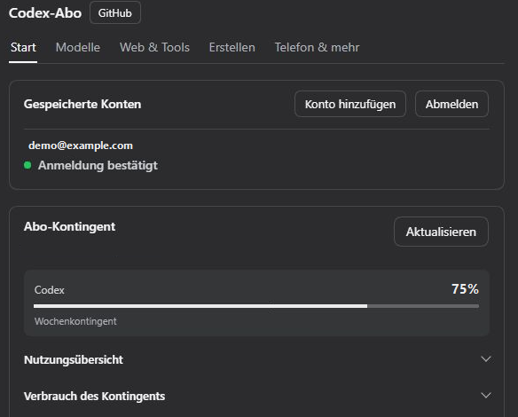
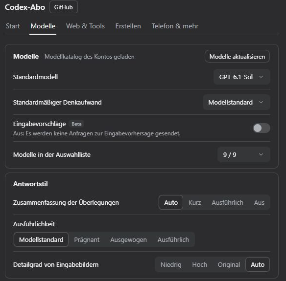

<p align="center"></p>

<div align="center">

# DSH Codex Subscription

[中文](README.md) · [English](README.en.md) · [日本語](README.ja.md) · [Español](README.es.md) · [Français](README.fr.md) · **Deutsch** · [Русский](README.ru.md) · [Português](README.pt.md)

**Nutze dein ChatGPT-/Codex-Abonnement direkt in DeepSeek Harness**

Melde dich mit ChatGPT Plus / Pro an, um GPT-6 und andere Codex-Modelle, Kontingent, Websuche und Bildgenerierung in DSH zu nutzen. Kein OpenAI-API-Schlüssel und keine Codex-CLI erforderlich.

[](https://github.com/WSL043/dsh-codex-subscription/actions/workflows/ci.yml)
[](https://www.npmjs.com/package/dsh-codex-subscription)
[](https://www.npmjs.com/package/dsh-codex-subscription)
[](LICENSE)
[](https://github.com/WSL043/dsh-codex-subscription/stargazers)

[Highlights](#highlights) · [Installation](#install) · [Bilder und Skizzieren](#images-and-sketching) · [Fernsteuerung per Smartphone](#phone-remote-control-beta) · [Alle Funktionen](#all-features) · [Benutzerhandbuch](docs/GUIDE.en.md) · [Fehlerbehebung](#troubleshooting) · [Agent](#agent-reference)

</div>

<p align="center"></p>

<a id="highlights"></a>

## Highlights

| Was du tun möchtest | Was das Plugin bietet |
| --- | --- |
| **Chatten und suchen** | Melde dich mit deinem Abonnement an; wähle von deinem Konto bereitgestellte Codex-Modelle sowie Stufen für Überlegungen und Geschwindigkeit aus; nutze die Websuche des Abonnements. |
| **Konten und Kontingent verwalten** | Wechsle zwischen Konten, sieh das Kontingent für kurze Zeitfenster und die Woche, Credits und Zurücksetzungen ein; sieh den Nutzungsverlauf und optionale Kontingentwarnungen im Eingabefeld. |
| **Bilder erstellen und bearbeiten** | Generiere Bilder, markiere Bereiche zur Bearbeitung oder zeichne manuell und mit dem Agent auf einer bearbeitbaren Skizzentafel. [Beispiele →](#images-and-sketching) |
| **Mit dem Smartphone fortfahren** | Kopple die ChatGPT-Mobil-App, um DSH auf diesem Computer zu steuern. DeepSeek und andere DSH-Modelle funktionieren ebenfalls. [Beta, standardmäßig deaktiviert →](#phone-remote-control-beta) |
| **Verbundene Apps verwenden** | Lass DSH-Modelle Apps verwenden, die in ChatGPT verbunden sind, darunter GitHub, Gmail, Drive und Calendar; Schreibfreigaben richten sich nach den Berechtigungen der aktuellen DSH-Sitzung. |

Modelle und Kontingent hängen davon ab, was dein Konto zurückgibt. [Vollständige Funktionsliste →](#all-features)

<details>
<summary>Abonnementfunktionen mit DeepSeek und anderen Modellen nutzen</summary>

Lass DeepSeek oder jedes andere DSH-Modell die Apps verwenden, die du in ChatGPT verbunden hast: GitHub, Gmail, Google Drive, Calendar und mehr. Modelle suchen zuerst und rufen dann die Apps auf; Schreibfreigaben richten sich nach dem gewählten Modus und den Berechtigungen der aktuellen DSH-Sitzung. Standardmäßig deaktiviert; aktiviere die Funktion unter „Web & Tools“.

Websuche und Quellen zum Lesen von Webseiten, ChatGPT-Konnektoren und offizielle unabhängige Codex-Teilaufgaben findest du unter **Einstellungen → Codex-Abonnement → Web & Tools**; ganz oben befindet sich ein Hauptschalter: Ist er deaktiviert, nutzen Unterhaltungen mit DeepSeek und anderen Nicht-Codex-Modellen nicht mehr die Websuche des Abonnements (stattdessen wird die DSH-Suche verwendet), die Bildgenerierung oder ChatGPT-Konnektoren; Codex-Abonnementmodelle sind davon nicht betroffen. Standardmäßig aktiviert.

<p align="center"><picture><source media="(prefers-color-scheme: dark)" srcset="docs/assets/ui-interop-en-dark.webp"></picture></p>

</details>

<a id="prepare-dsh"></a>

## DSH vorbereiten

Verifiziert mit DSH `0.2.2-rc.1`; `0.2.1-rc.3` und `0.2.1-rc.2` werden weiterhin unterstützt. Die mindestens erforderliche Version ist `0.1.7-rc.2`. Bitte aktualisiere ältere DSH-Versionen zuerst.

Für DSH `0.2.2-rc.1` CLI/Web ist Node.js **24.9 oder neuer** erforderlich; die offizielle Desktop-App verwendet ihre gebündelte Laufzeitumgebung.

Unterstützt auch den Vorschau-Host `0.2.2-alpha.2`. Einzelheiten zum Umfang und zu den Grenzen der Validierung findest du in den [Kompatibilitätshinweisen](docs/dsh-022-alpha2-compatibility.md) (auf Englisch).

Dieses Plugin unterstützt die neueste DeepSeek-Harness-Version, die in seinen Paketmetadaten angegeben ist, und erfordert ein ChatGPT-Konto, das derzeit Zugriff auf Codex hat.

<details>
<summary>Eine DSH-Distribution auswählen</summary>

- **Empfohlen: die offizielle Desktop-App.** DeepSeek bietet jetzt eine [DeepSeek Harness-Desktop-App](https://www.deepseek.com/harness/) an (macOS auf Apple Silicon und 64-Bit-Windows; Vorschauversion, quelloffen). Sie erfordert keine Node.js-Einrichtung: Installiere sie und füge dann das Plugin wie unten beschrieben über die Plugins-Seite hinzu. Desktop-App, Web-App und CLI verwenden dasselbe DSH-Plugin-System; die durchgängige Abnahme dieses Plugins erfolgt hauptsächlich in der Web-App. Bitte [erstelle ein Issue](https://github.com/WSL043/dsh-codex-subscription/issues), falls die Desktop-App Probleme macht.
- Brauchst du Linux oder bevorzugst du einen Community-Port? Verwende [DSH-Portable](https://github.com/WSL043/DSH-Portable), eine portable Desktop-Distribution der Community für Windows, macOS und Linux.
- Bevorzugst du den offiziellen Weg? Folge der [DeepSeek-Harness-Anleitung zur Inbetriebnahme](https://github.com/deepseek-ai/deepseek-harness#run) (auf Englisch).

</details>

<a id="install"></a>

## Installation

<a id="install-from-the-plugins-page-recommended"></a>

### Über die Plugins-Seite installieren (empfohlen)

1. Öffne in DSH **Plugins → Plugin hinzufügen**.
2. Füge diesen Paketnamen einschließlich Version in das Feld **Paketname oder Adresse** ein:

   ```text
   dsh-codex-subscription@3.2.9
   ```

3. Klicke auf **Installieren** und warte, bis der Vorgang abgeschlossen ist. Folge den Anweisungen auf der Seite; speichere deine Arbeit, bevor du neu startest, falls du dazu aufgefordert wirst.
4. Öffne **Einstellungen → Codex**, melde dich bei ChatGPT an und wähle dann in deiner Unterhaltung ein Codex-Modell aus.

<details>
<summary>Warum ist die Version angegeben?</summary>

Warum die Version angegeben ist: Auf der Plugin-Seite von DSH werden nur Versionen installiert, die mindestens 24 Stunden alt sind. Daher kann der reine Paketname am ersten Tag nach einer neuen Veröffentlichung eine ältere Version installieren, die deine DSH-Version möglicherweise nicht unterstützt. Mit der Versionsangabe erhältst du genau diese Version; einen Tag nach der Veröffentlichung verweist auch der reine Name `dsh-codex-subscription` auf die neueste stabile Version. Weitere Versionsnummern findest du auf der [Veröffentlichungsseite](https://github.com/WSL043/dsh-codex-subscription/releases) (auf Englisch).

</details>

<details>
<summary>Installation über das Terminal (mit einem vorhandenen dsh-Befehl)</summary>

```sh
dsh plugin --profile web add dsh-codex-subscription@3.2.9
```

Folge den Anweisungen zum Neustart und melde dich anschließend unter **Einstellungen → Codex** an. Sowohl die Plugins-Seite als auch das Terminal verwenden die Installationsverwaltung von DSH.

</details>

<details>
<summary>Headless-Aufgaben</summary>

Melde dich an und wähle in Web ein Codex-Modell aus. Installiere anschließend dasselbe Plugin im Headless-Profil:

```sh
dsh plugin --profile headless add dsh-codex-subscription@3.2.9
dsh --profile headless "Reply with only the word: ok"
```

</details>

<a id="interface-demo"></a>

## Demo der Benutzeroberfläche

Verbinde dein ChatGPT-Konto, wähle ein Codex-Modell in DSH und sieh das Kontingent deines Abos in den Einstellungen ein.

<details>
<summary>Anmelden und Abo-Kontingent prüfen</summary>

Öffne **Einstellungen → Codex → Start** und wähle **Im Browser anmelden**. Danach siehst du deine gespeicherten Konten und das von ChatGPT gemeldete Kontingent. Weitere Details findest du in der Nutzungsübersicht und der Aufschlüsselung des Verbrauchs.

<p align="center"></p>

_Konto und Kontingentwerte sind Beispieldaten._

</details>

<details>
<summary>Ein Codex-Modell auswählen und eine Nachricht senden</summary>

Unter **Einstellungen → Codex → Modelle** kannst du das Standardmodell und die Standard-Denkstufe wählen. Für einen einzelnen Chat kannst du das Modell über die Auswahl am Eingabefeld wechseln. Schreibe und sende eine Nachricht, um dein Abo in DSH zu nutzen.

<p align="center"></p>

</details>

<details>
<summary>Was ist in den einzelnen Einstellungsreitern enthalten?</summary>

| Einstellungsreiter | Funktion |
| --- | --- |
| **Start** | Anmeldung und Konten, Schalter für jede Funktion, Abonnementkontingent, Kontingentanzeige und Warnmeldungen |
| **Modelle** | Standardmodell, Standardaufwand für Überlegungen und Modellliste, Antwortstil; die eingeklappte Gruppe „Erweitert“ enthält Kontextlänge, Wiederholungsversuche, Verbindungsmodus, Cloud-Komprimierung und das Prüfmodell |
| **Web & Tools** | Hauptschalter für andere Modelle, Suchquelle, ChatGPT-Konnektoren und offizielle Codex-Teilaufgaben |
| **Erstellen** | Bildgenerierung, Bildbearbeitung, @image im Eingabefeld, Bildbetrachter, Skizzentafel und Zeichnen durch den Agent |
| **Telefon & mehr** | Fernsteuerung per Smartphone, experimentelle Sprachanrufe, lokaler Cache und Supportdiagnose |

Die Sprachunterhaltung ist standardmäßig deaktiviert. Aktiviere sie unter **Telefon & mehr** und starte dann einen Anruf über das Eingabefeld. Wenn ein natives Fenster, auch unter Linux, WebRTC nicht unterstützt, bietet DSH an, dieselbe Unterhaltung in einem Browser fortzusetzen. Sprachbeispiele bleiben verfügbar, und dein bestehendes Abo wird ohne API-Schlüssel verwendet.

**Modellbewusster Kontext** orientiert sich am Modellverzeichnis deines Kontos; beim Aktualisieren bleibt dein nicht gespeicherter Entwurf erhalten. In den Einstellungen wird das Rohfenster angezeigt; bei den Unterhaltungsbudgets wird anhand des offiziellen Prozentsatzes (5 %, falls nicht angegeben) ein Puffer reserviert. Anschließend verwaltet DSH Ausgabereserven und die Komprimierung. Manuelles Abziehen ist nicht nötig. Kontingentgruppen verwenden die vom Backend bereitgestellten Werte, einschließlich separater Kontingente wie Spark.

Fehler beim Abo bleiben sichtbar: Es wird nicht stillschweigend auf eine andere kostenpflichtige Option ausgewichen.

</details>

<a id="images-and-sketching"></a>

## Bilder und Skizzieren

Generiere Bilder mit deinem Abo, sieh dir die Originale an und lade sie herunter oder markiere einen Bereich und füge Notizen hinzu, um die Bearbeitung fortzusetzen. Die Bildgenerierung und -bearbeitung werden unter **Einstellungen → Codex → Erstellen** gesteuert.

<details>
<summary>Bildannotation und fortgesetzte Bearbeitung</summary>

<p align="center"></p>

</details>

<details>
<summary>Bild- und Skizzeneinstellungen anzeigen</summary>

<p align="center"><picture><source media="(prefers-color-scheme: dark)" srcset="docs/assets/ui-creative-en-dark.png"></picture></p>

Einstellungen, direkt als zugeschnittene Screenshots der tatsächlichen DSH-Oberfläche dargestellt, passend zum hellen oder dunklen Design.

</details>

<a id="sketch-board-beta"></a>

### Skizzentafel (Beta)

Die Skizzentafel und das Zeichnen durch den Agent sind **Beta** und standardmäßig deaktiviert; aktiviere sie auf der Seite „Erstellen“. Zeichne von Hand über die Skizzenschaltfläche im Eingabefeld oder sende `@sketch` mit der Bitte, den Agent zeichnen zu lassen.

Die Tafel unterstützt Ebenen, native Kurven, Pinsel, Verläufe, Weichzeichnen, Mischmodi, Beschneiden, Rückgängig/Wiederholen und Tastenkürzel. Speichere mehrere Entwürfe und exportiere PNGs oder bearbeitbare Entwürfe. Mit einer Referenz kann der Agent Bilder vergleichen, Farben und Positionen messen und Aktionen rückgängig machen. Fertige Zeichnungen können erneut abgespielt und als Video aufgezeichnet werden.

<details>
<summary>Beispiel für eine Zeichnung des Agents: Wal-Mädchen</summary>

Die Agents haben diese Beispiele auf der Skizzentafel mit nativen, bearbeitbaren Strichen gezeichnet, ohne Bildgenerierung aufzurufen. Für alle drei wurden dieselbe Referenz und dieselben grundlegenden Zeichentools verwendet. Es handelt sich um einzelne Durchläufe mit unterschiedlichen Aufwandsstufen und Laufzeiten.

<p align="center"><b>Referenzbild</b><br></p>

<table>
<tr><th width="33%">GPT-6-Astra</th><th width="33%">GPT-6.1-Sol</th><th width="33%">DeepSeek Flash</th></tr>
<tr><td></td><td></td><td></td></tr>
<tr><td>Mittel · 20 Min. 57 Sek.<br>686 Striche</td><td>Hoch · erster Durchlauf: 23 Min.<br>1.020 Striche</td><td>Hoch · 9 Min. 33 Sek.<br>623 Striche</td></tr>
</table>

Nach einer Verbindungsunterbrechung wurde die Zeichnung von 6.1 aus der automatischen Speicherung und den ursprünglich erfolgreichen Aufrufen wiederhergestellt. Das Modell prüfte anschließend die Vorschau und speicherte sie, ohne dass manuell etwas hinzugezeichnet wurde. Dies war kein ununterbrochen erfolgreicher Durchlauf.

</details>

<details>
<summary>Von der Skizze zum generierten Bild: Uhrturm und blaugrüne Landschaft</summary>

Der Agent zeichnete zunächst eine bearbeitbare Skizze und verwendete sie anschließend als Referenz für die Bildgenerierung über das Abo. Sol und Astra bezeichnen unten die Unterhaltungsmodelle, die den Ablauf steuern, nicht das Backend für die Bildgenerierung.

**Uhrturm-Querschnitt**

<table>
<tr><th>Unterhaltungsmodell</th><th width="43%">Agentenskizze</th><th width="43%">Aus der Skizze generiert</th></tr>
<tr><td>GPT-6.1-Sol<br>Xhigh</td><td></td><td></td></tr>
<tr><td>GPT-6-Astra<br>Low</td><td></td><td></td></tr>
</table>

**Blaugrüne Landschaft**

<table>
<tr><th>Unterhaltungsmodell</th><th width="43%">Agentenskizze</th><th width="43%">Aus der Skizze generiert</th></tr>
<tr><td>GPT-6.1-Sol<br>Xhigh</td><td></td><td></td></tr>
<tr><td>GPT-6-Astra<br>Low</td><td></td><td></td></tr>
</table>

</details>

[Bildbearbeitung und Entwurfsspeicherung →](docs/GUIDE.en.md#image-generation-and-editing)

<a id="phone-remote-control-beta"></a>

## Telefon-Fernsteuerung (Beta)

Kopple den Codex-Bereich der ChatGPT-Mobil-App mit DSH auf deinem Computer. Starte oder setze Unterhaltungen fort, verwende Tools und bearbeite Genehmigungen von deinem Telefon aus – mit DeepSeek oder einem beliebigen anderen DSH-Modell.

**Standardmäßig deaktiviert.** Aktiviere die Funktion unter **Einstellungen → Codex → Telefon & mehr → Fernsteuerung per Smartphone** und kopple die Geräte per QR-Code oder manuellem Code. Dein Computer muss eingeschaltet und online bleiben, und DSH muss weiterhin ausgeführt werden.

Dies ist eine Kompatibilitätsschicht eines Drittanbieters, die den Fernverbindungsdienst von OpenAI verwendet. Eine offizielle Codex-Fernsteuerung gibt es, aber OpenAI garantiert die Kompatibilität mit dem DSH-Host nicht ausdrücklich, und sie kann sich durch Dienstaktualisierungen ändern. Gekoppelte Geräte kannst du jederzeit entfernen oder die Funktion deaktivieren.

<details>
<summary>Unterstützte Telefonfunktionen</summary>

- Unterhaltungen verfolgen, starten, fortsetzen, unterbrechen und archivieren; Unterhaltungen und darin enthaltene Schlüsselwörter suchen;
- Modell, Überlegungsstufe und Berechtigung wechseln (Arbeitsbereich-Schreibzugriff / Vollzugriff);
- Genehmigungen und Fragen erscheinen auf dem Telefon; bei einer Unterbrechung erscheinen sie beim erneuten Öffnen wieder auf dem Telefon, andernfalls werden sie an den Computer zurückgegeben;
- Antworten werden während der Eingabe angezeigt; Befehle, Dateiänderungen mit Diffs, die Aufgabenliste, Websuchen, Connector-Aufrufe und generierte Bilder werden in den nativen Ansichten des Telefons dargestellt;
- Fotos senden, mit @ Dateien auf dem Computer suchen, mit / DSH-Skills auswählen, Änderungen mit schreibgeschütztem Git ansehen und Chats in einer echten Ordnerauswahl starten;
- DSH-Arbeitsbereiche erscheinen als Projekte; eine Unterhaltung verzweigen, Nutzungslimits, Gesamtnutzung und Kontextnutzung anzeigen; wenn DSH `/compact` unterstützt, den Kontext vom Telefon aus komprimieren;
- Modellfehler werden auf dem Telefon angezeigt; gekoppelte Telefone sind in den Einstellungen aufgeführt und können entfernt werden.

</details>

<details>
<summary>Kopplungseinstellungen und gekoppelte Telefone</summary>

<p align="center"><picture><source media="(prefers-color-scheme: dark)" srcset="docs/assets/ui-remote-en-dark.png"></picture></p>

</details>

<a id="all-features"></a>

## Alle Funktionen

Der Modellzugriff und das Kontingent hängen von deinem Konto ab.

<details>
<summary><b>Modelle und Suche</b></summary>

Wähle das Modell passend zur Aufgabe, die Denkstufe nach dem Analysebedarf und die Geschwindigkeit nach den verfügbaren Modi. Die Ausführlichkeit steuert den gewünschten Detailgrad. Unter **Web & Tools** findet die Suche neue Seiten und das Lesen öffnet eine bekannte URL.

| Funktion | Möglichkeiten | Verfügbarkeit / Einrichtung |
| --- | --- | --- |
| **Abo-Anmeldung** | Melde dich bei ChatGPT an und nutze Codex-Abo-Modelle ohne API-Schlüssel | Für normale Chats ist keine Codex-CLI erforderlich |
| **Modellsynchronisierung** | Verfügbare Modelle und Überlegungsstufen aus deinem Konto abrufen, mit manueller Aktualisierung; der zuletzt erfolgreich abgerufene Katalog wird lokal pro Konto gespeichert und bleibt während der Hintergrundaktualisierung nach einem Neustart verfügbar; er ist 24 Stunden gültig; bei Modellen, deren Auslauf bevorsteht, wird das Auslaufdatum neben dem Modellnamen angezeigt, ohne automatisch deine Auswahl zu ändern | Neue Modelle werden angezeigt, sobald dein Konto sie anbietet; der Kontokatalog ist die einzige Quelle. Daher werden keine Modelle angezeigt, wenn du abgemeldet bist oder weder ein Abruf aus der Ferne noch ein gültiger Cache verfügbar ist |
| **Modellliste** | Auf der Seite „Modelle“ einzelne Modelle in der Modellauswahl des Eingabefelds ein- oder ausblenden; im Auswahlfeld bleiben die eigenen Modellbezeichnungen von DSH erhalten (z. B. das Kennzeichen für neue Modelle) | Nur Anzeige; ausgewählte Modelle und Anfragen funktionieren weiterhin |
| **Modellmenü im Eingabefeld** | Automatisch lässt anderen Modellauswahlen den Vortritt und zeigt allein das Abonnementmenü. DSH-Standard überlässt das Menü DSH oder einer anderen Erweiterung. | Unter Modelle einstellbar. Mit Abonnement verwendest du dessen Menü und die unterstützten Geschwindigkeiten. Gespeicherte Einstellungen bleiben erhalten. |
| **Eingabevorschläge (Beta)** | Nach einer vollständigen Antwort kann das leere Eingabefeld eine Folgenachricht vorschlagen. Tab übernimmt sie in einen bearbeitbaren Entwurf. | Unter Modelle standardmäßig aus. Verfügbar für unterstützte Codex-Modelle mit freigeschalteten Vorschlägen. Anfragen können das Kontingent belasten. |
| **Standardmodell** | Auf der Seite „Modelle“ das Modell auswählen, mit dem eine neue Unterhaltung geöffnet wird | Legt die DSH-Einstellung für das Standardmodell fest – dieselbe Einstellung, die auch beim Modellwechsel innerhalb eines Chats geschrieben wird; lösche sie, um dem DSH-Standard zu folgen |
| **Standardaufwand für Überlegungen** | Auf der Seite „Modelle“ eine Standardstufe für Abo-Modelle auswählen; „Modellstandard“ folgt der Empfehlung des offiziellen Modellkatalogs für jedes Modell | Manuelle Auswahlen haben Vorrang. Nicht unterstützte Stufen fallen auf den gültigen Standard des Modells zurück; bestehende manuelle Auswahlen für Unterhaltungen bleiben erhalten |
| **Überlegungsstufen** | Im Eingabefeld einen unterstützten Aufwand für Überlegungen auswählen | Die Stufen unterscheiden sich je nach Modell |
| **Ultra-Denkstufe** | DSH kann unabhängige Arbeit mit einer unterstützten Denkstufe an native Teilaufgaben delegieren. | Verfügbar, wenn Modell und Agentenprofil es zulassen. Ultrafast bezeichnet eine Geschwindigkeitsstufe. |
| **Geschwindigkeitsstufen** | Unterstützte Modelle zwischen „Standard“ und „Schnell“ umschalten; außerdem „Ultraschnell (Beta)“, wenn der Kontokatalog diese Option anbietet; gekennzeichnet durch ein Blitzsymbol | Standardmäßig „Standard“; „Schnell“ und „Ultraschnell“ erhöhen den Verbrauch. „Ultraschnell“ ist derzeit nur für Pro 500 verfügbar |
| **Antwortausführlichkeit** | Kurze, mittellange oder ausführliche Antworten anfordern | Folgt dem Modellstandard, sofern nicht geändert |
| **Bilddetail für Eingaben** | Für Bilder, die an das Chatmodell gesendet werden, „Niedrig“, „Hoch“, „Original“ oder „Auto“ auswählen | Wirkt sich auf Eingabetokens aus; standardmäßig „Auto“ |
| **Websuche mit Abo** | Quellen „Auto“, „DSH“ und „Codex“ | „Auto“ bevorzugt die Quelle, die zum Sitzungsmodell passt, und versucht die andere nur bei fehlenden Anmeldedaten oder nicht verfügbarem Dienst. Explizite Auswahlen von „DSH“ / „Codex“ legen die Quelle fest und melden Fehler direkt. Wenn „Andere Modelle“ deaktiviert ist, verwenden Chats, die nicht mit Codex laufen, ausschließlich die native DSH-Suche. Das Plugin schreibt die DSH-Sucheinstellungen weder um noch fügt es eine DeepSeek-Kontoausweichmöglichkeit hinzu; die Kosten der nativen Suche hängen vom ausgewählten Dienst ab |
| **Quelle für das Lesen von Webseiten** | Lege unabhängig von der Suche fest, wie eine bekannte URL gelesen wird. | Unter Web & Tools. DSH ist voreingestellt. Codex benötigt einen kompatiblen Host und zeigt Lesefehler an. |
| **Umschalter für andere Modelle** | Ein Umschalter verhindert, dass Unterhaltungen mit DeepSeek und anderen Modellen, die nicht von Codex stammen, die Websuche mit Abo, Bildgenerierung und ChatGPT-Konnektoren verwenden | „Einstellungen“ → „Codex-Abonnement“ → „Web & Tools“; standardmäßig aktiviert; Codex-Abo-Modelle sind nicht betroffen; die Fernsteuerung per Smartphone und Sprache werden von dir gestartet und sind nicht betroffen |
| **Suchumfang** | Live- oder Cache-Suche auswählen, die Suche deaktivieren oder Domains einschränken | Unter „Web & Tools“ in der Gruppe für Suchquellen konfigurieren |
| **Zeitlimit bei Inaktivität des Streams** | Festlegen, wie lange bei einer Anfrage keine gestreamten Daten eingehen dürfen, bevor sie abgebrochen wird | Standardmäßig 10 Minuten; keine Gesamtfrist für die Antwort |
| **Kontextbudget** | Standard-, erweiterte oder benutzerdefinierte Budgets pro Modell verwenden | Durch den Modellkatalog begrenzt |
| **GPT-Reserve** | Das Reservemodell auswählen, sofern dein Konto es anbietet | Experimentell; kein Versprechen auf ein separates Reservekontingent |

</details>

<details>
<summary><b>Konten und Kontingent</b></summary>

Unter **Start → Abonnementkontingent** stehen Restkontingent und Rücksetzzeitpunkte. Ein kurzes und ein wöchentliches Zeitfenster können gleichzeitig gelten. Die Aufschlüsselung zeigt bisherigen Verbrauch, während die Prognose den jüngsten Verbrauchstrend fortschreibt. Aktiviere die Kontingentanzeige im Eingabefeld, um den Rest im Chat zu sehen.

| Funktion | Was du tun kannst | Verfügbarkeit / Einrichtung |
| --- | --- | --- |
| **Mehrere Konten** | Konten hinzufügen, wechseln oder entfernen oder dich von allen Konten abmelden | „Einstellungen“ → „Codex“ → „Start“ |
| **Kontingentdetails** | Kurz- und Wochenzeiträume, Rücksetzzeiten und separate Kontingentgruppen anzeigen | Es werden nur vom Backend bereitgestellte Zeiträume und Gruppen angezeigt |
| **Wofür das Kontingent verwendet wurde** | Auf der Kontingentkarte die Aufteilung des Wochenkontingents nach Modell, Oberfläche, Quelle und Auslöser anzeigen | Aus dem offiziellen Nutzungsbericht: ungefähr und möglicherweise ein oder zwei Tage verzögert; wird ausgeblendet, wenn für das Konto kein Bericht vorliegt |
| **Nutzungsübersicht** | Auf der Kontingentkarte Tokens über die gesamte Nutzungsdauer, den aktivsten Tag, Nutzungsserien, die am häufigsten verwendete Überlegungsstufe und eine tägliche Heatmap für ein halbes Jahr anzeigen | Aus der offiziellen Nutzungsstatistik; wird ausgeblendet, wenn keine vorhanden ist |
| **Guthaben- und Rücksetzungskarten** | Zusätzliches Guthaben, Ausgabenlimits und verfügbare Rücksetzungskarten anzeigen | Wird angezeigt, wenn diese Informationen für dein Konto zurückgegeben werden |
| **Kontingent im Eingabefeld** | Beim Chatten das verbleibende Kontingent als Prozentwert oder Fortschrittsbalken anzeigen | Standardmäßig deaktiviert; wähle deine Anzeigemethode |
| **Reichweitenschätzung** | Auf das Kontingent im Eingabefeld zeigen oder klicken, um zu sehen, wann es bei Fortsetzung der jüngsten Nutzung voraussichtlich aufgebraucht wäre | Beta; optionale Schätzung, keine Garantie |
| **Nutzungshinweise** | Feste, frühzeitige oder benutzerdefinierte Schwellenwerte für kurze und lange Zeiträume verwenden | Standardmäßig bei 20 % Restkontingent; kann deaktiviert werden |
| **Rücksetzungskarten einlösen** | Nach Bestätigung eine verfügbare Rücksetzungskarte verwenden | Mit Bestätigung und Schutzmaßnahmen gegen zu frühes Einlösen; der Server entscheidet über das Ergebnis |
| **Nach Rücksetzung erneut versuchen** | Auf eine bestätigte Rücksetzung des Kurzzeitkontingents warten, bevor du fortfährst | Standardmäßig deaktiviert; das Warten kann beendet werden |

</details>

<details>
<summary><b>Bilder und Skizzieren</b></summary>

Erzeuge ein neues Bild oder markiere mit einer Referenz oder einem Kommentar eine gezielte Änderung. Beim Schließen der Bildansicht bleiben Markierungen gespeichert. **Zur Eingabe hinzufügen** übernimmt sie in einen prüfbaren Entwurf. Exportiere zum Teilen als PNG oder speichere einen nativen Entwurf mit bearbeitbaren Ebenen und Strichen.

| Funktion | Was du tun kannst | Verfügbarkeit / Einrichtung |
| --- | --- | --- |
| **Bildgenerierung** | Mit deinem Abo Bilder generieren und verfügbare Optionen für Anfragemodell und Qualität anpassen; bei Bedarf ein PNG mit transparentem Hintergrund anfordern | Standardmäßig aktiviert, kann deaktiviert werden |
| **Referenzbildbearbeitung** | Ein Bild mithilfe von Referenzen weiter verfeinern | Standardmäßig aktiviert, kann deaktiviert werden |
| **Bilder anzeigen und herunterladen** | Fertige Bilder erscheinen nach der Antwort, ohne dass Tool-Aktivitäten aufgeklappt werden müssen; verifizierte Originale zoomen, verschieben, an das Fenster anpassen und herunterladen | Integrierte Bildanzeige; ältere Bilder haben möglicherweise nur Vorschauen |
| **Bereichsbearbeitung** | Bereiche markieren, Hinweise hinzufügen und die Bearbeitung mithilfe von Positionsreferenzen fortsetzen | Füllt das Eingabefeld aus, damit du den Inhalt überprüfen und senden kannst |
| **Manuelle Zeichenfläche** | Ein Seitenverhältnis auswählen und mit Stift, Bleistift, Marker und Radierern zeichnen | Beta; Zeichenfläche standardmäßig deaktiviert |
| **Formen und Text** | Linien, Pfeile, Formen, native Kurven sowie bearbeitbaren Text und Objekte zeichnen | Auf der Skizzenzeichenfläche verfügbar |
| **Verläufe, Unschärfe, Überblendung und Beschneidung** | Mit linearen oder radialen Verläufen füllen; Unschärfe hinzufügen (Leuchten, Schatten, Dunst), Überblendmodi (Multiplizieren, Negativ multiplizieren, Überlagern, …) und Formbeschneidung auf eine Kontur anwenden; auch Ebenen können einen Überblendmodus haben | Alles bleibt als Eigenschaft bearbeitbar und bleibt beim Verschieben, Skalieren, Erstellen von Entwürfen und Export erhalten; der Agent erhält dieselben Möglichkeiten über SVG-Verläufe, `feGaussianBlur`, `mix-blend-mode` und `clip-path` |
| **Ebenen und Bildimport** | In Ebenen arbeiten und Bilder auf die Leinwand bringen | Bilder werden als Ebenen verwaltet |
| **Glättung und Navigation** | Ganze Striche nach dem Loslassen glätten; schwenken, zoomen, rückgängig machen und wiederholen | Tastenkürzel lassen sich anpassen oder deaktivieren |
| **Mehrere Entwürfe** | Bis zu 20 lokale Entwürfe speichern und erneut öffnen | Werden im aktuellen Browser gespeichert |
| **Import und Export** | PNG oder native Entwürfe exportieren, die bearbeitbare Striche erhalten | Entwürfe können erneut importiert und weiterbearbeitet werden |
| **Zeichnen durch den Agenten** | Den Agenten bitten, mit `@sketch` zu zeichnen, den Fortschritt verfolgen und ihn stoppen; der Agent kann ganze Phasen in SVG zeichnen, die als bearbeitbare native Striche importiert werden; mit einer Referenz kann er sie nebeneinander vergleichen, eine Differenz-Heatmap lesen, einen Bereich vergrößern, Farben und Kantenpositionen messen sowie rückgängig machen, und für jedes Stapelpaket wird angegeben, wie sich der Fehler verändert hat | Beta; standardmäßig deaktiviert, erfordert die Leinwand. Die Werkzeuge messen und zeigen nur etwas an; sie zeichnen niemals für das Modell |
| **Wiedergabe und Video** | Die Schaltfläche „Wiedergabe“ zeichnet den Vorgang Strich für Strich erneut (Linien entlang ihres Pfads, Füllungen zuerst umrissen und dann von oben nach unten gefüllt), mit Geschwindigkeitsvoreinstellungen und einem Schieberegler, und zeichnet ihn als WebM-Video auf | Das Video wird auf der Zeichenfläche in der Vorschau angezeigt und nur gespeichert, wenn du auf „Video speichern“ klickst; es wird nichts automatisch heruntergeladen |
| **Ergebnisvorschau für das Modell** | Nach dem Zeichnen ein Leinwandbild zur späteren Überprüfung zurückgeben | Beta; standardmäßig deaktiviert, verursacht zusätzliche Bild-Eingabenutzung |

</details>

<a id="codex-subtask-runtime"></a>

<details>
<summary><b>Erweiterte Funktionen und Wartung</b></summary>

Die Fernsteuerung verbindet die ChatGPT-App mit dem laufenden DSH. Ein Sprachanruf dient dem Gespräch und eine Teilaufgabe der Delegation. Prüfe bei einem Problem unter **Telefon & mehr → Supportdiagnose**, welche Voraussetzung oder welcher letzte Vorgang betroffen ist.

| Funktion | Was du tun kannst | Verfügbarkeit / Einrichtung |
| --- | --- | --- |
| **Fernsteuerung per Smartphone** | DSH auf deinem Computer über den Codex-Bereich der ChatGPT-App für Mobilgeräte steuern: Unterhaltungen starten, fortsetzen und archivieren, Modell und Berechtigungen wechseln sowie Genehmigungen und Fragen beantworten; DeepSeek und jedes andere DSH-Modell funktionieren | Beta; standardmäßig deaktiviert; Einstellungen → Codex → Telefon & mehr → Fernsteuerung per Smartphone; per QR-Code oder manuellem Code koppeln |
| **Sprachunterhaltung (Beta)** | Starte einen Anruf im Eingabefeld. Fehlt WebRTC im nativen Fenster, kann der Anruf im Browser laufen. | Unter Telefon & mehr standardmäßig aus. Erlaube bei Bedarf den Zugriff auf das Mikrofon. |
| **Unabhängige Codex-Teilaufgaben** | Abo-Anmeldung und Arbeitsbereichsberechtigungen wiederverwenden; zugelassene Modelle und Aufwandsstufen für Überlegungen auswählen | Beta, optional, für die meisten nicht erforderlich: DSH führt standardmäßig eigene Unteragenten aus (auch sie können Abo-Modelle verwenden); installiere die optionale Komponente (mit eigener Codex CLI für dieses Plugin) und aktiviere die Modellauswahl unter Plugins → Unteragenten nur dann, wenn Teilaufgaben vom offiziellen Codex-Agenten ausgeführt werden sollen. Sie verwendet ein eigenes Datenverzeichnis und deine Abo-Anmeldung, niemals den Codex-Login auf diesem Computer |
| **Verwaltung der Teilaufgaben-Komponente** | Die offizielle Codex-Komponente für Teilaufgaben in den Einstellungen installieren, deaktivieren oder deinstallieren | Wird von unterstützten DSH-Hosts verwaltet; keine zusätzliche Anmeldung |
| **Cloud-Kontextkomprimierung** | Lange Unterhaltungen mit der Codex-Komprimierung fortsetzen und dabei den DSH-Verlauf sowie die native Komprimierung beibehalten | Beta / experimentell; standardmäßig deaktiviert, aktivierte Anfragen verwenden SSE |
| **WebSocket-Transport** | Verbindungen und Kontextübertragungen experimentell wiederverwenden, mit SSE als Rückfalloption bei Verbindungsfehlern | Beta / experimentell; standardmäßig SSE, keine Geschwindigkeitsgarantie |
| **Codex-Prüfer für die automatische Prüfung** | Die automatische Prüfung von DSH bewertet Tool-Aufrufe mit Codex' eigenem Prüfmodell; DSH behält seine Prüfrichtlinie und den Ablauf zum Zulassen oder Ablehnen bei | Beta; standardmäßig deaktiviert, gilt, wenn der Modellkatalog deines Kontos das Modell anbietet |
| **ChatGPT-Konnektoren** | DeepSeek oder jedes DSH-Modell die Apps nutzen lassen, die du in ChatGPT verbunden hast: GitHub, Gmail, Google Drive, Calendar und mehr; Modelle suchen zuerst und rufen dann auf, und Schreibfreigaben richten sich nach dem gewählten Modus und den Berechtigungen der aktuellen DSH-Sitzung | Standardmäßig deaktiviert, Einstellungen → Codex → Web & Tools → ChatGPT-Konnektoren; verbinde die Apps zuerst in ChatGPT |
| **Supportdiagnose** | Voraussetzungen und Ergebnisse der letzten Vorgänge prüfen und einen kurzen Bericht kopieren (etwa 1 KB; der vollständige Bericht kann separat kopiert werden), der weder Anmeldedaten noch Unterhaltungstext enthält | Einstellungen → Codex → Telefon & mehr; „nicht verifiziert“ bedeutet nicht „defekt“ |
| **Bereinigung des Prognose-Caches** | Den lokalen Verlauf der Kontingentprognose prüfen und löschen | Anmeldung, Entwürfe, Originale und gemeinsam genutzte Abhängigkeiten bleiben erhalten |

</details>

<a id="agent-reference"></a>

### Referenz für Agenten und Mitwirkende

DSH verwaltet Gespräche, Werkzeugfreigaben und Arbeitsbereichsrechte. Die Erweiterung stellt den Codex-Zugang und die oben genannten Einstellungen und Werkzeuge bereit. Prüfe bei einer fehlenden Funktion zunächst die DSH-Version, die Kontofunktionen, das Modell und die Einstellung, bevor du das Werkzeug oder die Anfrage untersuchst.

[Ausführliches Handbuch (Englisch)](docs/GUIDE.en.md) · [Vertrag des Skizzenwerkzeugs (Englisch)](docs/sketch-agent.md) · [Standardeinstellungen](src/preference-fields.js)

<a id="reuse-cache-when-changing-effort"></a>

### Cache bei Änderung des Aufwands wiederverwenden

**Cache bei Änderung des Aufwands wiederverwenden** befindet sich unter **Einstellungen → Codex → Modelle → Erweitert**. Die Funktion ist standardmäßig aktiviert und kann ausgeschaltet werden; gespeicherte Aus-Einstellungen bleiben erhalten. Sie gilt nur für Standardmodelle mit einem Agenten, die vom aktuellen Kontokatalog ausdrücklich unterstützt werden; die Unterstützung wird niemals anhand von Modellnamen abgeleitet. Gewöhnliches Prompt-Caching erfolgt automatisch und funktioniert weiterhin, wenn diese Option ausgeschaltet ist.

Die anfragebezogene Einstellung `reasoning.effort` bleibt auf dem Anfangswert des aktuellen Kontextfensters. Änderungen werden als `configuration_update`-Elemente im neuen Verlauf aufgezeichnet und an ihren ursprünglichen Positionen wiedergegeben. Dadurch kann die Cache-Invalidierung beim Wechsel des Aufwands verringert werden; Cache-Treffer, schnellere Antworten oder Einsparungen beim Kontingent werden dadurch nicht garantiert. Für den Antwortaufwand kann weiterhin der Anfangswert angegeben werden.

- **Automatische Cloud-Komprimierung und „Unbegrenzte Wiederholungen“ deaktivieren diese Funktion.** Die Benutzeroberfläche erklärt den Konflikt; deine Einstellungen für Komprimierung, Wiederholungsversuche, Authentifizierung, Verbindung und Cache-Schlüssel werden niemals automatisch geändert.
- Erfolgreiche Antworten speichern einen kleinen, textfreien Status zusammen mit den vorhandenen Wiedergabemetadaten von DSH für Neustart, Fortsetzen und Forks. Eine erfolgreiche lokale Komprimierung ändert das Präfix; nachdem der festgeschriebene Verlaufsersatz von DSH überprüft wurde, legt das Plugin beim ausgewählten Aufwand eine neue Basis fest. Bei fehlgeschlagener Komprimierung bleibt der vorherige Status erhalten.
- Beim Aktivieren eines bestehenden Chats oder der Rückkehr zu einem unterstützten Modell wird eine Basis nur festgelegt, wenn die vollständige Eingabe mit dem nativen Sitzungsverlauf von DSH übereinstimmt. Bei der ersten Anfrage kann der alte Cache verloren gehen. Nicht verifizierbarer Verlauf, nicht unterstützte Modelle, Kontoänderungen und Ressourcenlimits führen zu gewöhnlichen Anfragen mit dem ausgewählten Aufwand.
- Der ausstehende Status desselben Prozesses friert eine bereits übermittelte Eingabe ein, selbst wenn sie fehlschlägt oder abgebrochen wird. Wird für genau diesen erneuten Versuch ein anderer Aufwand für Überlegungen ausgewählt, wird ein Fehler gemeldet; behalte den ursprünglichen Aufwand bei oder sende eine neue Nachricht. Für fehlgeschlagene Versuche gibt es keinen dauerhaft gespeicherten Checkpoint einer erfolgreichen Antwort. Daher ist nicht garantiert, dass ihr Cache-Präfix einen Neustart des Prozesses oder ein erneutes Laden des Plugins übersteht.
- Durch Deaktivieren werden gewöhnliche Anfragen wiederhergestellt, ohne nachträglich Aktualisierungen in alte Protokolle einzufügen. Der Aktualisierungsverlauf wird niemals an `/responses/compact` gesendet. Pro, Multi-Agent, automatisches Kürzen und automatische Komprimierung werden nicht unterstützt.
- Die Funktion ist auf 20.000 Eingabeelemente, 16 MiB an Eingabe-/Hüllendaten mit Fingerabdruck, 128 Aktualisierungen und 256 aktive/ausstehende Sitzungen begrenzt. Fehler bei der Validierung von Grenzwerten oder des Verlaufs beenden die Beibehaltung, nicht den von dir gewählten Aufwand für Überlegungen.

Hierfür werden Konfigurationsaktualisierungen verwendet, die im [Reasoning-Leitfaden](https://developers.openai.com/api/docs/guides/reasoning) von OpenAI dokumentiert sind; Informationen zu Cache-Anforderungen findest du unter [Prompt-Caching](https://developers.openai.com/api/docs/guides/prompt-caching). Die Unterstützung richtet sich nach dem aktuellen Kontokatalog und den tatsächlichen Antworten. Ablehnungen von Backend-Parametern werden angezeigt und niemals mit einem alten Aufwand oder einem API-Schlüssel erneut versucht.

<a id="update-and-uninstall"></a>

## Aktualisieren und deinstallieren

Suche dieses Plugin auf der DSH-Seite **Plugins** und verwende dort die Aktion zum Aktualisieren oder Deinstallieren. Befolge alle Anweisungen zum Neustart. Durch die Deinstallation dieses Plugins werden keine anderen Plugins entfernt.

<details>
<summary>Terminalbefehle</summary>

```sh
dsh plugin --profile web update dsh-codex-subscription@3.2.9
```

Nur ausführen, wenn du deinstallieren möchtest:

```sh
dsh plugin --profile web remove dsh-codex-subscription
```

</details>

<a id="troubleshooting"></a>

## Fehlerbehebung

<details>
<summary>In welchem Zusammenhang steht dies mit dem offiziellen Codex-Bundle (dsh-hooks-codex) in der Plugin-Liste?</summary>

Sie sind unabhängig voneinander und können gemeinsam installiert werden. Mit den offiziellen Codex- / Claude Code-Bundles kann DSH Hooks-Konfigurationen im Codex- oder Claude Code-Stil ausführen (Skripte, die vor und nach Tool-Aufrufen laufen). Dieses Plugin meldet dich mit deinem ChatGPT-Abo an und stellt Codex-Modelle, Kontingent, Suche, Bilder und Fernsteuerung per Smartphone bereit.

</details>

<details>
<summary>Kein dsh-Befehl auf deinem Computer?</summary>

Verwende in DSH **Plugins → Plugin hinzufügen** und füge den Paketnamen ein. Eine Einrichtung über das Terminal ist nicht erforderlich.

</details>

<details>
<summary>Mehrere DSH-Installationen oder ein fehlendes Plugin?</summary>

Installiere das Plugin in der DSH-Installation, die du tatsächlich verwendest. Führe Befehle für eine Installation über das Terminal in der vorgesehenen DSH-Umgebung aus und prüfe deren Profil. Lösche keine Profile und ändere nicht den PATH deines Systems, um eine Installation zu erzwingen.

</details>

<details>
<summary>Wie melde ich ein Problem?</summary>

Erstelle unter **Einstellungen → Codex → Telefon & mehr** die **Supportdiagnose**, füge sie in das [Fehlerberichtsformular](https://github.com/WSL043/dsh-codex-subscription/issues/new?template=install-problem.yml) ein und gib die Schritte an, durch die das Problem aufgetreten ist.

Die Diagnosedaten enthalten keine Anmeldedaten, Konto-IDs, Rohantworten oder vollständigen Protokolle. Hänge niemals Anmelde-URLs, Autorisierungscodes oder Browser-Callback-Adressen an.

</details>

<details>
<summary>Benötige ich die Codex-Kommandozeile?</summary>

Für **unabhängige Codex-Teilaufgaben** installiere den **Codex-Subagenten** über DSH-Plugins und wähle in den Abo-Einstellungen **CLI vorbereiten**. [Anleitung zur Einrichtung und Deinstallation (Englisch) →](docs/GUIDE.en.md#codex-subtask-runtime)

</details>

<a id="positioning-and-boundaries"></a>
<a id="scope-and-support"></a>

<a id="project-and-support"></a>

## Projekt und Support

- **Nur ChatGPT-/Codex-Abo**, mit ausführlichen Funktionen: Kontingent und Prognosen, Bilder und Skizzen, Teilaufgaben, Diagnosedaten. Andere Abos wie Claude oder Grok sind nicht Gegenstand des Projekts.
- **Fehler werden ausdrücklich gemeldet**: Anfragen weichen niemals stillschweigend auf einen anderen kostenpflichtigen Zugangsweg aus, und Kontingentzeiträume, die das Konto nicht zurückgibt, werden niemals erfunden.
- **Folgt den offiziellen DSH-Versionen**: Jede Version wird durchgängig (Installation, Start, Entfernung, Neuinstallation) mit offiziellen DSH-Kanälen wie latest und next getestet; verifizierte Versionen sind in den [Kompatibilitätshinweisen](docs/dsh-020-compatibility.md) festgehalten.
- Modelle, Kontingent und Funktionen hängen davon ab, was dein Konto tatsächlich zurückgibt; das ChatGPT-Backend und DSH können sich unabhängig voneinander ändern.

Dieses Community-Projekt ist weder mit DeepSeek oder OpenAI verbunden noch wird es von ihnen unterstützt.

- Verwende für Rückmeldungen zum Projekt das [Fehlerberichtsformular](https://github.com/WSL043/dsh-codex-subscription/issues/new?template=install-problem.yml).
- Verwende für gezielte Produktvorschläge das [Formular für Funktionswünsche](https://github.com/WSL043/dsh-codex-subscription/issues/new?template=feature-request.yml).
- Gezielte Fehlerbehebungen und Kompatibilitätsverbesserungen sind willkommen; siehe [CONTRIBUTING.md](CONTRIBUTING.md) (auf Englisch).
- Hilf dabei, das [Projekt zu pflegen und weiterzuentwickeln](CONTRIBUTING.md#help-maintain): Übernimm laufende Verantwortung für ein Modul, kümmere dich um zugehörige Issues oder prüfe Code. [Eröffne ein Issue](https://github.com/WSL043/dsh-codex-subscription/issues/new?template=help-maintain.yml), um darüber zu sprechen.
- Diskussionen zu DSH-Plugins findest du unter [DeepSeek Harness Discussions](https://github.com/deepseek-ai/deepseek-harness/discussions).
- Lies [SECURITY.md](SECURITY.md) (auf Englisch), bevor du sensible Probleme meldest.

Wenn dir dieses Projekt nützlich ist, hilft der [Stern-Button](https://github.com/WSL043/dsh-codex-subscription/stargazers) anderen DSH-Nutzern, es zu finden.

<a href="https://star-history.com/#WSL043/dsh-codex-subscription&Date">
  <picture>
    <source media="(prefers-color-scheme: dark)" srcset="https://api.star-history.com/svg?repos=WSL043/dsh-codex-subscription&type=Date&theme=dark" />
    
  </picture>
</a>

[中文](README.md) · [English](README.en.md) · [日本語](README.ja.md) · [Español](README.es.md) · [Français](README.fr.md) · **Deutsch** · [Русский](README.ru.md) · [Português](README.pt.md) · [MIT](LICENSE)

[](https://github.com/deepseek-ai/deepseek-harness)
