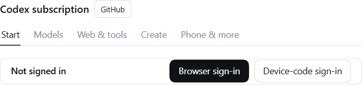
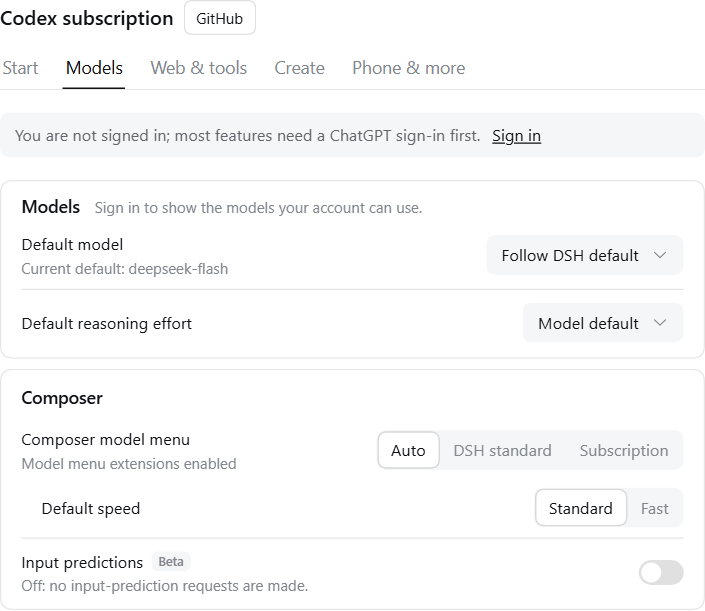

<p align="center"></p>

<div align="center">

# DSH Codex Subscription

[中文](README.md) · **English** · [日本語](README.ja.md) · [Español](README.es.md) · [Français](README.fr.md) · [Deutsch](README.de.md) · [Русский](README.ru.md) · [Português](README.pt.md)

**Use your ChatGPT / Codex subscription directly in DeepSeek Harness**

Sign in with ChatGPT Plus / Pro to use GPT-6 and other Codex models, quota, web search, and image generation inside DSH. No OpenAI API key or Codex CLI.

[](https://github.com/WSL043/dsh-codex-subscription/actions/workflows/ci.yml)
[](https://www.npmjs.com/package/dsh-codex-subscription)
[](https://www.npmjs.com/package/dsh-codex-subscription)
[](LICENSE)
[](https://github.com/WSL043/dsh-codex-subscription/stargazers)

[Highlights](#highlights) · [Install](#install) · [Images & sketching](#images-and-sketching) · [Phone remote control](#phone-remote-control-beta) · [All features](#all-features) · [User guide](docs/GUIDE.en.md) · [Troubleshooting](#troubleshooting) · [Agent](#agent-reference)

</div>

<a id="highlights"></a>

## Highlights

| What you want to do | What the plugin provides |
| --- | --- |
| **Chat and search** | Sign in with your subscription; pick account-provided Codex models, reasoning and speed levels; use subscription web search. |
| **Manage accounts and quota** | Switch accounts, view short-window and weekly quota, Credits and resets; see usage history and optional quota alerts in the composer. |
| **Create and edit images** | Generate images, mark regions for editing, or draw manually and with the Agent on an editable sketch board. [Examples →](#images-and-sketching) |
| **Continue from your phone** | Pair the ChatGPT mobile app to control this computer's DSH. DeepSeek and other DSH models work too. [Beta, off by default →](#phone-remote-control-beta) |
| **Use connected apps** | Let DSH models use apps connected in ChatGPT, including GitHub, Gmail, Drive and Calendar; write approval follows the current DSH session permissions. |

Models and quota depend on what your account returns. [Complete feature list →](#all-features)

<a id="prepare-dsh"></a>

## Prepare DSH

Use a compatible [official DSH release](https://github.com/deepseek-ai/deepseek-harness/releases). Plugin releases are tested against the DSH npm `latest` and `next` channels. The supported host range is listed under `engines.dsh` in the [package manifest](package.json).

See the [official DSH run guide](https://github.com/deepseek-ai/deepseek-harness#run) for CLI and Web Node.js requirements. DSH Desktop bundles its runtime. The plugin requires a ChatGPT account with Codex access.

<details>
<summary>Choose a DSH distribution</summary>

- **Recommended: the official desktop app.** DeepSeek now ships a [DeepSeek Harness desktop app](https://www.deepseek.com/harness/) (macOS on Apple Silicon and 64-bit Windows; preview, open source). It needs no Node.js setup: install it, then add this plugin from the Plugins page as described below. The desktop app, the web app and the CLI share one DSH plugin system; this plugin's end-to-end acceptance is mainly run on the web app, so please [open an issue](https://github.com/WSL043/dsh-codex-subscription/issues) if the desktop app misbehaves.
- Need Linux, or prefer a community portable build? Use [DSH-Portable](https://github.com/WSL043/DSH-Portable), a community portable desktop distribution for Windows, macOS, and Linux.
- Prefer the official route? Follow the [DeepSeek Harness run guide](https://github.com/deepseek-ai/deepseek-harness#run).

</details>

<a id="install"></a>

## Install

<a id="install-from-the-plugins-page-recommended"></a>

### Install from the Plugins page (recommended)

1. Open **Plugins → Add plugin** in DSH.
2. Paste this package name, with its version, into the **Package name or address** field:

   ```text
   dsh-codex-subscription@3.2.24
   ```

3. Click **Install** and wait for completion. Follow the page instructions; save your work before restarting if requested.
4. Open **Settings → Codex**, sign in to ChatGPT, then select a Codex model in your conversation.

<details>
<summary>Why is the version included?</summary>

Why the version is included: DSH's plugin page only installs versions that are at least 24 hours old, so the bare package name can install an older release during the first day after a new one, and that older release may not support your DSH. With the version you get exactly this release; a day after release the bare `dsh-codex-subscription` also resolves to the latest stable release. Other version numbers are on the [releases page](https://github.com/WSL043/dsh-codex-subscription/releases).

</details>

<details>
<summary>Terminal installation (with an existing dsh command)</summary>

```sh
dsh plugin --profile web add dsh-codex-subscription@3.2.24
```

Follow the restart instructions, then sign in under **Settings → Codex**. Both the Plugins page and the terminal use DSH's installation management.

</details>

<details>
<summary>Headless tasks</summary>

After signing in and selecting a Codex model in Web, install the same plugin in the Headless profile:

```sh
dsh plugin --profile headless add dsh-codex-subscription@3.2.24
dsh --profile headless "Reply with only the word: ok"
```

</details>

<a id="interface-demo"></a>

## Interface demo

Connect your ChatGPT account, choose a Codex model in DSH, and check your subscription quota from the same settings page.

<details>
<summary>Sign in and check subscription quota</summary>

Select **Browser sign-in** under **Settings → Codex → Start**. After sign-in, the same page shows saved accounts, subscription quota, and reset times.

<p align="center"></p>

</details>

<details>
<summary>Choose a Codex model and send a message</summary>

After signing in, set the default model and reasoning effort under **Settings → Codex → Models**. Use the model selector next to the composer to change the model for the current conversation.

<p align="center"></p>

</details>

<details>
<summary>What is in each settings tab?</summary>

| Settings tab | What it controls |
| --- | --- |
| **Start** | Sign-in and accounts, a switch for every feature, subscription quota, quota display and alerts |
| **Models** | Default model, default reasoning effort and model list, answer style; the folded Advanced group has context length, retry, connection mode, cloud compaction and the review model |
| **Web & tools** | The master switch for other models, search source, ChatGPT connectors, official Codex subtasks |
| **Create** | Image generation, editing, @image in the composer, image viewer, sketch board and agent drawing |
| **Phone & more** | Phone remote control, experimental voice calls, local cache, support diagnostics |

Voice conversation is off by default. Enable it under **Phone & more**, then start a call from the composer. If a native window, including Linux, does not support WebRTC, DSH offers to continue the same conversation in a browser. Voice samples remain available, and your existing subscription is used without an API key.

**Model-aware context** follows your account's model directory; refreshing preserves your unsaved draft. Settings show the raw window; conversation budgets reserve headroom using the official percentage (5% when omitted), then DSH manages output reservations and compaction. No manual subtraction is needed. Quota groups use backend-provided values, including separate buckets such as Spark.

Subscription failures remain visible: no silent fallback to another paid route.

</details>

<a id="images-and-sketching"></a>

## Images and sketching

Generate images with your subscription, view and download the originals, or mark a region and add notes to continue editing. Image generation and editing are controlled under **Settings → Codex → Create**.

<a id="sketch-board-beta"></a>

### Sketch board (Beta)

The sketch board and Agent drawing are **Beta** and off by default; turn them on in the Create page. Draw by hand from the sketch button in the composer, or send `@sketch` with a request to have the Agent draw.

The board supports layers, native curves, brushes, gradients, blur, blend modes, clipping, undo/redo and shortcuts. Save multiple drafts and export PNG or editable drafts. With a reference, the Agent can compare images, measure colours and positions, and undo. Finished drawings can be replayed and recorded as video.

<details>
<summary>Agent drawing example: whale girl</summary>

The agents drew these examples on the sketch board using native editable strokes, without calling image generation. All three used the same reference and drawing-tool baseline. These are individual runs with different effort levels and durations.

<p align="center"><b>Reference image</b><br></p>

<table>
<tr><th width="33%">GPT-6-Astra</th><th width="33%">GPT-6.1-Sol</th><th width="33%">DeepSeek Flash</th></tr>
<tr><td></td><td></td><td></td></tr>
<tr><td>Medium · 20 min 57 s<br>686 strokes</td><td>High · first turn: 23 min<br>1,020 strokes</td><td>High · 9 min 33 s<br>623 strokes</td></tr>
</table>

After a connection interruption, the 6.1 drawing was restored from its autosave and original successful calls. The model then checked the preview and saved it, with no manual drawing added. This was not an uninterrupted successful run.

</details>

[Image editing and draft storage →](docs/GUIDE.en.md#image-generation-and-editing)

<a id="phone-remote-control-beta"></a>

## Phone remote control (Beta)

Pair the Codex section of the ChatGPT mobile app with the DSH on your computer. Start or continue conversations, use tools and handle approvals from your phone, with DeepSeek or any other DSH model.

**Off by default.** Enable it under **Settings → Codex → Phone & more → Phone remote control** and pair by QR or manual code. Your computer must stay on, online and running DSH.

This is a third-party compatibility layer using OpenAI's remote connection service. Official Codex remote control exists, but DSH host compatibility is not explicitly guaranteed by OpenAI and may change with service updates. You can remove paired devices or disable it at any time.

Click **Show pairing code** on the computer, then scan the QR code or enter the manual code in Codex in the ChatGPT mobile app. Select the paired computer in the app to send messages and attach images.

<details>
<summary>Supported phone operations</summary>

- follow, start, continue, interrupt and archive conversations; search conversations and keywords inside one;
- switch model, reasoning level and permission (workspace write / full access);
- approvals and questions pop up on the phone; if it drops, they pop up again when you reopen it, otherwise they go back to the computer;
- replies appear as they are written; commands, file edits with diffs, the task list, web searches, connector calls and generated images use the phone's native views;
- send photos, @ search files on the computer, / pick DSH skills, view changes with read-only git, and start chats in a real folder picker;
- DSH workspaces appear as projects; fork a conversation, see usage limits, lifetime usage and context usage; where DSH supports `/compact`, compact the context from the phone;
- model errors show on the phone; paired phones are listed in settings and can be removed.

</details>

<a id="all-features"></a>

## All features

Model access and quota depend on your account.

<details>
<summary><b>Models and search</b></summary>

Choose the model for the task, then adjust reasoning for how much analysis you need and speed for how quickly a supported request runs. Response verbosity changes the requested level of detail. In **Web & tools**, use search to find pages and webpage reading to open a URL you already have.

| Feature | What you can do | Availability / setup |
| --- | --- | --- |
| **Subscription sign-in** | Sign in to ChatGPT and use Codex subscription models without an API key | Normal chat needs no Codex CLI |
| **Model catalog sync** | Read available models and reasoning levels from your account, with manual refresh; the last successful catalog is stored locally per account and remains available during the background refresh after restart, with a 24-hour lifetime; models marked for retirement show their retirement date next to the model name, without automatically switching your selection | New models appear when your account offers them; the account catalog is the only source, so no models are shown when signed out or when neither a remote read nor a valid cache is available |
| **Model list** | Show or hide individual models in the composer picker on the Models page; the picker keeps DSH's own model labels (such as the new-model badge) | Display only; selected models and requests still work |
| **Composer model menu** | Add speed and output detail through DSH’s model menu extensions and yield when another picker needs the slot. | Set under Models. Saved picker choices are preserved. |
| **Input predictions (Beta)** | After a completed reply, the empty composer may suggest a follow-up. Tab puts it in the draft for editing. | Off by default under Models. Only supported Codex models with prediction access qualify. Requests may consume usage. |
| **Default model** | Choose the model a new conversation opens with on the Models page | Writes the DSH default model setting, the same one a model switch inside a chat writes; unset it to follow the DSH default |
| **Default reasoning effort** | Choose a default level for subscription models on the Models page; Model default follows each model's official catalog recommendation | Manual choices take priority. Unsupported levels fall back to the model's valid default; existing manual conversation choices are preserved |
| **Reasoning levels** | Choose supported reasoning effort in the composer | Levels vary by model |
| **Ultra reasoning** | Lets DSH delegate suitable independent work to native subagents using the model’s supported reasoning effort. | Offered only when the model and Agent preset support it. Separate from the Ultrafast speed tier. |
| **Speed tiers** | Switch supported models between Standard and Fast; Ultrafast (Beta) too when the account catalog offers it, with a lightning indicator | Standard by default. Fast and Ultrafast use more quota; available tiers depend on your account and model. |
| **Response verbosity** | Request short, medium, or detailed responses | Follows the model default unless changed |
| **Input image detail** | Choose Low, High, Original, or Auto detail for images sent to the chat model | Affects input tokens; Auto by default |
| **Subscription web search** | Auto, Codex, and search providers registered in DSH | Set under Web & tools. Auto chooses a source based on the model. On hosts with shared Web settings, Plugins → Web search and fetch shows the same selection. Webpage reading is separate. |
| **Webpage reading source** | Choose how the tools read a known URL, independently of the search source. | Web & tools. On hosts with shared Web settings, choose HTTP, DeepSeek Fetch API, or Codex. |
| **Other-models switch** | One switch that stops conversations on DeepSeek and other non-Codex models from using subscription web search, image generation and ChatGPT connectors | Settings → Codex → Web & tools; on by default, Codex subscription models are not affected; phone remote control and voice are started by you and are not affected |
| **Search scope** | Choose live / cached search, disable search, or restrict domains | Set under Web & tools. Applies to Codex subscription searches only. |
| **Stream inactivity timeout** | Set how long a request can receive no streamed data before it is aborted | 10 minutes by default; not an overall response deadline |
| **Context budget** | Use standard, extended, or custom budgets per model | Limited by the model catalog |
| **GPT-Reserve** | Select the reserve model when your account offers it | Experimental; no promise of a separate reserve quota |

</details>

<details>
<summary><b>Accounts and quota</b></summary>

Start with **Start → Subscription quota** for the remaining allowance and reset times. A short and a weekly window can apply at the same time. The usage breakdown describes past activity, while Runway estimates what will happen if your recent pace continues. Enable Composer quota to see the remaining allowance without leaving a chat.

| Feature | What you can do | Availability / setup |
| --- | --- | --- |
| **Multiple accounts** | Add, switch, remove, or sign out of all accounts | Settings → Codex → Start |
| **Quota details** | View short / weekly windows, reset times, and separate quota groups | Only backend-provided windows and groups are shown |
| **Where the allowance went** | In the quota card, see each week's allowance split by model, surface, source and trigger | From the official usage report: approximate, may lag a day or two; hidden when the account has no report |
| **Usage overview** | In the quota card, see lifetime tokens, busiest day, streaks, most used reasoning level and a half-year daily heatmap | From the official usage statistics; hidden when the account has none |
| **Credits and reset cards** | View extra Credits, spending caps, and available reset cards | Shown when returned for your account |
| **Composer quota** | See remaining quota as a percentage or progress bar while chatting | Off by default; choose your display mode |
| **Runway estimate** | Hover over or click the composer quota to see when recent usage would exhaust it | Beta; optional estimate, not a guarantee |
| **Quota alerts** | Use fixed, early, or custom short / long-window thresholds | 20% remaining by default; can be disabled |
| **Redeem reset cards** | Use an available reset card after confirmation | Confirmation and waiting safeguards; server decides the result |
| **Retry after reset** | Wait for a confirmed short-window reset before continuing | Off by default; waiting can be stopped |

</details>

<details>
<summary><b>Images and sketching</b></summary>

Use generation to create an image and a reference or comment pin to request a specific edit. Closing the viewer saves your pins. **Add to composer** puts them in a draft you can review and send. Export PNG for sharing or a native draft to keep layers and strokes editable.

| Feature | What you can do | Availability / setup |
| --- | --- | --- |
| **Image generation** | Generate through your subscription and adjust available request model / quality options; ask for a transparent-background PNG when needed | On by default, can be disabled |
| **Reference image editing** | Continue refining an image with references | On by default, can be disabled |
| **Image viewing and download** | Completed images appear after the answer without expanding tool activity; zoom, pan, fit to window, and download verified originals | Built-in viewer; older images may only have previews |
| **Region-based editing** | Mark regions, add notes, and continue editing with location references | Close the viewer to save your notes. Choose Add to composer to put the image and notes into a draft. |
| **Manual canvas** | Choose an aspect ratio and draw with pen, pencil, marker, and erasers | Beta; canvas off by default |
| **Shapes and text** | Draw lines, arrows, shapes, native curves, and editable text / objects | Available in the sketch canvas |
| **Gradients, blur, blend and clip** | Fill with linear / radial gradients; add blur (glow, shadow, haze), blend modes (multiply, screen, overlay, …) and shape clipping to a stroke; layers can have a blend mode too | All stay editable properties and survive moving, scaling, drafts and export; the agent gets the same through SVG gradients, `feGaussianBlur`, `mix-blend-mode` and `clip-path` |
| **Layers and image import** | Work in layers and bring images into the canvas | Images are managed as layers |
| **Smoothing and navigation** | Smooth complete strokes after release; pan, zoom, undo, and redo | Shortcuts can be customized or disabled |
| **Multiple drafts** | Save and reopen up to 20 local drafts | Stored in the current browser |
| **Import and export** | Export PNG, or native drafts that preserve editable strokes | Drafts can be imported again to keep editing |
| **Agent drawing** | Ask the agent to draw with `@sketch`, follow progress, and stop it; the agent can draw whole stages in SVG, imported as editable native strokes; with a reference it can compare side by side, read a difference heat map, zoom into a region, measure colours and edge positions, and undo, and every batch reports how the error changed | Beta; off by default, requires the canvas. The tools only measure and show; they never draw for the model |
| **Replay and video** | Replay redraws strokes in order. Choose Record process video separately to preview and save a WebM. | The video is previewed in the board and only saved when you click Save video; nothing downloads automatically |
| **Result preview for the model** | Return a canvas image after drawing for subsequent review | Beta; off by default, adds image input usage |

</details>

<a id="codex-subtask-runtime"></a>

<details>
<summary><b>Advanced capabilities and maintenance</b></summary>

Use phone control to reach a running DSH from the ChatGPT mobile app. Use a voice call to speak in a conversation, or a subtask to delegate part of the work. For a failure, open **Phone & more → Support diagnostics** and check which prerequisite or recent operation the report covers.

| Feature | What you can do | Availability / setup |
| --- | --- | --- |
| **Phone remote control** | Drive the DSH on your computer from the Codex section of the ChatGPT mobile app: start, continue and archive conversations, switch model and permissions, answer approvals and questions; DeepSeek and any other DSH model work | Beta; off by default; Settings → Codex → Phone & more → Phone remote control, pair by QR or manual code |
| **Voice conversation (Beta)** | Start a spoken conversation from the composer. A browser can host the call when the native window lacks WebRTC. | Off by default under Phone & more. Grant microphone access when prompted. |
| **Codex independent subtasks** | Use your subscription for Codex subtasks, and choose their model and reasoning level. | Install Codex Subagent in DSH Plugins. Under Web & tools → Independent subtasks, prepare the CLI if prompted and select Codex (subscription). |
| **Cloud context compaction** | Continue long conversations using Codex compaction while retaining DSH history and native compaction | Beta / experimental; off by default, enabled requests use SSE |
| **WebSocket transport** | Experimentally reuse connections and context transfers, with SSE fallback on connection failure | SSE by default. Requests above the server’s advertised WebSocket limit switch to SSE before sending. |
| **Codex reviewer for Auto review** | DSH Auto review judges tool calls with Codex's own review model; DSH keeps its review policy and allow/deny flow | Beta; off by default, applies when your account catalog offers the model |
| **ChatGPT connectors** | Let DeepSeek or any DSH model use the apps you connected in ChatGPT: GitHub, Gmail, Google Drive, Calendar and more; models search first, then call, and write approval follows the chosen mode and current DSH session permissions | Off by default, Settings → Codex → Web & tools → ChatGPT connectors; connect the apps in ChatGPT first |
| **Support diagnostics** | Create a redacted JSON report of recent operations and environment details. Copy or download it. | Settings → Codex → Phone & more → Support diagnostics. |
| **Forecast cache cleanup** | Inspect and clear local quota forecast history | Keeps sign-in, drafts, originals, and shared dependencies |

</details>

<a id="agent-reference"></a>

### Reference for agents and contributors

DSH owns the conversation, tool approvals and workspace permissions. The subscription plugin supplies the Codex route and adds the settings and tools described above. When investigating a missing feature, check the DSH version, account capabilities, selected model and setting before tracing the relevant tool or request.

[Detailed user guide](docs/GUIDE.en.md) · [Sketch tool contract](docs/sketch-agent.md) · [Setting defaults](src/preference-fields.js) · [Development and documentation index](docs/DEVELOPMENT.md)

<a id="reuse-cache-when-changing-effort"></a>

### Reuse cache when changing effort

On by default under **Settings → Codex → Models → Advanced**. It can help supported models reuse their cache when you change reasoning effort. Ordinary prompt caching remains available with this setting off.

[How it works and when it is paused](docs/GUIDE.en.md#reuse-cache-when-changing-effort)

<a id="update-and-uninstall"></a>

## Update and uninstall

Find this plugin on the DSH **Plugins** page and use its update or uninstall action. Follow any restart instructions. Uninstalling this plugin does not remove other plugins.

<details>
<summary>Terminal commands</summary>

```sh
dsh plugin --profile web update dsh-codex-subscription@3.2.24
```

Run only when you want to uninstall:

```sh
dsh plugin --profile web remove dsh-codex-subscription
```

</details>

<a id="troubleshooting"></a>

## Troubleshooting

<details>
<summary>How does this relate to the official Codex bundle (dsh-hooks-codex) in the plugin list?</summary>

They are unrelated and can be installed together. The official Codex / Claude Code bundles let DSH run Codex or Claude Code style hooks configs (scripts that run before and after tool calls). This plugin signs in with your ChatGPT subscription and provides Codex models, quota, search, images and phone remote control.

</details>

<details>
<summary>No dsh command on your computer?</summary>

Use **Plugins → Add plugin** in DSH and paste the package name. No terminal setup is needed.

</details>

<details>
<summary>Multiple DSH installations, or a missing plugin?</summary>

Install from the DSH you actually use. For terminal installation, run commands in the intended DSH environment and check its profile. Do not delete profiles or change your system PATH to force an install.

</details>

<details>
<summary>How do I report a problem?</summary>

After reproducing the problem, open **Settings → Codex → Phone & more → Support diagnostics**, select **Create report**, and then **Download report**. Attach the JSON to the [bug report](https://github.com/WSL043/dsh-codex-subscription/issues/new?template=install-problem.yml) with your steps and version information.

</details>

<details>
<summary>Do I need the Codex command line?</summary>

Only independent subtasks running with Codex (subscription) need the CLI. Subscription chat, images, and native DSH subtasks work without it. [Setup, removal and the full guide →](docs/GUIDE.en.md#codex-subtask-runtime)

</details>

<a id="positioning-and-boundaries"></a>
<a id="scope-and-support"></a>

<a id="project-and-support"></a>

## Project and support

- **ChatGPT / Codex subscription only**, done in depth: quota and forecasting, images and sketches, subtasks, diagnostics. Other subscriptions such as Claude or Grok are out of scope.
- **Fail explicitly**: requests never silently fall back to another paid route, and quota windows the account does not return are never invented.
- **Tracks official DSH releases**: every release is accepted end to end (install, start, remove, reinstall) against official DSH channels such as latest and next; verified versions are recorded in the [compatibility notes](docs/DEVELOPMENT.md#compatibility).
- Models, quota and features depend on what your account actually returns; the ChatGPT backend and DSH can change independently.

This community project is not affiliated with or endorsed by DeepSeek or OpenAI.

- Use the [bug report form](https://github.com/WSL043/dsh-codex-subscription/issues/new?template=install-problem.yml) for project feedback.
- Use the [feature request form](https://github.com/WSL043/dsh-codex-subscription/issues/new?template=feature-request.yml) for focused product suggestions.
- Focused fixes and compatibility improvements are welcome; see [CONTRIBUTING.md](CONTRIBUTING.md).
- Help [maintain and develop the project](CONTRIBUTING.md#help-maintain): take ongoing responsibility for a module, follow up on related issues or review code. [Open an issue](https://github.com/WSL043/dsh-codex-subscription/issues/new?template=help-maintain.yml) to discuss.
- For DSH plugin discussion, visit [DeepSeek Harness Discussions](https://github.com/deepseek-ai/deepseek-harness/discussions).
- Read [SECURITY.md](SECURITY.md) before reporting sensitive issues.

If this project is useful, the [Star button](https://github.com/WSL043/dsh-codex-subscription/stargazers) helps more DSH users find it.

<a href="https://star-history.com/#WSL043/dsh-codex-subscription&Date">
  <picture>
    <source media="(prefers-color-scheme: dark)" srcset="https://api.star-history.com/svg?repos=WSL043/dsh-codex-subscription&type=Date&theme=dark" />
    
  </picture>
</a>

[中文](README.md) · **English** · [日本語](README.ja.md) · [Español](README.es.md) · [Français](README.fr.md) · [Deutsch](README.de.md) · [Русский](README.ru.md) · [Português](README.pt.md) · [MIT](LICENSE)

[](https://github.com/deepseek-ai/deepseek-harness)
