<p align="center"></p>

<div align="center">

# DSH Codex Subscription

[简体中文](https://github.com/WSL043/dsh-codex-subscription/blob/main/README.md) · **English**

**Use your ChatGPT / Codex subscription directly in DeepSeek Harness**

Sign in with ChatGPT Plus / Pro to use GPT-6 and other Codex models, quota, web search, and image generation inside DSH. No OpenAI API key or Codex CLI.

[](https://github.com/WSL043/dsh-codex-subscription/actions/workflows/ci.yml)
[](https://www.npmjs.com/package/dsh-codex-subscription)
[](https://www.npmjs.com/package/dsh-codex-subscription)
[](LICENSE)
[](https://github.com/WSL043/dsh-codex-subscription/stargazers)

[Highlights](#highlights) · [Install](#install) · [Images & sketching](#images-and-sketching) · [Phone remote control](#phone-remote-control-beta) · [All features](#all-features) · [User guide](docs/GUIDE.en.md) · [Troubleshooting](#troubleshooting)

</div>

<p align="center">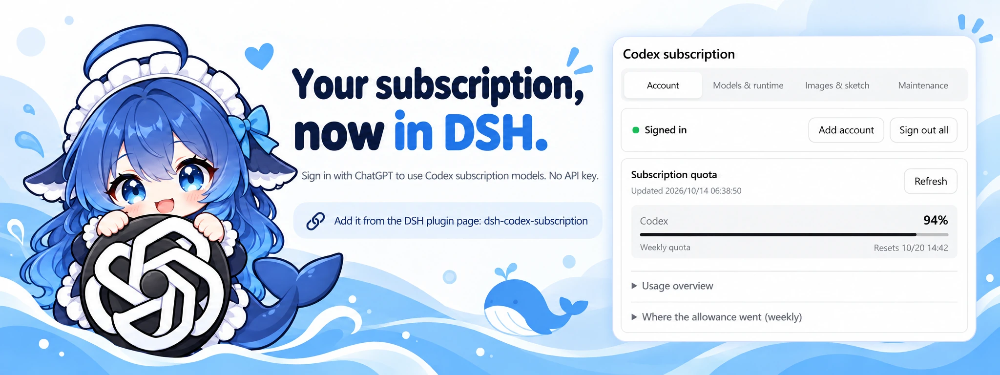</p>

## Highlights

| What you want to do | What the plugin provides |
| --- | --- |
| **Chat and search** | Sign in with your subscription; pick account-provided Codex models, reasoning and speed levels; use subscription web search. |
| **Manage accounts and quota** | Switch accounts, view short-window and weekly quota, Credits and resets; see usage history and optional quota alerts in the composer. |
| **Create and edit images** | Generate images, mark regions for editing, or draw manually and with the Agent on an editable sketch board. [Examples →](#images-and-sketching) |
| **Continue from your phone** | Pair the ChatGPT mobile app to control this computer's DSH. DeepSeek and other DSH models work too. [Beta, off by default →](#phone-remote-control-beta) |
| **Use connected apps** | Let DSH models use apps connected in ChatGPT, including GitHub, Gmail, Drive and Calendar; changes ask for approval by default. |

Models and quota depend on what your account returns. [Complete feature list →](#all-features)

<details>
<summary>Use subscription features with DeepSeek and other models</summary>

Let DeepSeek or any other DSH model use the apps you connected in ChatGPT: GitHub, Gmail, Google Drive, Calendar and more. Models search first, then call, and by default every change asks for your approval (you can switch that off in settings). Off by default; turn it on under Web & tools.

Web search and webpage reading sources, ChatGPT connectors and official Codex independent subtasks are on **Settings → Codex subscription → Web & tools**, with one master switch at the top: when off, conversations on DeepSeek and other non-Codex models no longer use subscription web search (DSH search is used instead), image generation or ChatGPT connectors; Codex subscription models are not affected. On by default.

<p align="center"><picture><source media="(prefers-color-scheme: dark)" srcset="docs/assets/ui-interop-en-dark.webp">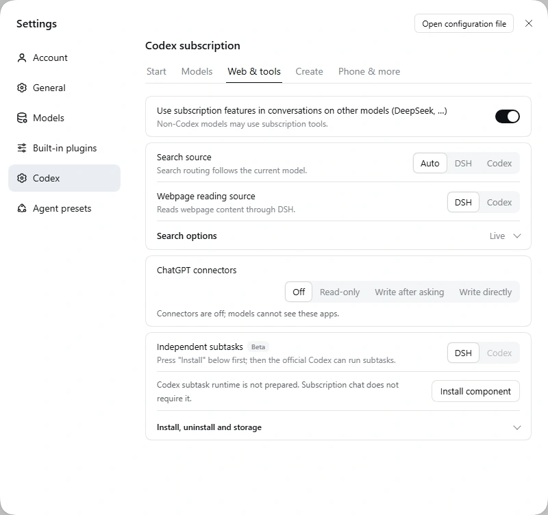</picture></p>

</details>

## Prepare DSH

Verified against DSH `0.2.1-rc.4` (the `next` channel), with `0.2.1-rc.3` and `0.2.1-rc.2` still supported; the minimum supported version is `0.1.7-rc.2`. Please upgrade older DSH releases first.

Also supports the preview host `0.2.2-alpha.2`. See the [compatibility notes](docs/dsh-022-alpha2-compatibility.md) for scope and validation limits.

This plugin supports the latest DeepSeek Harness release recorded in its package metadata and requires a ChatGPT account that currently has Codex access.

<details>
<summary>Choose a DSH distribution</summary>

- **Recommended: the official desktop app.** DeepSeek now ships a [DeepSeek Harness desktop app](https://www.deepseek.com/harness/) (macOS on Apple Silicon and 64-bit Windows; preview, open source). It needs no Node.js setup: install it, then add this plugin from the Plugins page as described below. The desktop app, the web app and the CLI share one DSH plugin system; this plugin's end-to-end acceptance is mainly run on the web app, so please [open an issue](https://github.com/WSL043/dsh-codex-subscription/issues) if the desktop app misbehaves.
- Need Linux, or prefer a community portable build? Use [DSH-Portable](https://github.com/WSL043/DSH-Portable), a community portable desktop distribution for Windows, macOS, and Linux.
- Prefer the official route? Follow the [DeepSeek Harness run guide](https://github.com/deepseek-ai/deepseek-harness#run).

</details>

## Install

### Install from the Plugins page (recommended)

1. Open **Plugins → Add plugin** in DSH.
2. Paste this package name, with its version, into the **Package name or address** field:

   ```text
   dsh-codex-subscription@3.2.0
   ```

3. Click **Install** and wait for completion. Follow the page instructions; save your work before restarting if requested.
4. Open **Settings → Codex**, sign in to ChatGPT, then select a Codex model in your conversation.

<details>
<summary>Why is the version included?</summary>

Why the version is included: DSH's plugin page only installs versions that are at least 24 hours old, so the bare package name can install an older release during the first day after a new one, and that older release may not support your DSH. With the version you get exactly this release; a day after release the bare `dsh-codex-subscription` also resolves to the latest stable release. Other version numbers are on the [releases page](https://github.com/WSL043/dsh-codex-subscription/releases).

</details>

<details>
<summary>Terminal installation (with an existing dsh command)</summary>

```sh
dsh plugin --profile web add dsh-codex-subscription@3.2.0
```

Follow the restart instructions, then sign in under **Settings → Codex**. Both the Plugins page and the terminal use DSH's installation management.

</details>

<details>
<summary>Headless tasks</summary>

After signing in and selecting a Codex model in Web, install the same plugin in the Headless profile:

```sh
dsh plugin --profile headless add dsh-codex-subscription@3.2.0
dsh --profile headless "Reply with only the word: ok"
```

</details>

## Interface demo

Open **Settings → Codex** to manage accounts and preferences. Screenshots and animation are collapsed below; choose the view you need.

<details>
<summary><b>Interface demo (animation, click to expand)</b>: models, prompts, images, annotation, sketch board, quota and resets</summary>
<br>
<p align="center">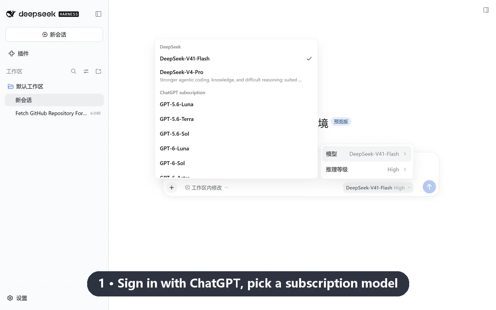</p>
</details>

<details>
<summary>Model settings: defaults, input predictions and answer style</summary>

<p align="center"><picture><source media="(prefers-color-scheme: dark)" srcset="docs/assets/ui-models-en-dark.png">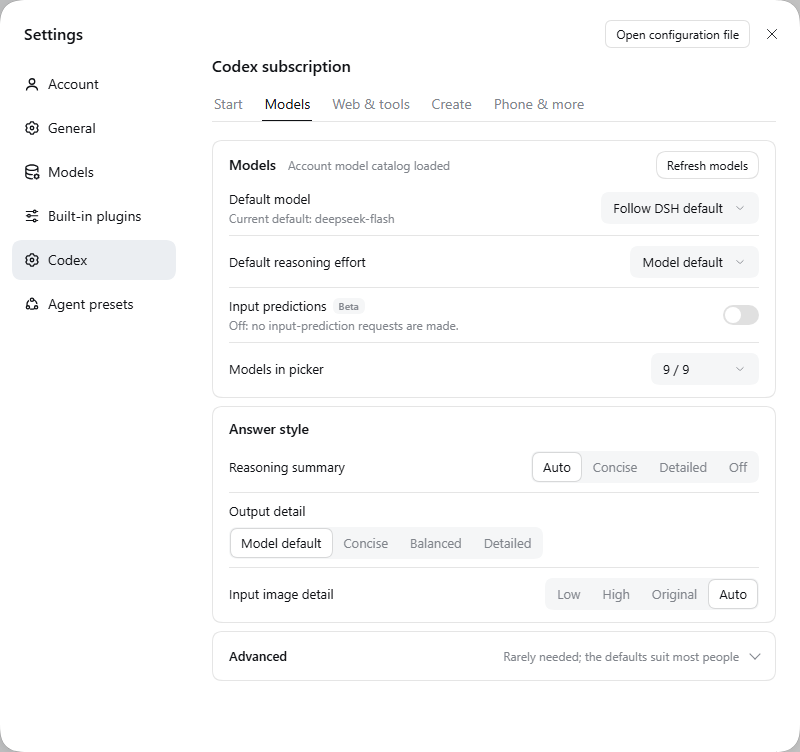</picture></p>

</details>

<details>
<summary>Composer: models, speed, permissions and quota</summary>

<p align="center"><picture><source media="(prefers-color-scheme: dark)" srcset="docs/assets/ui-composer-en-dark.png">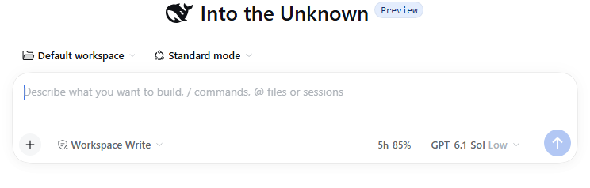</picture></p>

</details>

<details>
<summary>Quota and usage: balances, history and weekly breakdown</summary>

<p align="center"><picture><source media="(prefers-color-scheme: dark)" srcset="docs/assets/ui-quota-en-dark.png">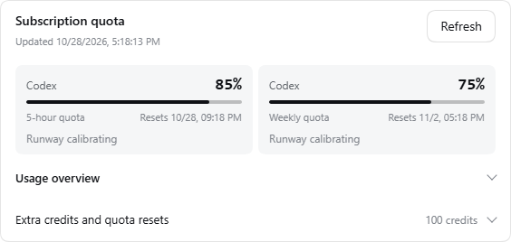</picture></p>

<p align="center">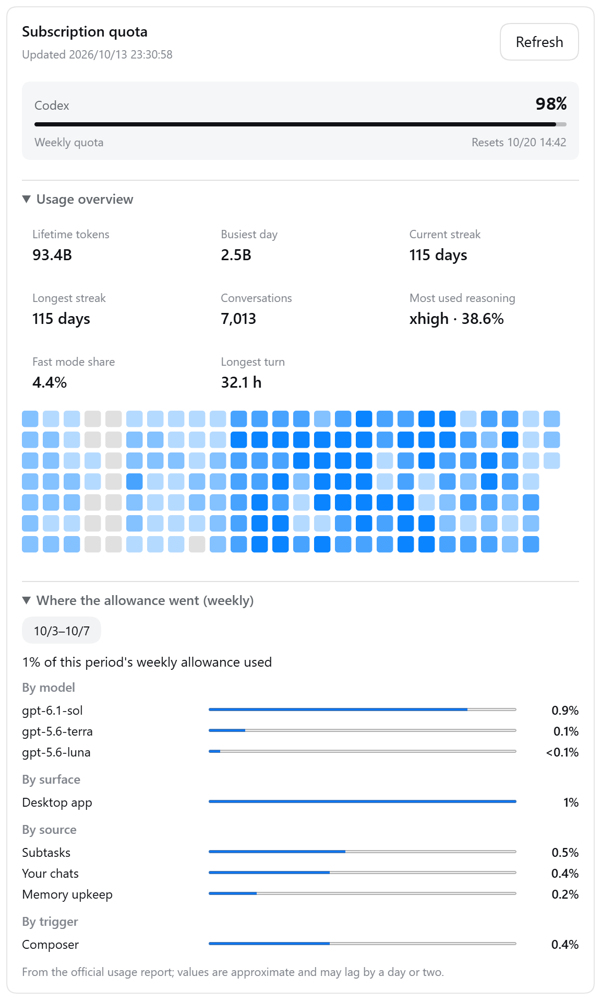</p>

</details>

<details>
<summary>What is in each settings tab?</summary>

| Settings tab | What it controls |
| --- | --- |
| **Start** | Sign-in and accounts, a switch for every feature, subscription quota, quota display and alerts |
| **Models** | Default model, default reasoning effort and model list, answer style; the folded Advanced group has context length, retry, connection mode, cloud compaction and the review model |
| **Web & tools** | The master switch for other models, search source, ChatGPT connectors, official Codex subtasks |
| **Create** | Image generation, editing, @image in the composer, image viewer, sketch board and agent drawing |
| **Phone & more** | Phone remote control, experimental voice calls, local cache, support diagnostics |

Voice conversation is off by default. Enable it under **Phone & more**, then start a call from the composer. If a native window, including Linux, does not support WebRTC, DSH offers to continue the same conversation in a browser. Voice samples remain available, and your existing subscription is used without an API key.

**Model-aware context** follows your account's model directory; refreshing preserves your unsaved draft. Quota groups use backend-provided values, including separate buckets such as Spark.

Subscription failures remain visible: no silent fallback to another paid route.

</details>

## Images and sketching

Generate images with your subscription, view and download the originals, or mark a region and add notes to continue editing. Image generation and editing are controlled under **Settings → Codex → Create**.

<details>
<summary>Image annotation and continued editing</summary>

<p align="center">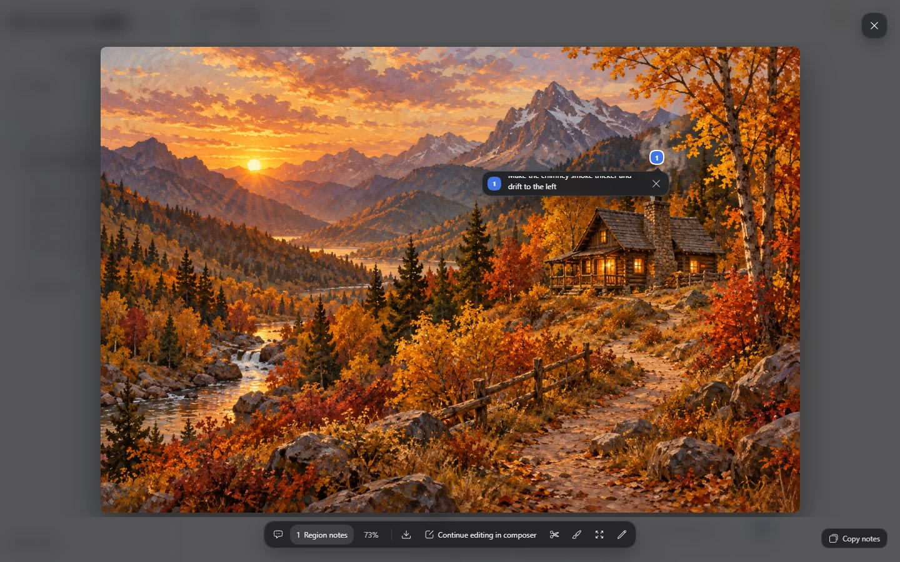</p>

</details>

<details>
<summary>View Images & sketch settings</summary>

<p align="center"><picture><source media="(prefers-color-scheme: dark)" srcset="docs/assets/ui-creative-en-dark.png">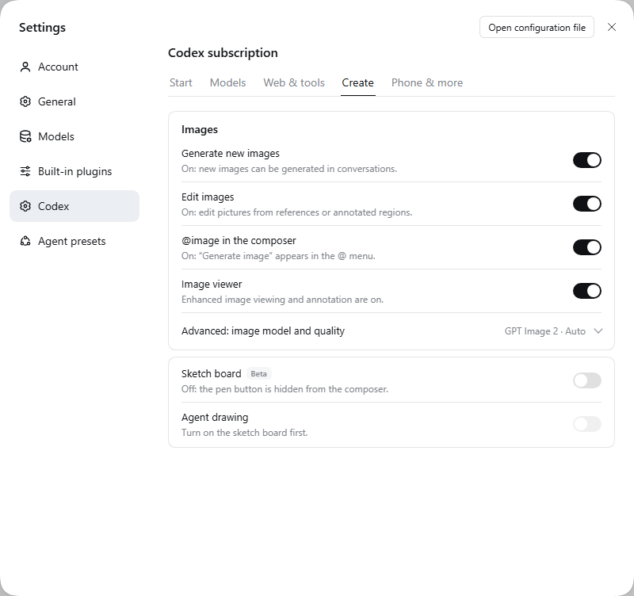</picture></p>

Settings shown directly as cropped screenshots from the actual DSH interface, following the light or dark theme.

</details>

### Sketch board (Beta)

The sketch board and Agent drawing are **Beta** and off by default; turn them on in the Create page. Draw by hand from the sketch button in the composer, or send `@sketch` with a request to have the Agent draw.

The board supports layers, native curves, brushes, gradients, blur, blend modes, clipping, undo/redo and shortcuts. Save multiple drafts and export PNG or editable drafts. With a reference, the Agent can compare images, measure colours and positions, and undo. Finished drawings can be replayed and recorded as video.

<details>
<summary>Agent drawing example: whale girl</summary>

The agents drew these examples on the sketch board using native editable strokes, without calling image generation. All three used the same reference and drawing-tool baseline. These are individual runs with different effort levels and durations.

<p align="center"><b>Reference image</b><br></p>

<table>
<tr><th width="33%">GPT-6-Astra</th><th width="33%">GPT-6.1-Sol</th><th width="33%">DeepSeek Flash</th></tr>
<tr><td></td><td></td><td></td></tr>
<tr><td>Medium · 20 min 57 s<br>686 strokes</td><td>High · first turn: 23 min<br>1,020 strokes</td><td>High · 9 min 33 s<br>623 strokes</td></tr>
</table>

After a connection interruption, the 6.1 drawing was restored from its autosave and original successful calls. The model then checked the preview and saved it, with no manual drawing added. This was not an uninterrupted successful run.

</details>

<details>
<summary>Sketch to generated image: clocktower and blue-green landscape</summary>

The Agent first drew an editable sketch, then used that sketch as the reference for subscription image generation. Sol and Astra below name the conversation models directing the workflow, not the image-generation backend.

**Clocktower cutaway**

<table>
<tr><th>Conversation model</th><th width="43%">Agent sketch</th><th width="43%">Generated from the sketch</th></tr>
<tr><td>GPT-6.1-Sol<br>Xhigh</td><td>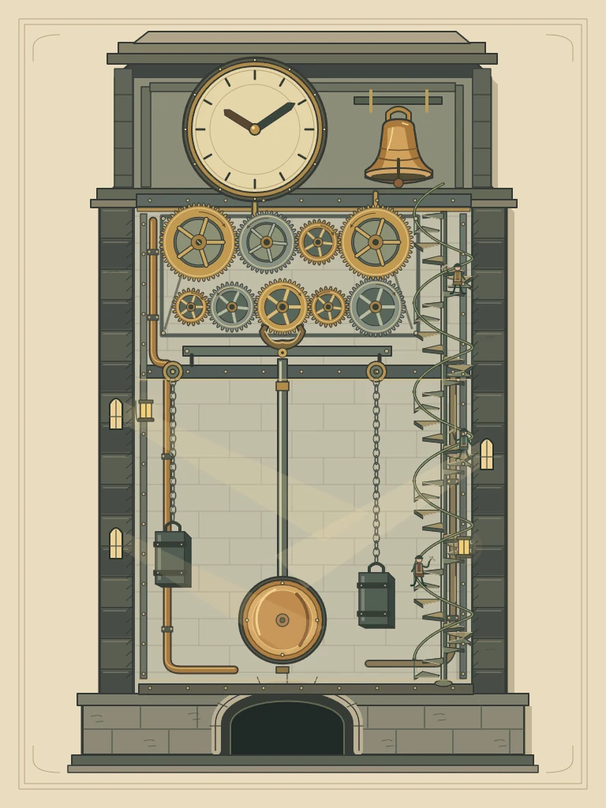</td><td>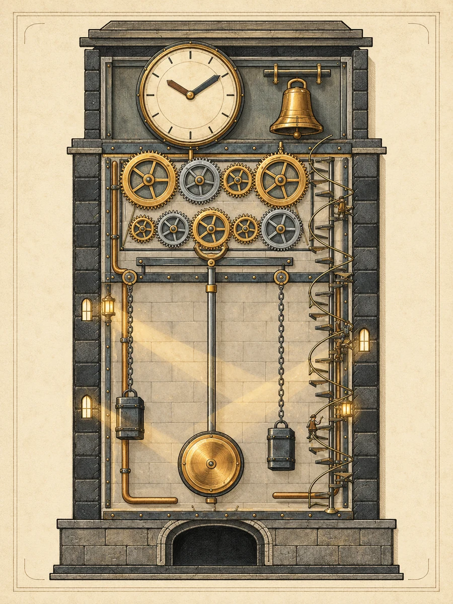</td></tr>
<tr><td>GPT-6-Astra<br>Low</td><td>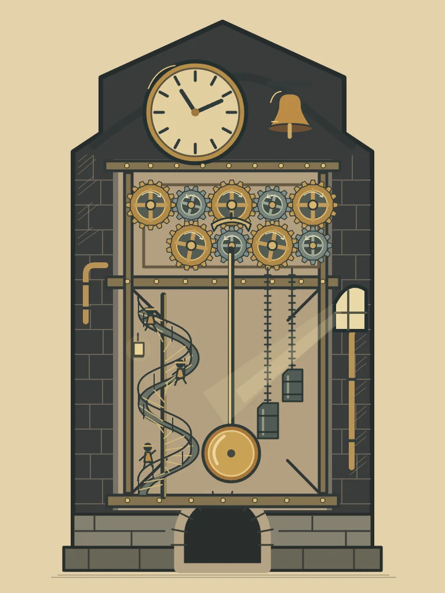</td><td>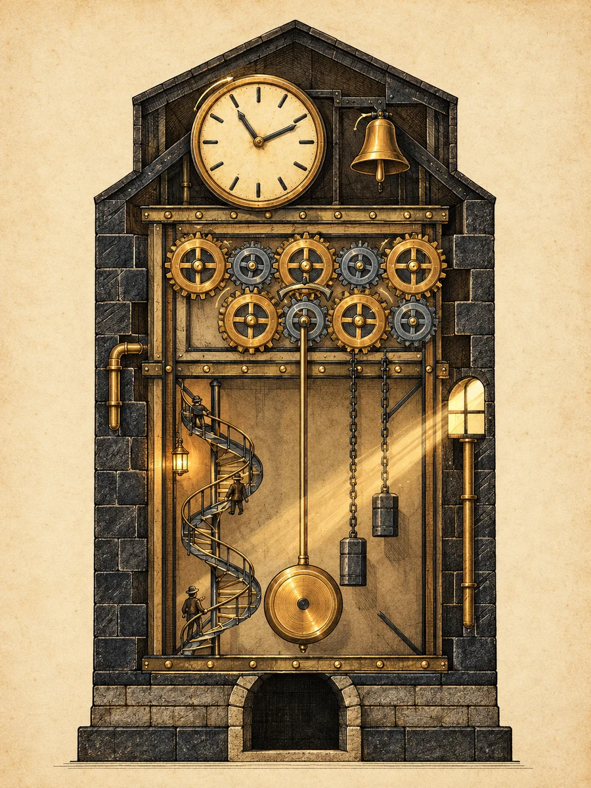</td></tr>
</table>

**Blue-green landscape**

<table>
<tr><th>Conversation model</th><th width="43%">Agent sketch</th><th width="43%">Generated from the sketch</th></tr>
<tr><td>GPT-6.1-Sol<br>Xhigh</td><td></td><td></td></tr>
<tr><td>GPT-6-Astra<br>Low</td><td>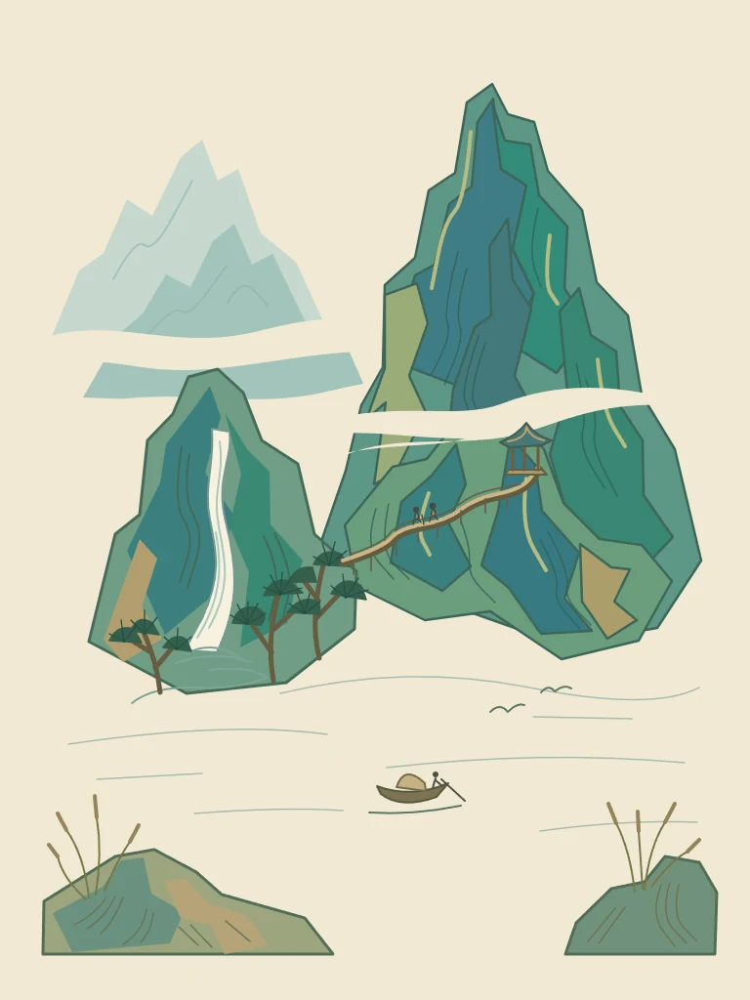</td><td></td></tr>
</table>

</details>

[Image editing and draft storage →](docs/GUIDE.en.md#image-generation-and-editing)

## Phone remote control (Beta)

Pair the Codex section of the ChatGPT mobile app with the DSH on your computer. Start or continue conversations, use tools and handle approvals from your phone, with DeepSeek or any other DSH model.

**Off by default.** Enable it under **Settings → Codex → Phone & more → Phone remote control** and pair by QR or manual code. Your computer must stay on, online and running DSH.

This is a third-party compatibility layer using OpenAI's remote connection service. Official Codex remote control exists, but DSH host compatibility is not explicitly guaranteed by OpenAI and may change with service updates. You can remove paired devices or disable it at any time.

<details>
<summary>Supported phone operations</summary>

- follow, start, continue, interrupt and archive conversations; search conversations and keywords inside one;
- switch model, reasoning level and permission (workspace write / full access);
- approvals and questions pop up on the phone; if it drops, they pop up again when you reopen it, otherwise they go back to the computer;
- replies appear as they are written; commands, file edits with diffs, the task list, web searches, connector calls and generated images use the phone's native views;
- send photos, @ search files on the computer, / pick DSH skills, view changes with read-only git, and start chats in a real folder picker;
- DSH workspaces appear as projects; fork a conversation, see usage limits, lifetime usage and context usage; where DSH supports `/compact`, compact the context from the phone;
- model errors show on the phone; paired phones are listed in settings and can be removed.

</details>

<details>
<summary>Pairing settings and paired phones</summary>

<p align="center"><picture><source media="(prefers-color-scheme: dark)" srcset="docs/assets/ui-remote-en-dark.png">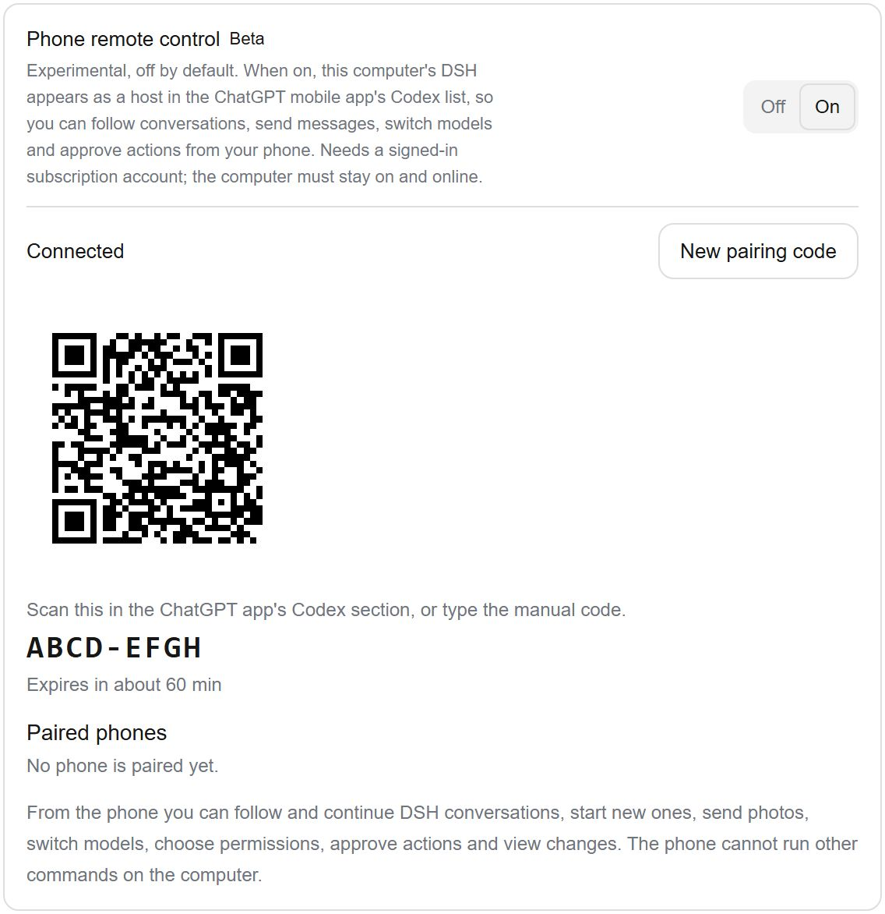</picture></p>

</details>

## All features

Model access and quota depend on your account.

<details>
<summary><b>Models and search</b> (14)</summary>
<br>

| Feature | What you can do | Availability / setup |
| --- | --- | --- |
| **Subscription sign-in** | Sign in to ChatGPT and use Codex subscription models without an API key | Normal chat needs no Codex CLI |
| **Model catalog sync** | Read available models and reasoning levels from your account, with manual refresh; the last successful catalog is stored locally per account and remains available during the background refresh after restart, with a 24-hour lifetime; models marked for retirement show their retirement date next to the model name, without automatically switching your selection | New models appear when your account offers them; the account catalog is the only source, so no models are shown when signed out or when neither a remote read nor a valid cache is available |
| **Model list** | Show or hide individual models in the composer picker on the Models page; the picker keeps DSH's own model labels (such as the new-model badge) | Display only; selected models and requests still work |
| **Default model** | Choose the model a new conversation opens with on the Models page | Writes the DSH default model setting, the same one a model switch inside a chat writes; unset it to follow the DSH default |
| **Default reasoning effort** | Choose a default level for subscription models on the Models page; Model default follows each model's official catalog recommendation | Manual choices take priority. Unsupported levels fall back to the model's valid default; existing manual conversation choices are preserved |
| **Reasoning levels** | Choose supported reasoning effort in the composer | Levels vary by model |
| **Speed tiers** | Switch supported models between Standard and Fast; Ultrafast (Beta) too when the account catalog offers it, with a lightning indicator | Standard by default; Fast and Ultrafast increase usage, and Ultrafast is Pro 500 only today |
| **Response verbosity** | Request short, medium, or detailed responses | Follows the model default unless changed |
| **Input image detail** | Choose Low, High, Original, or Auto detail for images sent to the chat model | Affects input tokens; Auto by default |
| **Subscription web search** | Auto, DSH, and Codex sources | Auto prefers the source matching the session model and tries the other only for missing credentials or an unavailable service. Explicit DSH / Codex choices fix the source and report failures directly. With Other models off, non-Codex chats use native DSH search only. The plugin neither rewrites DSH search settings nor adds a DeepSeek account fallback; native search charges depend on the selected service |
| **Other-models switch** | One switch that stops conversations on DeepSeek and other non-Codex models from using subscription web search, image generation and ChatGPT connectors | Settings → Codex subscription → Web & tools; on by default, Codex subscription models are not affected; phone remote control and voice are started by you and are not affected |
| **Search scope** | Choose live / cached search, disable search, or restrict domains | Configure under Web & tools, in the search source group |
| **Stream inactivity timeout** | Set how long a request can receive no streamed data before it is aborted | 10 minutes by default; not an overall response deadline |
| **Context budget** | Use standard, extended, or custom budgets per model | Limited by the model catalog |
| **GPT-Reserve** | Select the reserve model when your account offers it | Experimental; no promise of a separate reserve quota |

</details>

<details>
<summary><b>Accounts and quota</b> (10)</summary>
<br>

| Feature | What you can do | Availability / setup |
| --- | --- | --- |
| **Multiple accounts** | Add, switch, remove, or sign out of all accounts | Settings → Codex → Start |
| **Quota details** | View short / weekly windows, reset times, and separate quota groups | Only backend-provided windows and groups are shown |
| **Where the allowance went** | In the quota card, see each week's allowance split by model, surface, source and trigger | From the official usage report: approximate, may lag a day or two; hidden when the account has no report |
| **Usage overview** | In the quota card, see lifetime tokens, busiest day, streaks, most used reasoning level and a half-year daily heatmap | From the official usage statistics; hidden when the account has none |
| **Credits and reset cards** | View extra Credits, spending caps, and available reset cards | Shown when returned for your account |
| **Composer quota** | See remaining quota as a percentage or progress bar while chatting | Off by default; choose your display mode |
| **Runway estimate** | Hover over or click the composer quota to see when recent usage would exhaust it | Beta; optional estimate, not a guarantee |
| **Quota alerts** | Use fixed, early, or custom short / long-window thresholds | 20% remaining by default; can be disabled |
| **Redeem reset cards** | Use an available reset card after confirmation | Confirmation and waiting safeguards; server decides the result |
| **Retry after reset** | Wait for a confirmed short-window reset before continuing | Off by default; waiting can be stopped |

</details>

<details>
<summary><b>Images and sketching</b> (14)</summary>
<br>

| Feature | What you can do | Availability / setup |
| --- | --- | --- |
| **Image generation** | Generate through your subscription and adjust available request model / quality options; ask for a transparent-background PNG when needed | On by default, can be disabled |
| **Reference image editing** | Continue refining an image with references | On by default, can be disabled |
| **Image viewing and download** | Completed images appear after the answer without expanding tool activity; zoom, pan, fit to window, and download verified originals | Built-in viewer; older images may only have previews |
| **Region-based editing** | Mark regions, add notes, and continue editing with location references | Fills the composer for you to review and send |
| **Manual canvas** | Choose an aspect ratio and draw with pen, pencil, marker, and erasers | Beta; canvas off by default |
| **Shapes and text** | Draw lines, arrows, shapes, native curves, and editable text / objects | Available in the sketch canvas |
| **Gradients, blur, blend and clip** | Fill with linear / radial gradients; add blur (glow, shadow, haze), blend modes (multiply, screen, overlay, …) and shape clipping to a stroke; layers can have a blend mode too | All stay editable properties and survive moving, scaling, drafts and export; the agent gets the same through SVG gradients, `feGaussianBlur`, `mix-blend-mode` and `clip-path` |
| **Layers and image import** | Work in layers and bring images into the canvas | Images are managed as layers |
| **Smoothing and navigation** | Smooth complete strokes after release; pan, zoom, undo, and redo | Shortcuts can be customized or disabled |
| **Multiple drafts** | Save and reopen up to 20 local drafts | Stored in the current browser |
| **Import and export** | Export PNG, or native drafts that preserve editable strokes | Drafts can be imported again to keep editing |
| **Agent drawing** | Ask the agent to draw with `@sketch`, follow progress, and stop it; the agent can draw whole stages in SVG, imported as editable native strokes; with a reference it can compare side by side, read a difference heat map, zoom into a region, measure colours and edge positions, and undo, and every batch reports how the error changed | Beta; off by default, requires the canvas. The tools only measure and show; they never draw for the model |
| **Replay and video** | The Replay button redraws the process stroke by stroke (lines along their path, fills outlined first and then filled top to bottom), with speed presets and a scrubber, and records it as a WebM video | The video is previewed in the board and only saved when you click Save video; nothing downloads automatically |
| **Result preview for the model** | Return a canvas image after drawing for subsequent review | Beta; off by default, adds image input usage |

</details>

<details>
<summary><b>Advanced capabilities and maintenance</b> (9)</summary>
<br>

| Feature | What you can do | Availability / setup |
| --- | --- | --- |
| **Phone remote control** | Drive the DSH on your computer from the Codex section of the ChatGPT mobile app: start, continue and archive conversations, switch model and permissions, answer approvals and questions; DeepSeek and any other DSH model work | Beta; off by default; Settings → Codex → Phone & more → Phone remote control, pair by QR or manual code |
| **Codex independent subtasks** | Reuse subscription sign-in and workspace permissions; select allowed models and reasoning levels | Beta, optional, most people do not need it: by default DSH runs its own subagents (they can use subscription models too); install the optional component (about 377 MB on Windows) and turn on model selection under Plugins → Subagents only if you want subtasks run by the official Codex agent. It uses its own data directory and your subscription sign-in, never the Codex login on this computer |
| **Subtask component management** | Install, disable, or uninstall the official Codex subtask component from settings | Managed by supported DSH hosts; no extra login |
| **Cloud context compaction** | Continue long conversations using Codex compaction while retaining DSH history and native compaction | Beta / experimental; off by default, enabled requests use SSE |
| **WebSocket transport** | Experimentally reuse connections and context transfers, with SSE fallback on connection failure | Beta / experimental; SSE by default, no speed guarantee |
| **Codex reviewer for Auto review** | DSH Auto review judges tool calls with Codex's own review model; DSH keeps its review policy and allow/deny flow | Beta; off by default, applies when your account catalog offers the model |
| **ChatGPT connectors** | Let DeepSeek or any DSH model use the apps you connected in ChatGPT: GitHub, Gmail, Google Drive, Calendar and more; models search first, then call, and by default every change asks for your approval, switchable | Off by default, Settings → Codex → Web & tools → ChatGPT connectors; connect the apps in ChatGPT first |
| **Support diagnostics** | Inspect prerequisites and recent operation results, and copy a short report (about 1 KB; the full one can be copied separately) without credentials or conversation text | Settings → Codex → Phone & more; unverified does not mean broken |
| **Forecast cache cleanup** | Inspect and clear local quota forecast history | Keeps sign-in, drafts, originals, and shared dependencies |

</details>

### Reuse cache when changing effort

**Reuse cache when changing effort** is under **Settings → Codex → Models → Advanced**. It is on by default and can be turned off; saved Off choices are preserved. It applies only to standard, single-agent models explicitly supported by the current account catalog; support is never inferred from model names. Ordinary prompt caching is automatic and still works when this switch is off.

The request-level `reasoning.effort` stays at the current context window's initial value. Changes are recorded as `configuration_update` items in new history and replayed in their original positions. This can reduce cache invalidation when switching effort; it does not guarantee cache hits, faster replies or quota savings. The response-level effort can still report the initial value.

- **Cloud auto-compaction and Unlimited retries disable this feature.** The UI explains the conflict; your compaction, retry, authentication, connection and cache-key settings are never changed automatically.
- Successful responses save small, text-free state alongside DSH's existing replay metadata for restart, resume and forks. Successful local compaction changes the prefix; after checking DSH's committed history replacement, the plugin establishes a fresh baseline at the selected effort. Failed compaction keeps the previous state.
- Enabling an existing chat or returning to a supported model establishes a baseline only when the complete input matches DSH's native session history. The first request may lose the old cache. Unverifiable history, unsupported models, account changes and resource limits use ordinary requests with your selected effort.
- The same-process pending state freezes an already dispatched input even if it fails or is cancelled. Selecting a different effort for that exact retry reports an error; keep its original effort or send a new message. Failed attempts have no durable successful-response checkpoint, so preserving their cache prefix across a process restart or plugin reload is not guaranteed.
- Disabling restores ordinary requests without retrofitting updates into old logs. Update history is never sent to `/responses/compact`. Pro, multi-agent, automatic truncation and automatic compaction are not supported.
- The feature is bounded to 20,000 input items, 16 MiB of fingerprinted input/envelope data, 128 updates and 256 active/pending sessions. Boundary or history validation failures stop preservation, not your selected reasoning effort.

This uses configuration updates documented in OpenAI's [reasoning guide](https://developers.openai.com/api/docs/guides/reasoning); see [prompt caching](https://developers.openai.com/api/docs/guides/prompt-caching) for cache requirements. Support follows the current account catalog and actual responses. Backend parameter rejections are surfaced, never retried with an old effort or an API key.

## Update and uninstall

Find this plugin on the DSH **Plugins** page and use its update or uninstall action. Follow any restart instructions. Uninstalling this plugin does not remove other plugins.

<details>
<summary>Terminal commands</summary>

```sh
dsh plugin --profile web update dsh-codex-subscription@3.2.0
```

Run only when you want to uninstall:

```sh
dsh plugin --profile web remove dsh-codex-subscription
```

</details>

## Troubleshooting

<details>
<summary>How does this relate to the official Codex bundle (dsh-hooks-codex) in the plugin list?</summary>

They are unrelated and can be installed together. The official Codex / Claude Code bundles let DSH run Codex or Claude Code style hooks configs (scripts that run before and after tool calls). This plugin signs in with your ChatGPT subscription and provides Codex models, quota, search, images and phone remote control.

</details>

<details>
<summary>No dsh command on your computer?</summary>

Use **Plugins → Add plugin** in DSH and paste the package name. No terminal setup is needed.

</details>

<details>
<summary>Multiple DSH installations, or a missing plugin?</summary>

Install from the DSH you actually use. For terminal installation, run commands in the intended DSH environment and check its profile. Do not delete profiles or change your system PATH to force an install.

</details>

<details>
<summary>How do I report a problem?</summary>

Generate **Support diagnostics** under **Settings → Codex → Phone & more**, paste it into the [bug report form](https://github.com/WSL043/dsh-codex-subscription/issues/new?template=install-problem.yml), and include the steps that caused the problem.

Diagnostics exclude credentials, account identifiers, raw responses, and full logs. Never attach sign-in URLs, authorization codes, or browser callback addresses.

</details>

<details>
<summary>Do I need the Codex command line?</summary>

Not for ordinary subscription chat. Only if you want **Codex independent subtasks**: use "Install component" under Settings → Codex subscription → Web & tools; disabling and uninstalling are in the same place. Other experimental options are opt-in. [Optional components, storage cleanup and the full guide →](docs/GUIDE.en.md)

</details>

<a id="positioning-and-boundaries"></a>
<a id="scope-and-support"></a>

## Project and support

- **ChatGPT / Codex subscription only**, done in depth: quota and forecasting, images and sketches, subtasks, diagnostics. Other subscriptions such as Claude or Grok are out of scope.
- **Fail explicitly**: requests never silently fall back to another paid route, and quota windows the account does not return are never invented.
- **Tracks official DSH releases**: every release is accepted end to end (install, start, remove, reinstall) against official DSH channels such as latest and next; verified versions are recorded in the [compatibility notes](docs/dsh-020-compatibility.md).
- Models, quota and features depend on what your account actually returns; the ChatGPT backend and DSH can change independently.

This community project is not affiliated with or endorsed by DeepSeek or OpenAI.

- Use the [bug report form](https://github.com/WSL043/dsh-codex-subscription/issues/new?template=install-problem.yml) for project feedback.
- Use the [feature request form](https://github.com/WSL043/dsh-codex-subscription/issues/new?template=feature-request.yml) for focused product suggestions.
- Focused fixes and compatibility improvements are welcome; see [CONTRIBUTING.md](CONTRIBUTING.md).
- For DSH plugin discussion, visit [DeepSeek Harness Discussions](https://github.com/deepseek-ai/deepseek-harness/discussions).
- Read [SECURITY.md](SECURITY.md) before reporting sensitive issues.

If this project is useful, the [Star button](https://github.com/WSL043/dsh-codex-subscription/stargazers) helps more DSH users find it.

<a href="https://star-history.com/#WSL043/dsh-codex-subscription&Date">
  <picture>
    <source media="(prefers-color-scheme: dark)" srcset="https://api.star-history.com/svg?repos=WSL043/dsh-codex-subscription&type=Date&theme=dark" />
    
  </picture>
</a>

[简体中文](README.md) · [MIT](LICENSE)
