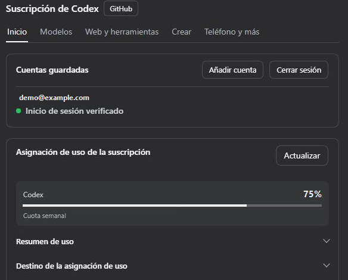
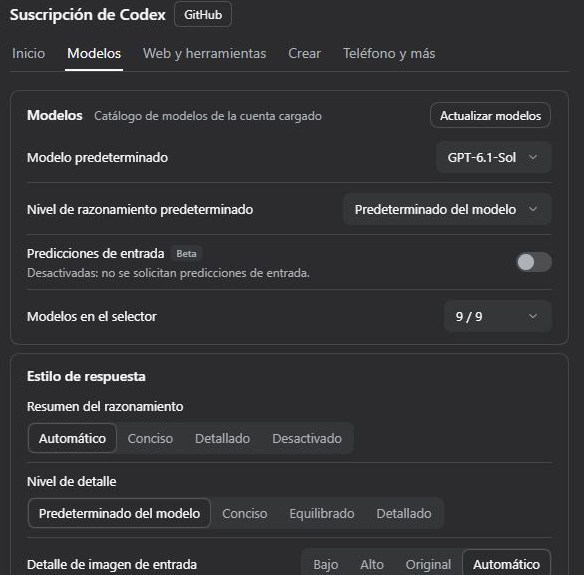

<p align="center"></p>

<div align="center">

# DSH Codex Subscription

[中文](README.md) · [English](README.en.md) · [日本語](README.ja.md) · **Español** · [Français](README.fr.md) · [Deutsch](README.de.md) · [Русский](README.ru.md) · [Português](README.pt.md)

**Usa tu suscripción de ChatGPT / Codex directamente en DeepSeek Harness**

Inicia sesión con ChatGPT Plus / Pro para usar GPT-6 y otros modelos de Codex, la cuota, la búsqueda web y la generación de imágenes dentro de DSH. No se necesita una clave de API de OpenAI ni Codex CLI.

[](https://github.com/WSL043/dsh-codex-subscription/actions/workflows/ci.yml)
[](https://www.npmjs.com/package/dsh-codex-subscription)
[](https://www.npmjs.com/package/dsh-codex-subscription)
[](LICENSE)
[](https://github.com/WSL043/dsh-codex-subscription/stargazers)

[Aspectos destacados](#highlights) · [Instalación](#install) · [Imágenes y bocetos](#images-and-sketching) · [Control remoto desde el teléfono](#phone-remote-control-beta) · [Todas las funciones](#all-features) · [Guía del usuario (en inglés)](docs/GUIDE.en.md) · [Solución de problemas (en inglés)](#troubleshooting) · [Agent](#agent-reference)

</div>

<p align="center"></p>

<a id="highlights"></a>

## Aspectos destacados

| Lo que quieres hacer | Lo que ofrece el complemento |
| --- | --- |
| **Chatear y buscar** | Inicia sesión con tu suscripción; elige entre los modelos de Codex, los niveles de razonamiento y los niveles de velocidad que ofrece tu cuenta; usa la búsqueda web de la suscripción. |
| **Gestionar cuentas y cuota** | Cambia de cuenta, consulta la cuota de periodos cortos y semanal, los créditos y los restablecimientos; consulta el historial de uso y las alertas de cuota opcionales en el cuadro de entrada. |
| **Crear y editar imágenes** | Genera imágenes, marca regiones para editarlas o dibuja manualmente y con el agente en un tablero de bocetos editable. [Ver ejemplos →](#images-and-sketching) |
| **Continuar desde tu teléfono** | Empareja la aplicación móvil de ChatGPT para controlar este equipo con DSH. DeepSeek y otros modelos de DSH también funcionan. [Beta, desactivado de forma predeterminada →](#phone-remote-control-beta) |
| **Usar aplicaciones conectadas** | Permite que los modelos de DSH usen las aplicaciones conectadas en ChatGPT, como GitHub, Gmail, Drive y Calendar; la aprobación de escritura depende de los permisos de la sesión de DSH. |

Los modelos y la cuota dependen de lo que devuelva tu cuenta. [Lista completa de funciones →](#all-features)

<details>
<summary>Usa las funciones de la suscripción con DeepSeek y otros modelos</summary>

Permite que DeepSeek o cualquier otro modelo de DSH use las aplicaciones que conectaste en ChatGPT: GitHub, Gmail, Google Drive, Calendar y más. Los modelos primero buscan y luego realizan la acción; la aprobación de escritura depende del modo y los permisos de la sesión de DSH. Está desactivado de forma predeterminada; actívalo en Web y herramientas.

La búsqueda web y la lectura de páginas web como fuentes, los conectores de ChatGPT y las subtareas independientes oficiales de Codex están en **Configuración → Suscripción de Codex → Web y herramientas**, con un interruptor general en la parte superior: cuando está desactivado, las conversaciones con DeepSeek y otros modelos que no son de Codex dejan de usar la búsqueda web de la suscripción (se usa la búsqueda de DSH en su lugar), la generación de imágenes o los conectores de ChatGPT; los modelos de la suscripción de Codex no se ven afectados. Está activado de forma predeterminada.

<p align="center"><picture><source media="(prefers-color-scheme: dark)" srcset="docs/assets/ui-interop-en-dark.webp"></picture></p>

</details>

<a id="prepare-dsh"></a>

## Preparar DSH

Verificado con DSH `0.2.2-rc.1`; `0.2.1-rc.3` y `0.2.1-rc.2` siguen siendo compatibles; la versión mínima compatible es `0.1.7-rc.2`. Actualiza primero las versiones anteriores de DSH.

Se verificó el funcionamiento de la aplicación oficial DSH Desktop `0.2.2-rc.2`.

La CLI/Web de DSH `0.2.2-rc.1` requiere Node.js **24.9 o posterior**; la aplicación oficial de escritorio usa el entorno de ejecución incluido.

También es compatible con el host de vista previa `0.2.2-alpha.2`. Consulta las [notas de compatibilidad (en inglés)](docs/archive/dsh-022-alpha2-compatibility.md) para conocer el alcance y los límites de validación.

Este complemento es compatible con la versión más reciente de DeepSeek Harness indicada en los metadatos de su paquete y requiere una cuenta de ChatGPT que tenga acceso a Codex en este momento.

<details>
<summary>Elige una distribución de DSH</summary>

- **Recomendado: la aplicación oficial de escritorio.** DeepSeek ya ofrece una [aplicación de escritorio de DeepSeek Harness](https://www.deepseek.com/harness/) (macOS con Apple Silicon y Windows de 64 bits; versión preliminar, de código abierto). No requiere configurar Node.js: instálala y luego añade este complemento desde la página Complementos como se describe a continuación. La aplicación de escritorio, la aplicación web y la CLI comparten un único sistema de complementos de DSH; las pruebas de aceptación integrales de este complemento se realizan principalmente en la aplicación web, así que [abre un informe de error](https://github.com/WSL043/dsh-codex-subscription/issues) si la aplicación de escritorio no funciona correctamente.
- ¿Necesitas Linux o prefieres una versión portátil de la comunidad? Usa [DSH-Portable](https://github.com/WSL043/DSH-Portable), una distribución portátil de escritorio de la comunidad para Windows, macOS y Linux.
- ¿Prefieres la vía oficial? Sigue la [guía de ejecución de DeepSeek Harness (en inglés)](https://github.com/deepseek-ai/deepseek-harness#run).

</details>

<a id="install"></a>

## Instalar

<a id="install-from-the-plugins-page-recommended"></a>

### Instalar desde la página Plugins (recomendado)

1. En DSH, abre **Plugins → Añadir complemento**.
2. Pega el nombre de este paquete, incluida su versión, en el campo **Nombre o dirección del paquete**:

   ```text
   dsh-codex-subscription@3.2.16
   ```

3. Haz clic en **Instalar** y espera a que termine. Sigue las instrucciones de la página; guarda tu trabajo antes de reiniciar si se te solicita.
4. Abre **Configuración → Codex**, inicia sesión en ChatGPT y luego selecciona un modelo de Codex en la conversación.

<details>
<summary>¿Por qué se incluye la versión?</summary>

Por qué se incluye la versión: la página de complementos de DSH solo instala versiones que tienen al menos 24 horas, así que durante el primer día después de una nueva publicación, el nombre del paquete sin versión puede instalar una versión anterior, que quizá no sea compatible con tu DSH. Al indicar la versión, obtienes exactamente esta versión; un día después de su publicación, `dsh-codex-subscription` sin versión también resuelve a la última versión estable. Encontrarás otros números de versión en la [página de versiones (en inglés)](https://github.com/WSL043/dsh-codex-subscription/releases).

</details>

<details>
<summary>Instalación desde la terminal (con un comando dsh existente)</summary>

```sh
dsh plugin --profile web add dsh-codex-subscription@3.2.16
```

Sigue las instrucciones para reiniciar y luego inicia sesión en **Configuración → Codex**. Tanto la página Complementos como la terminal usan la administración de instalaciones de DSH.

</details>

<details>
<summary>Tareas sin interfaz gráfica</summary>

Después de iniciar sesión y seleccionar un modelo de Codex en Web, instala el mismo complemento en el perfil Headless:

```sh
dsh plugin --profile headless add dsh-codex-subscription@3.2.16
dsh --profile headless "Reply with only the word: ok"
```

</details>

<a id="interface-demo"></a>

## Demostración de la interfaz

Conecta tu cuenta de ChatGPT, elige un modelo de Codex en DSH y consulta la cuota de tu suscripción desde los ajustes.

<details>
<summary>Iniciar sesión y consultar la cuota</summary>

Abre **Ajustes → Codex → Inicio** y selecciona **Iniciar sesión en el navegador**. Tras conectarte, se muestran las cuentas guardadas y la cuota que indica ChatGPT. Despliega el resumen o el desglose de uso para consultar más detalles.

<p align="center"></p>

_La cuenta y los valores de cuota son ejemplos._

</details>

<details>
<summary>Elegir un modelo de Codex y enviar un mensaje</summary>

En **Ajustes → Codex → Modelos** puedes elegir el modelo y el nivel de razonamiento predeterminados. Usa el selector junto al campo de entrada para cambiar de modelo en una conversación. Escribe y envía un mensaje para usar tu suscripción en DSH.

<p align="center"></p>

</details>

<details>
<summary>¿Qué controla cada pestaña de configuración?</summary>

| Pestaña de configuración | Qué controla |
| --- | --- |
| **Inicio** | Inicio de sesión y cuentas, un interruptor para cada función, cuota de la suscripción, visualización de la cuota y alertas |
| **Modelos** | Modelo predeterminado, nivel de razonamiento predeterminado y lista de modelos, estilo de respuesta; el grupo avanzado contraído contiene la longitud del contexto, los reintentos, el modo de conexión, la compactación en la nube y el modelo de revisión |
| **Web y herramientas** | El interruptor general para otros modelos, la fuente de búsqueda, los conectores de ChatGPT y las subtareas independientes oficiales de Codex |
| **Crear** | Generación y edición de imágenes, @image en el cuadro de entrada, visor de imágenes, tablero de bocetos y dibujo del agente |
| **Teléfono y más** | Control remoto desde el teléfono, llamadas de voz experimentales, caché local y diagnósticos de soporte |

La conversación por voz está desactivada de forma predeterminada. Actívala en **Teléfono y más** y, luego, inicia una llamada desde el cuadro de entrada del mensaje. Si una ventana nativa, incluida la de Linux, no es compatible con WebRTC, DSH ofrece continuar la misma conversación en un navegador. Las muestras de voz siguen estando disponibles y se utiliza tu suscripción existente sin una clave de API.

**Contexto adaptado al modelo** sigue el directorio de modelos de tu cuenta; al actualizarlo, se conserva el borrador sin guardar. La configuración muestra la ventana sin procesar; los presupuestos de conversación reservan margen según el porcentaje oficial (5 % si se omite) y, después, DSH administra las reservas de salida y la compactación. No hace falta restar nada manualmente. Los grupos de cuotas usan los valores proporcionados por el backend, incluidos los segmentos separados, como Spark.

Los fallos de la suscripción siguen siendo visibles: no hay cambios silenciosos a otra opción de pago.

</details>

<a id="images-and-sketching"></a>

## Imágenes y bocetos

Genera imágenes con tu suscripción, visualiza y descarga los originales o marca una región y añade notas para seguir editándola. La generación y edición de imágenes se controlan en **Configuración → Codex → Crear**.

<details>
<summary>Anotación de imágenes y edición posterior</summary>

<p align="center"></p>

</details>

<details>
<summary>Ver la configuración de Imágenes y bocetos</summary>

<p align="center"><picture><source media="(prefers-color-scheme: dark)" srcset="docs/assets/ui-creative-en-dark.png"></picture></p>

La configuración se muestra directamente como capturas recortadas de la interfaz real de DSH, con el tema claro u oscuro correspondiente.

</details>

<a id="sketch-board-beta"></a>

### Pizarra de bocetos (Beta)

La pizarra de bocetos y el dibujo del Agente están en **Beta** y desactivados de forma predeterminada; actívalos en la página Crear. Dibuja a mano desde el botón de bocetos del cuadro de entrada del mensaje o envía `@sketch` con una solicitud para que dibuje el Agente.

La pizarra admite capas, curvas nativas, pinceles, degradados, desenfoque, modos de fusión, recorte, deshacer/rehacer y atajos. Guarda varios borradores y exporta PNG o borradores editables. Con una referencia, el Agente puede comparar imágenes, medir colores y posiciones y deshacer acciones. Los dibujos terminados se pueden reproducir y grabar como vídeo.

<details>
<summary>Ejemplo de dibujo del Agente: chica ballena</summary>

Los agentes dibujaron estos ejemplos en la pizarra de bocetos con trazos nativos editables, sin recurrir a la generación de imágenes. Los tres usaron la misma referencia y la misma configuración de herramientas de dibujo. Son ejecuciones individuales con distintos niveles de razonamiento y duraciones.

<p align="center"><b>Imagen de referencia</b><br></p>

<table>
<tr><th width="33%">GPT-6-Astra</th><th width="33%">GPT-6.1-Sol</th><th width="33%">DeepSeek Flash</th></tr>
<tr><td></td><td></td><td></td></tr>
<tr><td>Medio · 20 min 57 s<br>686 trazos</td><td>Alto · primer turno: 23 min<br>1,020 trazos</td><td>Alto · 9 min 33 s<br>623 trazos</td></tr>
</table>

Tras una interrupción de la conexión, el dibujo de 6.1 se restauró a partir del guardado automático y de las llamadas originales que se completaron correctamente. Luego, el modelo comprobó la vista previa y la guardó, sin añadir ningún dibujo manual. No fue una ejecución ininterrumpida que concluyera correctamente.

</details>

<details>
<summary>Del boceto a la imagen generada: torre del reloj y paisaje azul verdoso</summary>

El Agente primero dibujó un boceto editable y luego lo usó como referencia para generar una imagen con la suscripción. Sol y Astra, a continuación, son los nombres de los modelos de conversación que dirigen el flujo de trabajo, no del backend de generación de imágenes.

**Corte de la torre del reloj**

<table>
<tr><th>Modelo de conversación</th><th width="43%">Boceto del Agente</th><th width="43%">Generada a partir del boceto</th></tr>
<tr><td>GPT-6.1-Sol<br>Xhigh</td><td></td><td></td></tr>
<tr><td>GPT-6-Astra<br>Low</td><td></td><td></td></tr>
</table>

**Paisaje azul verdoso**

<table>
<tr><th>Modelo de conversación</th><th width="43%">Boceto del Agente</th><th width="43%">Generada a partir del boceto</th></tr>
<tr><td>GPT-6.1-Sol<br>Xhigh</td><td></td><td></td></tr>
<tr><td>GPT-6-Astra<br>Low</td><td></td><td></td></tr>
</table>

</details>

[Edición de imágenes y almacenamiento de borradores →](docs/GUIDE.en.md#image-generation-and-editing)

<a id="phone-remote-control-beta"></a>

## Control remoto desde el teléfono (Beta)

Vincula la sección Codex de la aplicación móvil ChatGPT con DSH en tu computadora. Inicia o continúa conversaciones, usa herramientas y gestiona aprobaciones desde el teléfono, con DeepSeek o cualquier otro modelo de DSH.

**Desactivado de forma predeterminada.** Actívalo en **Configuración → Codex → Teléfono y más → Control remoto desde el teléfono** y vincula mediante un código QR o un código manual. Tu computadora debe permanecer encendida, conectada a Internet y con DSH en ejecución.

Esta es una capa de compatibilidad de terceros que utiliza el servicio de conexión remota de OpenAI. Existe el control remoto oficial de Codex, pero OpenAI no garantiza explícitamente la compatibilidad con el host de DSH y esta podría cambiar con las actualizaciones del servicio. Puedes quitar los dispositivos vinculados o desactivarla en cualquier momento.

<details>
<summary>Operaciones compatibles desde el teléfono</summary>

- seguir, iniciar, continuar, interrumpir y archivar conversaciones; buscar conversaciones y palabras clave dentro de una conversación;
- cambiar el modelo, el nivel de razonamiento y los permisos (escritura en el espacio de trabajo / acceso completo);
- las aprobaciones y preguntas aparecen en el teléfono; si se desconecta, vuelven a aparecer cuando lo abres de nuevo; de lo contrario, regresan a la computadora;
- las respuestas aparecen a medida que se escriben; los comandos, las ediciones de archivos con diferencias, la lista de tareas, las búsquedas web, las llamadas a conectores y las imágenes generadas se muestran en las vistas nativas del teléfono;
- enviar fotos, buscar archivos en la computadora con @, elegir habilidades de DSH con /, ver cambios con git de solo lectura e iniciar chats desde un selector de carpetas real;
- los espacios de trabajo de DSH aparecen como proyectos; bifurcar una conversación, consultar los límites de uso, el uso acumulado y el uso del contexto; cuando DSH admita `/compact`, compactar el contexto desde el teléfono;
- los errores del modelo se muestran en el teléfono; los teléfonos vinculados aparecen en la configuración y se pueden quitar.

</details>

<details>
<summary>Configuración de vinculación y teléfonos vinculados</summary>

<p align="center"><picture><source media="(prefers-color-scheme: dark)" srcset="docs/assets/ui-remote-en-dark.png"></picture></p>

</details>

<a id="all-features"></a>

## Todas las funciones

El acceso a los modelos y las cuotas dependen de tu cuenta.

<details>
<summary><b>Modelos y búsqueda</b></summary>

Elige el modelo según la tarea, el razonamiento según el análisis necesario y la velocidad según el ritmo de ejecución que admita el modelo. El nivel de detalle orienta la respuesta. En **Web y herramientas**, usa la búsqueda para encontrar páginas y la lectura para abrir una URL conocida.

| Función | Qué puedes hacer | Disponibilidad / configuración |
| --- | --- | --- |
| **Inicio de sesión de la suscripción** | Inicia sesión en ChatGPT y usa modelos de la suscripción de Codex sin una clave de API | El chat normal no requiere Codex CLI |
| **Sincronización del catálogo de modelos** | Lee los modelos y niveles de razonamiento disponibles en tu cuenta, con actualización manual; el último catálogo sincronizado correctamente se guarda localmente por cuenta y permanece disponible durante la actualización en segundo plano tras reiniciar, con una vigencia de 24 horas; los modelos marcados para retirarse muestran la fecha de retirada junto al nombre, sin cambiar automáticamente tu selección | Aparecen modelos nuevos cuando tu cuenta los ofrece; el catálogo de la cuenta es la única fuente, por lo que no se muestra ningún modelo si no has iniciado sesión o no hay disponible una lectura remota ni una caché válida |
| **Lista de modelos** | Muestra u oculta modelos individuales en el selector del cuadro de redacción, en la página Modelos; el selector conserva las etiquetas de modelo propias de DSH (como la insignia de modelo nuevo) | Solo afecta a la visualización; los modelos seleccionados y las solicitudes siguen funcionando |
| **Menú de modelos del cuadro de entrada** | Automático cede el sitio a otros selectores y muestra el menú de suscripción cuando funciona solo. DSH estándar deja el menú al anfitrión u otro complemento. | Se configura en Modelos. Selecciona Suscripción para utilizar su menú y los controles de velocidad compatibles. Las preferencias guardadas se conservan. |
| **Predicciones de entrada (Beta)** | Tras una respuesta completa, el cuadro de texto vacío puede sugerir otro mensaje. Pulsa Tab para insertarlo en un borrador editable. | Desactivadas por defecto en Modelos. Solo funcionan con modelos Codex compatibles y con acceso habilitado. Las solicitudes pueden consumir cuota. |
| **Modelo predeterminado** | Elige en la página Modelos el modelo con el que se abre una conversación nueva | Escribe el ajuste de modelo predeterminado de DSH, el mismo que se escribe al cambiar de modelo dentro de un chat; borra este ajuste para seguir el modelo predeterminado de DSH |
| **Nivel de razonamiento predeterminado** | Elige en la página Modelos un nivel predeterminado para los modelos de suscripción; «Predeterminado del modelo» sigue la recomendación del catálogo oficial de cada modelo | Las opciones manuales tienen prioridad. Los niveles no compatibles recurren al nivel predeterminado válido del modelo; se conservan las opciones manuales existentes de las conversaciones |
| **Niveles de razonamiento** | Elige en el cuadro de redacción un nivel de razonamiento compatible | Los niveles varían según el modelo |
| **Razonamiento Ultra** | Permite a DSH delegar trabajo independiente en subtareas nativas con el nivel de razonamiento compatible del modelo. | Disponible si el modelo y la configuración del agente lo admiten. Ultrafast es un nivel de velocidad. |
| **Niveles de velocidad** | Cambia los modelos compatibles entre Estándar y Rápido; también Ultrarrápido (Beta) cuando el catálogo de la cuenta lo ofrece, indicado con un rayo | Estándar de forma predeterminada; Rápido y Ultrarrápido aumentan el uso, y actualmente Ultrarrápido solo está disponible con Pro 500 |
| **Extensión de las respuestas** | Solicita respuestas breves, medias o detalladas | Sigue el valor predeterminado del modelo, salvo que lo cambies |
| **Detalle de imagen de entrada** | Elige el nivel de detalle Bajo, Alto, Original o Automático para las imágenes enviadas al modelo de chat | Afecta a los tokens de entrada; Automático de forma predeterminada |
| **Búsqueda web de la suscripción** | Fuentes Automático, DSH y Codex | Automático prefiere la fuente que coincide con el modelo de la sesión y prueba la otra solo si faltan credenciales o el servicio no está disponible. Las opciones explícitas DSH / Codex fijan la fuente e informan directamente de los errores. Si Otros modelos está desactivado, los chats que no sean de Codex solo usan la búsqueda nativa de DSH. El plugin no reescribe los ajustes de búsqueda de DSH ni añade una alternativa con una cuenta de DeepSeek; los cargos de la búsqueda nativa dependen del servicio seleccionado |
| **Fuente de lectura de páginas web** | Elige cómo leer una URL conocida, con independencia de la fuente de búsqueda. | En Web y herramientas. DSH es la opción predeterminada. Codex requiere un anfitrión compatible y muestra los fallos de lectura. |
| **Interruptor para otros modelos** | Un solo interruptor impide que las conversaciones con DeepSeek y otros modelos que no sean de Codex usen la búsqueda web de la suscripción, la generación de imágenes y los conectores de ChatGPT | Configuración → Suscripción de Codex → Web y herramientas; activado de forma predeterminada, no afecta a los modelos de suscripción de Codex; el control remoto desde el teléfono y la voz los inicias tú y no se ven afectados |
| **Ámbito de búsqueda** | Elige entre búsqueda en directo o en caché, desactiva la búsqueda o limita los dominios | Configúralo en Web y herramientas, en el grupo de fuentes de búsqueda |
| **Tiempo de espera por inactividad de la transmisión** | Establece cuánto tiempo puede no recibir datos transmitidos una solicitud antes de cancelarse | 10 minutos de forma predeterminada; no es un límite de tiempo total para la respuesta |
| **Presupuesto de contexto** | Usa presupuestos estándar, ampliados o personalizados por modelo | Limitado por el catálogo de modelos |
| **GPT-Reserve** | Selecciona el modelo de reserva cuando tu cuenta lo ofrece | Experimental; no se garantiza una cuota de reserva separada |

</details>

<details>
<summary><b>Cuentas y cuota</b></summary>

En **Inicio → Cuota de suscripción** puedes ver cuánto queda y cuándo se restablece. Los períodos corto y semanal pueden aplicarse a la vez. El desglose muestra uso pasado y la previsión estima cuánto durará la cuota al ritmo reciente. Activa la cuota del cuadro de texto para verla durante el chat.

| Función | Qué puedes hacer | Disponibilidad / configuración |
| --- | --- | --- |
| **Varias cuentas** | Añade cuentas, cambia entre ellas, elimínalas o cierra sesión en todas | Settings → Codex → Start |
| **Detalles de la cuota** | Consulta los periodos corto y semanal, las horas de restablecimiento y los grupos de cuota separados | Solo se muestran los periodos y grupos que proporciona el backend |
| **En qué se ha usado la cuota** | En la tarjeta de cuota, consulta el desglose de la cuota semanal por modelo, superficie, fuente y desencadenante | Procede del informe de uso oficial: es aproximado y puede tener uno o dos días de retraso; se oculta si la cuenta no tiene ningún informe |
| **Resumen de uso** | En la tarjeta de cuota, consulta los tokens acumulados, el día de mayor actividad, las rachas, el nivel de razonamiento más usado y un mapa de actividad diaria de los últimos seis meses | Procede de las estadísticas de uso oficiales; se oculta si la cuenta no tiene ninguna |
| **Créditos y tarjetas de restablecimiento** | Consulta los créditos adicionales, los límites de gasto y las tarjetas de restablecimiento disponibles | Se muestran cuando se proporcionan para tu cuenta |
| **Cuota en el cuadro de redacción** | Consulta la cuota restante como porcentaje o barra de progreso mientras chateas | Desactivada de forma predeterminada; elige cómo mostrarla |
| **Estimación de autonomía** | Pasa el cursor por encima de la cuota del cuadro de redacción o haz clic en ella para ver cuándo se agotaría según el uso reciente | Beta; estimación opcional, no es una garantía |
| **Alertas de cuota** | Usa umbrales fijos, anticipados o personalizados para los periodos corto y largo | 20 % restante de forma predeterminada; se pueden desactivar |
| **Canjear tarjetas de restablecimiento** | Usa una tarjeta de restablecimiento disponible tras confirmar | Incluye confirmación y medidas de seguridad durante la espera; el servidor determina el resultado |
| **Reintentar tras el restablecimiento** | Espera a que se confirme el restablecimiento del periodo corto antes de continuar | Desactivado de forma predeterminada; se puede detener la espera |

</details>

<details>
<summary><b>Imágenes y bocetos</b></summary>

Genera una imagen nueva o indica una edición concreta con una referencia o un comentario. Cerrar el visor guarda las marcas. **Añadir al cuadro de entrada** las pone en un borrador que puedes revisar antes de enviar. Exporta PNG para compartir o un borrador nativo para conservar capas y trazos editables.

| Función | Qué puedes hacer | Disponibilidad / configuración |
| --- | --- | --- |
| **Generación de imágenes** | Genera imágenes con tu suscripción y ajusta las opciones disponibles de modelo y calidad de la solicitud; si lo necesitas, pide un PNG con fondo transparente | Activada de forma predeterminada; se puede desactivar |
| **Edición de imágenes de referencia** | Sigue perfeccionando una imagen con imágenes de referencia | Activada de forma predeterminada; se puede desactivar |
| **Visualización y descarga de imágenes** | Las imágenes terminadas aparecen después de la respuesta sin expandir la actividad de las herramientas; amplía, desplaza, ajusta a la ventana y descarga los originales verificados | Visor integrado; las imágenes antiguas quizá solo tengan vistas previas |
| **Edición por regiones** | Marca regiones, añade notas y continúa editando con referencias de ubicación | Rellena el cuadro de redacción para que lo revises y envíes |
| **Lienzo manual** | Elige una relación de aspecto y dibuja con pluma, lápiz, marcador y borradores | Beta; el lienzo está desactivado de forma predeterminada |
| **Formas y texto** | Dibuja líneas, flechas, formas, curvas nativas y texto u objetos editables | Disponible en el lienzo de bocetos |
| **Degradados, desenfoque, modos de fusión y recorte** | Rellenar con degradados lineales o radiales; añadir desenfoque (resplandor, sombra, neblina), modos de fusión (multiplicar, trama, superponer, …) y recorte de formas a un trazo; las capas también pueden tener un modo de fusión | Todo sigue siendo propiedades editables y se conserva al mover, escalar, hacer borradores y exportar; el agente obtiene lo mismo mediante degradados SVG, `feGaussianBlur`, `mix-blend-mode` y `clip-path` |
| **Capas e importación de imágenes** | Trabajar con capas e incorporar imágenes al lienzo | Las imágenes se gestionan como capas |
| **Suavizado y navegación** | Suavizar trazos completos al soltarlos; desplazar, ampliar, reducir, deshacer y rehacer | Los atajos se pueden personalizar o desactivar |
| **Varios borradores** | Guardar y volver a abrir hasta 20 borradores locales | Se almacenan en el navegador actual |
| **Importación y exportación** | Exportar PNG o borradores nativos que conservan los trazos editables | Los borradores se pueden volver a importar para seguir editándolos |
| **Dibujo del agente** | Pedir al agente que dibuje con `@sketch`, seguir el progreso y detenerlo; el agente puede dibujar etapas completas en SVG, que se importan como trazos nativos editables; con una referencia, puede comparar en paralelo, consultar un mapa de calor de diferencias, ampliar una región, medir colores y posiciones de bordes, y deshacer; cada grupo de trazos informa cómo cambió el error | Beta; desactivado de forma predeterminada, requiere el lienzo. Las herramientas solo miden y muestran; nunca dibujan por el modelo |
| **Reproducción y vídeo** | El botón Reproducir vuelve a dibujar el proceso trazo a trazo (las líneas siguen su recorrido; primero se delinean los rellenos y luego se rellenan de arriba abajo), con ajustes preestablecidos de velocidad y un control deslizante de reproducción, y lo graba como vídeo WebM | El vídeo se previsualiza en el tablero y solo se guarda al hacer clic en Guardar vídeo; no se descarga nada automáticamente |
| **Vista previa del resultado para el modelo** | Devolver una imagen del lienzo después de dibujar para que se revise posteriormente | Beta; desactivado de forma predeterminada, añade uso de entrada de imágenes |

</details>

<a id="codex-subtask-runtime"></a>

<details>
<summary><b>Funciones avanzadas y mantenimiento</b></summary>

El control remoto conecta la app móvil de ChatGPT con DSH en ejecución. Las llamadas permiten hablar en una conversación y las subtareas delegan parte del trabajo. Si algo falla, revisa **Teléfono y más → Diagnóstico de soporte** para ver qué requisito u operación reciente se ha comprobado.

| Función | Qué puedes hacer | Disponibilidad / configuración |
| --- | --- | --- |
| **Control remoto desde el teléfono** | Controlar el DSH de tu ordenador desde la sección Codex de la aplicación móvil de ChatGPT: iniciar, continuar y archivar conversaciones, cambiar el modelo y los permisos, responder a aprobaciones y preguntas; DeepSeek y cualquier otro modelo de DSH también funcionan | Beta; desactivado de forma predeterminada; Configuración → Codex → Teléfono y más → Control remoto desde el teléfono; emparejar mediante QR o código manual |
| **Conversación por voz (Beta)** | Inicia una llamada desde el cuadro de texto. Si la ventana nativa no admite WebRTC, puedes usar un navegador. | Desactivada por defecto en Teléfono y más. Concede acceso al micrófono cuando se te pida. |
| **Subtareas independientes de Codex** | Reutilizar el inicio de sesión de la suscripción y los permisos del espacio de trabajo; seleccionar modelos y niveles de razonamiento permitidos | Beta, opcional; la mayoría de las personas no lo necesita: de forma predeterminada, DSH ejecuta sus propios subagentes (que también pueden usar modelos de suscripción); instala el componente opcional (incluye un Codex CLI exclusivo del complemento) y activa la selección de modelos en Complementos → Subagentes solo si quieres que el agente oficial de Codex ejecute las subtareas. Usa su propio directorio de datos y el inicio de sesión de tu suscripción, nunca el inicio de sesión de Codex de este ordenador |
| **Gestión del componente de subtareas** | Instalar, desactivar o desinstalar desde la configuración el componente oficial de subtareas de Codex | Lo administran los hosts de DSH compatibles; no requiere inicio de sesión adicional |
| **Compactación del contexto en la nube** | Continuar conversaciones largas con la compactación de Codex y conservar el historial de DSH y la compactación nativa | Beta / experimental; desactivada de forma predeterminada; cuando está activada, las solicitudes usan SSE |
| **Transporte WebSocket** | Reutilizar conexiones y transferencias de contexto de forma experimental, con SSE como alternativa si falla la conexión | Beta / experimental; SSE de forma predeterminada, sin garantía de velocidad |
| **Revisor de Codex para la revisión automática** | La función de revisión automática de DSH evalúa las llamadas a herramientas con el modelo de revisión propio de Codex; DSH conserva su política de revisión y el flujo de permitir o denegar | Beta; desactivado de forma predeterminada; se aplica cuando el catálogo de tu cuenta ofrece el modelo |
| **Conectores de ChatGPT** | Permitir que DeepSeek o cualquier modelo de DSH use las aplicaciones que conectaste en ChatGPT: GitHub, Gmail, Google Drive, Calendar y más; los modelos primero buscan y después realizan acciones; la aprobación de escritura depende del modo y los permisos de la sesión de DSH | Desactivados de forma predeterminada; Configuración → Codex → Web y herramientas → Conectores de ChatGPT; primero conecta las aplicaciones en ChatGPT |
| **Diagnósticos de soporte** | Revisar los requisitos previos y los resultados de operaciones recientes, y copiar un informe breve (de unos 1 KB; también se puede copiar por separado el informe completo) sin credenciales ni texto de conversaciones | Configuración → Codex → Teléfono y más; que no esté verificado no significa que esté averiado |
| **Limpieza de la caché de previsiones** | Revisar y borrar el historial local de previsiones de cuota | Conserva el inicio de sesión, los borradores, los originales y las dependencias compartidas |

</details>

<a id="agent-reference"></a>

### Referencia para agentes y colaboradores

DSH gestiona las conversaciones, las aprobaciones de herramientas y los permisos del espacio de trabajo. El complemento aporta la conexión a Codex y los ajustes y herramientas anteriores. Para investigar una función ausente, verifica primero la versión de DSH, las capacidades de la cuenta, el modelo y el ajuste pertinente.

[Guía completa (inglés)](docs/GUIDE.en.md) · [Contrato de la herramienta de dibujo (inglés)](docs/sketch-agent.md) · [Valores predeterminados](src/preference-fields.js) · [Índice de desarrollo y documentación (en inglés)](docs/DEVELOPMENT.md)

<a id="reuse-cache-when-changing-effort"></a>

### Reutilizar la caché al cambiar el nivel de razonamiento

Activada de forma predeterminada en **Ajustes → Codex → Modelos → Avanzado**. Puede ayudar a los modelos compatibles a reutilizar la caché al cambiar el nivel de razonamiento. La caché normal de prompts sigue disponible al desactivarla.

[Funcionamiento y límites (en inglés)](docs/GUIDE.en.md#reuse-cache-when-changing-effort)

<a id="update-and-uninstall"></a>

## Actualizar y desinstalar

Busca este plugin en la página **Complementos** de DSH y usa la opción de actualizar o desinstalar. Sigue las instrucciones de reinicio que aparezcan. Desinstalar este plugin no elimina otros plugins.

<details>
<summary>Comandos de terminal</summary>

```sh
dsh plugin --profile web update dsh-codex-subscription@3.2.16
```

Ejecuta solo si quieres desinstalarlo:

```sh
dsh plugin --profile web remove dsh-codex-subscription
```

</details>

<a id="troubleshooting"></a>

## Solución de problemas

<details>
<summary>¿Qué relación tiene esto con el paquete oficial de Codex (dsh-hooks-codex) de la lista de plugins?</summary>

No están relacionados y se pueden instalar juntos. Los paquetes oficiales de Codex / Claude Code permiten que DSH ejecute configuraciones de hooks de estilo Codex o Claude Code (scripts que se ejecutan antes y después de las llamadas a herramientas). Este plugin inicia sesión con tu suscripción a ChatGPT y proporciona modelos Codex, cuota, búsqueda, imágenes y control remoto desde el teléfono.

</details>

<details>
<summary>¿No tienes el comando dsh en tu computadora?</summary>

En DSH, usa **Plugins → Add plugin** y pega el nombre del paquete. No hace falta configurar nada desde la terminal.

</details>

<details>
<summary>¿Tienes varias instalaciones de DSH o te falta un plugin?</summary>

Instálalo desde la instalación de DSH que realmente usas. Si lo instalas desde la terminal, ejecuta los comandos en el entorno de DSH previsto y comprueba su perfil. No elimines perfiles ni cambies la variable PATH del sistema para forzar una instalación.

</details>

<details>
<summary>¿Cómo informo de un problema?</summary>

Genera un informe de **Diagnósticos de soporte** en **Configuración → Codex → Teléfono y más**, pégalo en el [formulario de informe de errores](https://github.com/WSL043/dsh-codex-subscription/issues/new?template=install-problem.yml) e incluye los pasos que provocaron el problema.

Los diagnósticos excluyen credenciales, identificadores de cuenta, respuestas sin procesar y registros completos. Nunca adjuntes URL de inicio de sesión, códigos de autorización ni direcciones de retorno del navegador.

</details>

<details>
<summary>¿Necesito la línea de comandos de Codex?</summary>

Para usar **subtareas independientes de Codex**, instala el **subagente de Codex** desde los complementos de DSH y selecciona **Preparar CLI** en los ajustes de la suscripción. [Guía de instalación y desinstalación (en inglés) →](docs/GUIDE.en.md#codex-subtask-runtime)

</details>

<a id="positioning-and-boundaries"></a>
<a id="scope-and-support"></a>

<a id="project-and-support"></a>

## Proyecto y asistencia

- **Solo suscripción de ChatGPT / Codex**, con funciones detalladas: cuota y previsiones, imágenes y bocetos, subtareas y diagnósticos. Otras suscripciones, como Claude o Grok, quedan fuera del alcance.
- **Los errores se muestran explícitamente**: las solicitudes nunca recurren silenciosamente a otra vía de pago y nunca se inventan períodos de cuota que la cuenta no devuelve.
- **Sigue las versiones oficiales de DSH**: cada versión se acepta de principio a fin (instalación, inicio, eliminación y reinstalación) en canales oficiales de DSH, como latest y next; las versiones verificadas se registran en las [notas de compatibilidad](docs/DEVELOPMENT.md#compatibility).
- Los modelos, la cuota y las funciones dependen de lo que devuelva realmente tu cuenta; el backend de ChatGPT y DSH pueden cambiar de forma independiente.

Este proyecto comunitario no está afiliado a DeepSeek ni a OpenAI, ni cuenta con su respaldo.

- Usa el [formulario de informe de errores](https://github.com/WSL043/dsh-codex-subscription/issues/new?template=install-problem.yml) para enviar comentarios sobre el proyecto.
- Usa el [formulario de solicitud de funciones](https://github.com/WSL043/dsh-codex-subscription/issues/new?template=feature-request.yml) para sugerencias concretas de producto.
- Agradecemos las correcciones concretas y las mejoras de compatibilidad; consulta [CONTRIBUTING.md](CONTRIBUTING.md) (en inglés).
- Ayuda a [mantener y desarrollar el proyecto](CONTRIBUTING.md#help-maintain): asume la responsabilidad continua de un módulo, da seguimiento a problemas relacionados o revisa código. [Abre un problema](https://github.com/WSL043/dsh-codex-subscription/issues/new?template=help-maintain.yml) para conversar sobre ello.
- Para conversar sobre plugins de DSH, visita [DeepSeek Harness Discussions](https://github.com/deepseek-ai/deepseek-harness/discussions).
- Lee [SECURITY.md](SECURITY.md) (en inglés) antes de informar sobre problemas sensibles.

Si este proyecto te resulta útil, el [botón Star](https://github.com/WSL043/dsh-codex-subscription/stargazers) ayuda a que más usuarios de DSH lo encuentren.

<a href="https://star-history.com/#WSL043/dsh-codex-subscription&Date">
  <picture>
    <source media="(prefers-color-scheme: dark)" srcset="https://api.star-history.com/svg?repos=WSL043/dsh-codex-subscription&type=Date&theme=dark" />
    
  </picture>
</a>

[中文](README.md) · [English](README.en.md) · [日本語](README.ja.md) · **Español** · [Français](README.fr.md) · [Deutsch](README.de.md) · [Русский](README.ru.md) · [Português](README.pt.md) · [MIT](LICENSE)

[](https://github.com/deepseek-ai/deepseek-harness)
