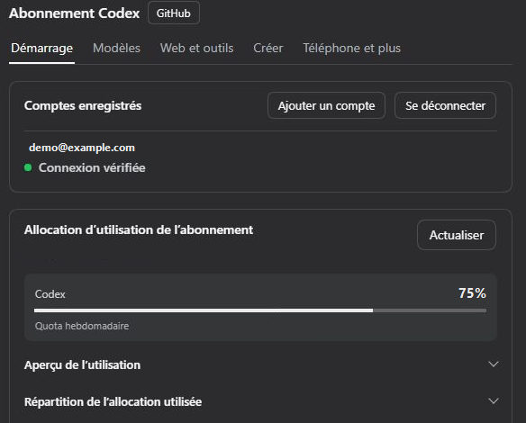
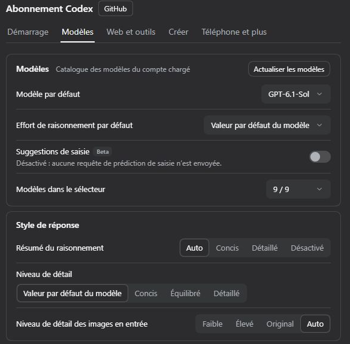

<p align="center"></p>

<div align="center">

# DSH Codex Subscription

[English](README.md) · [简体中文](README.zh-CN.md) · [日本語](README.ja.md) · [Español](README.es.md) · **Français** · [Deutsch](README.de.md) · [Русский](README.ru.md) · [Português](README.pt.md)

**Utilisez votre abonnement ChatGPT / Codex directement dans DeepSeek Harness**

Connectez-vous avec ChatGPT Plus / Pro pour utiliser GPT-6 et d’autres modèles Codex, le quota, la recherche sur le Web et la génération d’images dans DSH. Aucune clé API OpenAI ni CLI Codex requise.

[](https://github.com/WSL043/dsh-codex-subscription/actions/workflows/ci.yml)
[](https://www.npmjs.com/package/dsh-codex-subscription)
[](https://www.npmjs.com/package/dsh-codex-subscription)
[](LICENSE)
[](https://github.com/WSL043/dsh-codex-subscription/stargazers)

[Points forts](#highlights) · [Installation](#install) · [Images et croquis](#images-and-sketching) · [Contrôle à distance par téléphone](#phone-remote-control-beta) · [Toutes les fonctionnalités](#all-features) · [Guide utilisateur (en anglais)](docs/GUIDE.en.md) · [Dépannage](#troubleshooting)

</div>

<p align="center"></p>

<a id="highlights"></a>

## Points forts

| Ce que vous voulez faire | Ce que le plugin propose |
| --- | --- |
| **Discuter et rechercher** | Connectez-vous avec votre abonnement ; choisissez les modèles Codex, les niveaux de raisonnement et de vitesse proposés par votre compte ; utilisez la recherche Web de l’abonnement. |
| **Gérer les comptes et le quota** | Changez de compte, consultez le quota à court terme et hebdomadaire, les crédits et les réinitialisations ; consultez l’historique d’utilisation et, en option, les alertes de quota dans la zone de rédaction. |
| **Créer et modifier des images** | Générez des images, marquez des zones à modifier ou dessinez manuellement et avec l’Agent sur un tableau de croquis modifiable. [Exemples →](#images-and-sketching) |
| **Continuer depuis votre téléphone** | Associez l’application mobile ChatGPT pour contrôler le DSH de cet ordinateur. DeepSeek et les autres modèles DSH fonctionnent aussi. [Bêta, désactivée par défaut →](#phone-remote-control-beta) |
| **Utiliser les applications connectées** | Permettez aux modèles DSH d’utiliser les applications connectées dans ChatGPT, notamment GitHub, Gmail, Drive et Calendar ; toute modification demande une approbation par défaut. |

Les modèles et le quota dépendent des informations renvoyées par votre compte. [Liste complète des fonctionnalités →](#all-features)

<details>
<summary>Utiliser les fonctionnalités de l’abonnement avec DeepSeek et d’autres modèles</summary>

Permettez à DeepSeek ou à tout autre modèle DSH d’utiliser les applications que vous avez connectées dans ChatGPT : GitHub, Gmail, Google Drive, Calendar et plus encore. Les modèles commencent par rechercher, puis effectuent l’appel ; par défaut, chaque modification demande votre approbation (vous pouvez désactiver cette option dans les paramètres). Désactivé par défaut ; activez cette fonction dans Web et outils.

Les sources de recherche Web et de lecture de pages Web, les connecteurs ChatGPT et les sous-tâches indépendantes officielles de Codex se trouvent dans **Paramètres → Abonnement Codex → Web et outils**, avec un seul interrupteur général en haut : lorsqu’il est désactivé, les conversations avec DeepSeek et d’autres modèles non-Codex n’utilisent plus la recherche Web de l’abonnement (la recherche DSH est utilisée à la place), la génération d’images ni les connecteurs ChatGPT ; les modèles d’abonnement Codex ne sont pas concernés. Activé par défaut.

<p align="center"><picture><source media="(prefers-color-scheme: dark)" srcset="docs/assets/ui-interop-en-dark.webp"></picture></p>

</details>

<a id="prepare-dsh"></a>

## Préparer DSH

Vérifié avec DSH `0.2.2-rc.1`, avec `0.2.1-rc.3` et `0.2.1-rc.2` toujours pris en charge ; la version minimale prise en charge est `0.1.7-rc.2`. Veuillez d’abord mettre à niveau les anciennes versions de DSH.

La CLI/Web DSH `0.2.2-rc.1` nécessite Node.js **24.9 ou une version ultérieure** ; l’application de bureau officielle utilise son environnement d’exécution intégré.

Prend également en charge l’hôte de prévisualisation `0.2.2-alpha.2`. Consultez les [notes de compatibilité (en anglais)](docs/dsh-022-alpha2-compatibility.md) pour connaître le périmètre et les limites de validation.

Ce plugin prend en charge la dernière version de DeepSeek Harness indiquée dans les métadonnées de son package et nécessite un compte ChatGPT disposant actuellement d’un accès à Codex.

<details>
<summary>Choisir une distribution DSH</summary>

- **Recommandé : l’application de bureau officielle.** DeepSeek propose désormais une [application de bureau DeepSeek Harness](https://www.deepseek.com/harness/) (macOS sur Apple Silicon et Windows 64 bits ; préversion, open source). Aucune configuration de Node.js n’est nécessaire : installez-la, puis ajoutez ce plugin depuis la page Plugins comme indiqué ci-dessous. L’application de bureau, l’application Web et la CLI partagent un même système de plugins DSH ; les tests d’acceptation de bout en bout de ce plugin sont principalement réalisés sur l’application Web. Veuillez donc [signaler un problème](https://github.com/WSL043/dsh-codex-subscription/issues) si l’application de bureau ne fonctionne pas correctement.
- Besoin de Linux ou envie d’utiliser une version portable communautaire ? Utilisez [DSH-Portable](https://github.com/WSL043/DSH-Portable), une distribution de bureau portable communautaire pour Windows, macOS et Linux.
- Vous préférez la voie officielle ? Suivez le [guide d’exécution DeepSeek Harness (en anglais)](https://github.com/deepseek-ai/deepseek-harness#run).

</details>

<a id="install"></a>

## Installation

<a id="install-from-the-plugins-page-recommended"></a>

### Installer depuis la page Plugins (recommandé)

1. Dans DSH, ouvrez **Plugins → Ajouter un plugin**.
2. Collez ce nom de package, avec sa version, dans le champ **Nom ou adresse du package** :

   ```text
   dsh-codex-subscription@3.2.6
   ```

3. Cliquez sur **Installer** et attendez la fin de l’installation. Suivez les instructions de la page ; enregistrez votre travail avant de redémarrer si cela vous est demandé.
4. Ouvrez **Paramètres → Codex**, connectez-vous à ChatGPT, puis sélectionnez un modèle Codex dans votre conversation.

<details>
<summary>Pourquoi inclure la version ?</summary>

Pourquoi inclure la version : la page des plugins de DSH n’installe que des versions publiées depuis au moins 24 heures. Ainsi, pendant le premier jour suivant une nouvelle publication, le nom du package sans version peut installer une ancienne version, qui risque de ne pas prendre en charge votre version de DSH. En précisant la version, vous obtenez exactement cette version ; un jour après sa publication, `dsh-codex-subscription` sans version désigne également la dernière version stable. Les autres numéros de version sont indiqués sur la [page des versions](https://github.com/WSL043/dsh-codex-subscription/releases).

</details>

<details>
<summary>Installation dans le terminal (avec une commande dsh déjà installée)</summary>

```sh
dsh plugin --profile web add dsh-codex-subscription@3.2.6
```

Suivez les instructions de redémarrage, puis connectez-vous dans **Paramètres → Codex**. La page Plugins et le terminal utilisent tous deux le système de gestion des installations de DSH.

</details>

<details>
<summary>Tâches sans interface graphique</summary>

Après vous être connecté et avoir sélectionné un modèle Codex dans Web, installez le même plugin dans le profil Headless :

```sh
dsh plugin --profile headless add dsh-codex-subscription@3.2.6
dsh --profile headless "Reply with only the word: ok"
```

</details>

<a id="interface-demo"></a>

## Démonstration de l’interface

Connectez votre compte ChatGPT, choisissez un modèle Codex dans DSH et consultez le quota de votre abonnement dans les paramètres.

<details>
<summary>Se connecter et consulter le quota</summary>

Ouvrez **Paramètres → Codex → Démarrage**, puis sélectionnez **Connexion par navigateur**. Vos comptes enregistrés et le quota indiqué par ChatGPT s’affichent après la connexion. Ouvrez l’aperçu ou la répartition de l’utilisation pour voir le détail.

<p align="center"></p>

_Le compte et les valeurs de quota sont fictifs._

</details>

<details>
<summary>Choisir un modèle Codex et envoyer un message</summary>

Dans **Paramètres → Codex → Modèles**, choisissez le modèle et le niveau de raisonnement par défaut. Pour une seule conversation, utilisez le sélecteur près du champ de saisie. Saisissez puis envoyez un message pour utiliser votre abonnement dans DSH.

<p align="center"></p>

</details>

<details>
<summary>Que trouve-t-on dans chaque onglet des paramètres ?</summary>

| Onglet des paramètres | Ce qu’il permet de contrôler |
| --- | --- |
| **Démarrage** | Connexion et comptes, interrupteur pour chaque fonctionnalité, quota de l’abonnement, affichage du quota et alertes |
| **Modèles** | Modèle par défaut, intensité de raisonnement par défaut et liste des modèles, style des réponses ; le groupe Avancé replié contient la longueur du contexte, les nouvelles tentatives, le mode de connexion, la compaction dans le cloud et le modèle de révision |
| **Web et outils** | Interrupteur général pour les autres modèles, source de recherche, connecteurs ChatGPT, sous-tâches officielles Codex |
| **Créer** | Génération et retouche d’images, @image dans la zone de rédaction, visionneuse d’images, canevas de croquis et dessin par l’agent |
| **Téléphone et plus** | Contrôle à distance par téléphone, appels vocaux expérimentaux, cache local, diagnostics d’assistance |

La conversation vocale est désactivée par défaut. Activez-la dans **Téléphone et plus**, puis démarrez un appel depuis la zone de saisie. Si une fenêtre native, y compris sous Linux, ne prend pas en charge WebRTC, DSH vous propose de poursuivre la même conversation dans un navigateur. Les échantillons vocaux restent disponibles et votre abonnement existant est utilisé sans clé API.

**Contexte adapté au modèle** suit le répertoire de modèles de votre compte ; l’actualisation conserve votre brouillon non enregistré. Les paramètres affichent la fenêtre brute ; les budgets de conversation réservent une marge selon le pourcentage officiel (5 % s’il n’est pas précisé), puis DSH gère les réservations de sortie et la compaction. Aucun calcul manuel n’est nécessaire. Les groupes de quotas utilisent les valeurs fournies par le backend, y compris les compartiments séparés tels que Spark.

Les échecs d’abonnement restent visibles : aucun basculement silencieux vers une autre offre payante.

</details>

<a id="images-and-sketching"></a>

## Images et croquis

Générez des images avec votre abonnement, affichez et téléchargez les originaux, ou sélectionnez une zone et ajoutez des notes pour continuer à la modifier. La génération et la modification d’images se contrôlent dans **Paramètres → Codex → Créer**.

<details>
<summary>Annotation et modification continue d’images</summary>

<p align="center"></p>

</details>

<details>
<summary>Afficher les paramètres Images et croquis</summary>

<p align="center"><picture><source media="(prefers-color-scheme: dark)" srcset="docs/assets/ui-creative-en-dark.png"></picture></p>

Paramètres présentés directement sous forme de captures recadrées de l’interface réelle de DSH, avec le thème clair ou sombre.

</details>

<a id="sketch-board-beta"></a>

### Tableau de croquis (bêta)

Le tableau de croquis et le dessin par l’Agent sont en **bêta** et désactivés par défaut ; activez-les dans la page Créer. Dessinez à la main à l’aide du bouton de croquis dans la zone de saisie, ou envoyez `@sketch` avec une demande pour que l’Agent dessine.

Le tableau prend en charge les calques, les courbes natives, les pinceaux, les dégradés, le flou, les modes de fusion, l’écrêtage, l’annulation et le rétablissement, ainsi que les raccourcis. Enregistrez plusieurs brouillons et exportez des PNG ou des brouillons modifiables. Avec une référence, l’Agent peut comparer les images, mesurer les couleurs et les positions, et annuler. Les dessins terminés peuvent être rejoués et enregistrés en vidéo.

<details>
<summary>Exemple de dessin par l’Agent : fille-baleine</summary>

Les agents ont dessiné ces exemples sur le tableau de croquis avec des traits natifs modifiables, sans faire appel à la génération d’images. Les trois utilisaient la même référence et les mêmes réglages de base pour l’outil de dessin. Il s’agit d’exécutions individuelles avec des niveaux d’intensité et des durées différents.

<p align="center"><b>Image de référence</b><br></p>

<table>
<tr><th width="33%">GPT-6-Astra</th><th width="33%">GPT-6.1-Sol</th><th width="33%">DeepSeek Flash</th></tr>
<tr><td></td><td></td><td></td></tr>
<tr><td>Moyenne · 20 min 57 s<br>686 traits</td><td>Élevée · premier tour : 23 min<br>1 020 traits</td><td>Élevée · 9 min 33 s<br>623 traits</td></tr>
</table>

Après une interruption de connexion, le dessin de 6.1 a été restauré à partir de l’enregistrement automatique et des appels réussis d’origine. Le modèle a ensuite vérifié l’aperçu et l’a enregistré, sans ajout de dessin manuel. Cette exécution n’a pas réussi sans interruption.

</details>

<details>
<summary>Du croquis à l’image générée : tour d’horloge et paysage bleu-vert</summary>

L’Agent a d’abord dessiné un croquis modifiable, puis l’a utilisé comme référence pour générer une image avec l’abonnement. Sol et Astra ci-dessous désignent les modèles de conversation qui pilotent le flux de travail, et non le backend de génération d’images.

**Coupe de la tour d’horloge**

<table>
<tr><th>Modèle de conversation</th><th width="43%">Croquis de l’Agent</th><th width="43%">Généré à partir du croquis</th></tr>
<tr><td>GPT-6.1-Sol<br>Xhigh</td><td></td><td></td></tr>
<tr><td>GPT-6-Astra<br>Low</td><td></td><td></td></tr>
</table>

**Paysage bleu-vert**

<table>
<tr><th>Modèle de conversation</th><th width="43%">Croquis de l’Agent</th><th width="43%">Généré à partir du croquis</th></tr>
<tr><td>GPT-6.1-Sol<br>Xhigh</td><td></td><td></td></tr>
<tr><td>GPT-6-Astra<br>Low</td><td></td><td></td></tr>
</table>

</details>

[Modification d’images et stockage des brouillons →](docs/GUIDE.en.md#image-generation-and-editing)

<a id="phone-remote-control-beta"></a>

## Contrôle à distance depuis le téléphone (bêta)

Associez la section Codex de l’application mobile ChatGPT à DSH sur votre ordinateur. Démarrez ou poursuivez des conversations, utilisez des outils et gérez les demandes d’autorisation depuis votre téléphone, avec DeepSeek ou tout autre modèle DSH.

**Désactivé par défaut.** Activez cette option dans **Paramètres → Codex → Téléphone et plus → Contrôle à distance depuis le téléphone**, puis associez l’appareil à l’aide d’un QR code ou d’un code manuel. Votre ordinateur doit rester allumé, connecté et DSH doit être en cours d’exécution.

Il s’agit d’une couche de compatibilité tierce qui utilise le service de connexion à distance d’OpenAI. Le contrôle à distance officiel de Codex existe, mais la compatibilité avec l’hôte DSH n’est pas explicitement garantie par OpenAI et peut changer lors des mises à jour du service. Vous pouvez à tout moment supprimer les appareils associés ou désactiver cette fonction.

<details>
<summary>Opérations prises en charge depuis le téléphone</summary>

- suivre, démarrer, poursuivre, interrompre et archiver des conversations ; rechercher des conversations et des mots-clés à l’intérieur de celles-ci ;
- changer de modèle, de niveau de raisonnement et d’autorisation (écriture dans l’espace de travail / accès complet) ;
- les demandes d’autorisation et les questions s’affichent sur le téléphone ; en cas de déconnexion, elles réapparaissent lorsque vous le rouvrez, sinon elles sont renvoyées à l’ordinateur ;
- les réponses s’affichent au fur et à mesure de leur rédaction ; les commandes, les modifications de fichiers avec différences, la liste des tâches, les recherches sur le Web, les appels aux connecteurs et les images générées utilisent les vues natives du téléphone ;
- envoyer des photos, utiliser @ pour rechercher des fichiers sur l’ordinateur, / pour sélectionner des compétences DSH, consulter les changements avec git en lecture seule et démarrer des discussions dans un véritable sélecteur de dossiers ;
- les espaces de travail DSH apparaissent comme des projets ; cloner une conversation, consulter les limites d’utilisation, l’utilisation cumulée et l’utilisation du contexte ; lorsque DSH prend en charge `/compact`, compacter le contexte depuis le téléphone ;
- les erreurs de modèle s’affichent sur le téléphone ; les téléphones associés sont répertoriés dans les paramètres et peuvent être supprimés.

</details>

<details>
<summary>Paramètres d’association et téléphones associés</summary>

<p align="center"><picture><source media="(prefers-color-scheme: dark)" srcset="docs/assets/ui-remote-en-dark.png"></picture></p>

</details>

<a id="all-features"></a>

## Toutes les fonctionnalités

L’accès aux modèles et les quotas dépendent de votre compte.

<details>
<summary><b>Modèles et recherche</b> (14)</summary>
<br>

| Fonctionnalité | Ce que vous pouvez faire | Disponibilité / configuration |
| --- | --- | --- |
| **Connexion à l’abonnement** | Connectez-vous à ChatGPT et utilisez les modèles d’abonnement Codex sans clé API | Le chat normal ne nécessite pas Codex CLI |
| **Synchronisation du catalogue des modèles** | Lire les modèles et niveaux de raisonnement disponibles sur votre compte, avec actualisation manuelle ; le dernier catalogue récupéré avec succès est stocké localement pour chaque compte et reste disponible pendant l’actualisation en arrière-plan après le redémarrage, pendant 24 heures ; les modèles signalés comme devant être retirés affichent leur date de retrait à côté de leur nom, sans changement automatique de votre sélection | Les nouveaux modèles apparaissent lorsque votre compte les propose ; le catalogue du compte est l’unique source, donc aucun modèle n’est affiché si vous êtes déconnecté ou si aucune lecture distante ni aucun cache valide n’est disponible |
| **Liste des modèles** | Afficher ou masquer des modèles individuels dans le sélecteur de la zone de rédaction, sur la page Modèles ; le sélecteur conserve les libellés de modèles propres à DSH (tels que le badge de nouveau modèle) | Affichage uniquement ; les modèles sélectionnés et les requêtes continuent de fonctionner |
| **Modèle par défaut** | Choisir le modèle utilisé à l’ouverture d’une nouvelle conversation, sur la page Modèles | Définit le modèle par défaut de DSH, le même que celui défini lors du changement de modèle dans une conversation ; effacez ce réglage pour suivre le modèle par défaut de DSH |
| **Intensité de raisonnement par défaut** | Choisir un niveau par défaut pour les modèles d’abonnement, sur la page Modèles ; « Valeur par défaut du modèle » suit la recommandation officielle du catalogue pour chaque modèle | Les choix manuels sont prioritaires. Les niveaux non pris en charge sont remplacés par le niveau par défaut valide du modèle ; les choix manuels déjà définis pour une conversation sont conservés |
| **Niveaux de raisonnement** | Choisir une intensité de raisonnement prise en charge dans la zone de rédaction | Les niveaux varient selon le modèle |
| **Niveaux de vitesse** | Basculer les modèles pris en charge entre Standard et Rapide ; Ultrarapide (Bêta) est également disponible si le catalogue du compte le propose, avec un indicateur en forme d’éclair | Standard par défaut ; Rapide et Ultrarapide augmentent l’utilisation, et Ultrarapide est actuellement réservé à Pro 500 |
| **Verbosit​​é des réponses** | Demander des réponses courtes, moyennes ou détaillées | Suit le réglage par défaut du modèle, sauf modification |
| **Détail des images envoyées** | Choisir le niveau de détail Faible, Élevé, Original ou Auto pour les images envoyées au modèle de chat | Influe sur les jetons d’entrée ; Auto par défaut |
| **Recherche Web par abonnement** | Sources Auto, DSH et Codex | Auto privilégie la source correspondant au modèle de la session et essaie l’autre uniquement si les identifiants sont manquants ou si le service est indisponible. Les choix explicites DSH / Codex imposent la source et signalent directement les échecs. Si Autres modèles est désactivé, les conversations non-Codex utilisent uniquement la recherche native de DSH. Le plugin ne réécrit pas les paramètres de recherche de DSH et n’ajoute aucun recours à un compte DeepSeek ; les frais de recherche native dépendent du service sélectionné |
| **Interrupteur Autres modèles** | Un seul interrupteur empêche les conversations utilisant DeepSeek et d’autres modèles non-Codex d’utiliser la recherche Web par abonnement, la génération d’images et les connecteurs ChatGPT | Paramètres → Abonnement Codex → Web et outils ; activé par défaut, sans effet sur les modèles d’abonnement Codex ; le contrôle à distance par téléphone et la voix sont lancés par vous et ne sont pas concernés |
| **Portée de la recherche** | Choisir la recherche en direct / en cache, désactiver la recherche ou limiter les domaines | À configurer sous Web et outils, dans le groupe des sources de recherche |
| **Délai d’inactivité du flux** | Définir combien de temps une requête peut ne recevoir aucune donnée en flux avant d’être interrompue | 10 minutes par défaut ; ne constitue pas un délai limite global de réponse |
| **Budget de contexte** | Utiliser un budget standard, étendu ou personnalisé pour chaque modèle | Limité par le catalogue de modèles |
| **GPT-Reserve** | Sélectionner le modèle de réserve lorsque votre compte le propose | Expérimental ; aucun quota de réserve distinct n’est garanti |

</details>

<details>
<summary><b>Comptes et quota</b> (10)</summary>
<br>

| Fonctionnalité | Ce que vous pouvez faire | Disponibilité / configuration |
| --- | --- | --- |
| **Comptes multiples** | Ajouter, changer, supprimer des comptes ou se déconnecter de tous les comptes | Settings → Codex → Start |
| **Détails du quota** | Consulter les périodes courtes / hebdomadaires, les heures de réinitialisation et les groupes de quotas distincts | Seules les périodes et les groupes fournis par le backend sont affichés |
| **Utilisation de votre allocation** | Dans la carte de quota, voir la répartition de l’allocation de chaque semaine par modèle, interface, source et déclencheur | À partir du rapport d’utilisation officiel : données approximatives, susceptibles d’avoir un ou deux jours de retard ; masqué si le compte ne dispose d’aucun rapport |
| **Aperçu de l’utilisation** | Dans la carte de quota, consulter le nombre total de jetons utilisés, le jour le plus actif, les séries, le niveau de raisonnement le plus utilisé et une carte thermique quotidienne sur six mois | À partir des statistiques d’utilisation officielles ; masqué si le compte n’en dispose pas |
| **Crédits et cartes de réinitialisation** | Consulter les crédits supplémentaires, les plafonds de dépenses et les cartes de réinitialisation disponibles | Affichés lorsqu’ils sont fournis pour votre compte |
| **Quota dans la zone de rédaction** | Voir le quota restant sous forme de pourcentage ou de barre de progression pendant la conversation | Désactivé par défaut ; choisissez le mode d’affichage |
| **Estimation de l’autonomie** | Survoler ou cliquer sur le quota dans la zone de rédaction pour voir à quel moment l’utilisation récente l’épuiserait | Bêta ; estimation facultative, sans garantie |
| **Alertes de quota** | Utiliser des seuils fixes, anticipés ou personnalisés pour les périodes courtes / longues | 20 % restants par défaut ; possibilité de désactivation |
| **Utiliser des cartes de réinitialisation** | Utiliser une carte de réinitialisation disponible après confirmation | Mesures de protection avec confirmation et attente ; le serveur détermine le résultat |
| **Réessayer après réinitialisation** | Attendre la confirmation de la réinitialisation de la période courte avant de continuer | Désactivé par défaut ; l’attente peut être interrompue |

</details>

<details>
<summary><b>Images et croquis</b> (14)</summary>
<br>

| Fonctionnalité | Ce que vous pouvez faire | Disponibilité / configuration |
| --- | --- | --- |
| **Génération d’images** | Générer des images avec votre abonnement et ajuster les options disponibles de modèle / qualité de la requête ; demander un PNG avec arrière-plan transparent si nécessaire | Activée par défaut, peut être désactivée |
| **Retouche d’images de référence** | Continuer à affiner une image à l’aide de références | Activée par défaut, peut être désactivée |
| **Affichage et téléchargement des images** | Les images terminées apparaissent après la réponse sans développer l’activité des outils ; zoomer, déplacer, ajuster à la fenêtre et télécharger les originaux vérifiés | Visionneuse intégrée ; seules des prévisualisations peuvent être disponibles pour les images plus anciennes |
| **Modification par zone** | Marquer des zones, ajouter des notes et poursuivre la modification à l’aide de références de position | Remplit la zone de rédaction pour que vous puissiez vérifier et envoyer le contenu |
| **Canevas manuel** | Choisir un rapport largeur/hauteur et dessiner avec un stylo, un crayon, un marqueur et des gommes | Bêta ; canevas désactivé par défaut |
| **Formes et texte** | Dessiner des lignes, des flèches, des formes, des courbes natives, ainsi que du texte / des objets modifiables | Disponible dans le canevas de croquis |
| **Dégradés, flou, modes de fusion et découpage** | Remplir avec des dégradés linéaires ou radiaux ; ajouter du flou (lueur, ombre, brume), des modes de fusion (multiplication, écran, superposition, …) et découper un trait selon une forme ; les calques peuvent aussi avoir un mode de fusion | Tout reste sous forme de propriétés modifiables et est conservé lors des déplacements, mises à l’échelle, brouillons et exportations ; l’agent dispose des mêmes fonctionnalités via les dégradés SVG, `feGaussianBlur`, `mix-blend-mode` et `clip-path` |
| **Calques et importation d’images** | Travailler avec des calques et ajouter des images au canevas | Les images sont gérées sous forme de calques |
| **Lissage et navigation** | Lisser les traits complets après leur tracé ; déplacer le canevas, zoomer, annuler et rétablir | Les raccourcis peuvent être personnalisés ou désactivés |
| **Plusieurs brouillons** | Enregistrer et rouvrir jusqu’à 20 brouillons locaux | Stockés dans le navigateur actuel |
| **Importation et exportation** | Exporter au format PNG ou en brouillons natifs qui préservent les traits modifiables | Les brouillons peuvent être réimportés pour poursuivre leur modification |
| **Dessin par l’agent** | Demander à l’agent de dessiner avec `@sketch`, suivre sa progression et l’arrêter ; l’agent peut dessiner des étapes entières en SVG, importées sous forme de traits natifs modifiables ; avec une référence, il peut comparer côte à côte, lire une carte thermique des différences, zoomer sur une zone, mesurer les couleurs et la position des contours, et annuler ; chaque lot indique l’évolution de l’erreur | Bêta ; désactivé par défaut, nécessite le canevas. Les outils mesurent et affichent uniquement ; ils ne dessinent jamais à la place du modèle |
| **Lecture et vidéo** | Le bouton Lecture redessine le processus trait par trait (les lignes suivent leur tracé, les remplissages sont d’abord délimités, puis remplis de haut en bas), avec des préréglages de vitesse et une barre de lecture, et l’enregistre sous forme de vidéo WebM | La vidéo est prévisualisée sur le tableau et n’est enregistrée que lorsque vous cliquez sur Enregistrer la vidéo ; aucun téléchargement ne démarre automatiquement |
| **Aperçu du résultat pour le modèle** | Renvoyer une image du canevas après le dessin pour permettre une vérification ultérieure | Bêta ; désactivé par défaut, augmente l’utilisation de l’entrée image |

</details>

<a id="codex-subtask-runtime"></a>

<details>
<summary><b>Fonctionnalités avancées et maintenance</b> (9)</summary>
<br>

| Fonctionnalité | Ce que vous pouvez faire | Disponibilité / configuration |
| --- | --- | --- |
| **Contrôle à distance par téléphone** | Contrôler le DSH sur votre ordinateur depuis la section Codex de l’application mobile ChatGPT : démarrer, poursuivre et archiver des conversations, changer de modèle et d’autorisations, répondre aux demandes d’approbation et aux questions ; DeepSeek et tout autre modèle DSH fonctionnent | Bêta ; désactivé par défaut ; Paramètres → Codex → Téléphone et plus → Contrôle à distance depuis le téléphone, associez l’appareil par QR code ou code manuel |
| **Sous-tâches Codex indépendantes** | Réutiliser la connexion à l’abonnement et les autorisations de l’espace de travail ; sélectionner les modèles et niveaux de raisonnement autorisés | Bêta, facultatif, inutile pour la plupart des utilisateurs : par défaut, DSH exécute ses propres sous-agents (qui peuvent aussi utiliser des modèles d’abonnement) ; installez le composant facultatif (avec un Codex CLI réservé au plugin) et activez la sélection de modèle sous Plugins → Sous-agents uniquement si vous souhaitez que les sous-tâches soient exécutées par l’agent Codex officiel. Il utilise son propre répertoire de données et votre connexion à l’abonnement, jamais la connexion Codex de cet ordinateur |
| **Gestion du composant de sous-tâche** | Installer, désactiver ou désinstaller le composant officiel de sous-tâche Codex depuis les paramètres | Géré par les hôtes DSH compatibles ; aucune connexion supplémentaire |
| **Compaction du contexte dans le cloud** | Poursuivre les longues conversations à l’aide de la compaction Codex tout en conservant l’historique DSH et la compaction native | Bêta / expérimental ; désactivé par défaut, les requêtes activées utilisent SSE |
| **Transport WebSocket** | Réutiliser expérimentalement les connexions et les transferts de contexte, avec un basculement vers SSE en cas d’échec de connexion | Bêta / expérimental ; SSE par défaut, aucune garantie de vitesse |
| **Évaluateur Codex pour la vérification automatique** | La vérification automatique DSH évalue les appels d’outils avec le propre modèle de vérification de Codex ; DSH conserve sa politique de vérification et son processus d’autorisation/refus | Bêta ; désactivé par défaut, s’applique lorsque le catalogue de votre compte propose le modèle |
| **Connecteurs ChatGPT** | Permettre à DeepSeek ou à tout modèle DSH d’utiliser les applications que vous avez connectées dans ChatGPT : GitHub, Gmail, Google Drive, Calendar et plus encore ; les modèles effectuent d’abord une recherche, puis appellent l’application, et par défaut chaque modification demande votre approbation, option désactivable | Désactivé par défaut, Paramètres → Codex → Web et outils → Connecteurs ChatGPT ; connectez d’abord les applications dans ChatGPT |
| **Diagnostics d’assistance** | Vérifier les prérequis et les résultats récents des opérations, et copier un bref rapport (environ 1 Ko ; le rapport complet peut être copié séparément) sans identifiants ni texte de conversation | Paramètres → Codex → Téléphone et plus ; « non vérifié » ne signifie pas « en panne » |
| **Nettoyage du cache des prévisions** | Examiner et effacer l’historique local des prévisions de quota | Préserve la connexion, les brouillons, les originaux et les dépendances partagées |

</details>

<a id="reuse-cache-when-changing-effort"></a>

### Réutiliser le cache lors d’un changement d’intensité

**Réutiliser le cache lors d’un changement d’intensité** se trouve sous **Paramètres → Codex → Modèles → Avancé**. Cette option est activée par défaut et peut être désactivée ; les choix Désactivé enregistrés sont conservés. Elle s’applique uniquement aux modèles standard à agent unique explicitement pris en charge par le catalogue actuel du compte ; la prise en charge n’est jamais déduite du nom des modèles. La mise en cache ordinaire des invites est automatique et continue de fonctionner lorsque cette option est désactivée.

La valeur de `reasoning.effort` au niveau de la requête reste celle définie initialement pour la fenêtre de contexte actuelle. Les modifications sont enregistrées sous forme d’éléments `configuration_update` dans le nouvel historique et rejouées à leur emplacement d’origine. Cela peut réduire l’invalidation du cache lors d’un changement d’intensité ; cela ne garantit ni l’utilisation du cache, ni des réponses plus rapides, ni des économies de quota. La réponse peut toujours indiquer la valeur d’intensité initiale.

- **La compaction automatique dans le cloud et les nouvelles tentatives illimitées désactivent cette fonctionnalité.** L’interface explique le conflit ; vos paramètres de compaction, de nouvelle tentative, d’authentification, de connexion et de clé de cache ne sont jamais modifiés automatiquement.
- Les réponses réussies enregistrent un petit état sans texte, avec les métadonnées de relecture existantes de DSH, pour le redémarrage, la reprise et les embranchements. Une compaction locale réussie modifie le préfixe ; après vérification du remplacement de l’historique validé par DSH, le plugin établit une nouvelle référence de base pour l’intensité sélectionnée. Une compaction échouée conserve l’état précédent.
- L’activation d’une conversation existante ou le retour à un modèle pris en charge n’établit une référence de base que si l’entrée complète correspond à l’historique natif de la session DSH. La première requête peut perdre l’ancien cache. En cas d’historique invérifiable, de modèle non pris en charge, de changement de compte ou de limite de ressources, des requêtes ordinaires sont utilisées avec l’intensité sélectionnée.
- L’état en attente dans le même processus fige une entrée déjà envoyée, même si elle échoue ou est annulée. Sélectionner une intensité différente pour cette nouvelle tentative précise renvoie une erreur ; conservez son intensité d’origine ou envoyez un nouveau message. Les tentatives échouées ne disposent d’aucun point de contrôle durable de réponse réussie ; la conservation de leur préfixe de cache après le redémarrage d’un processus ou le rechargement du plugin n’est donc pas garantie.
- La désactivation rétablit les requêtes ordinaires sans appliquer rétroactivement de mises à jour aux anciens journaux. L’historique des mises à jour n’est jamais envoyé à `/responses/compact`. Pro, le mode multi-agent, la troncature automatique et la compaction automatique ne sont pas pris en charge.
- La fonctionnalité est limitée à 20 000 éléments d’entrée, 16 Mio de données d’entrée/enveloppe avec empreinte, 128 mises à jour et 256 sessions actives/en attente. Les échecs de validation des limites ou de l’historique interrompent la conservation, mais pas l’intensité de raisonnement que vous avez sélectionnée.

Cette fonctionnalité utilise les mises à jour de configuration décrites dans le [guide de raisonnement](https://developers.openai.com/api/docs/guides/reasoning) d’OpenAI ; consultez la page sur la [mise en cache des invites](https://developers.openai.com/api/docs/guides/prompt-caching) pour connaître les exigences relatives au cache. La prise en charge dépend du catalogue du compte actuel et des réponses réelles. Les refus de paramètres par le backend sont signalés ; aucune nouvelle tentative n’est effectuée avec une ancienne intensité ou une clé API.

<a id="update-and-uninstall"></a>

## Mettre à jour et désinstaller

Trouvez ce plugin sur la page **Plugins** de DSH et utilisez l’action de mise à jour ou de désinstallation. Suivez les éventuelles instructions de redémarrage. La désinstallation de ce plugin ne supprime pas les autres plugins.

<details>
<summary>Commandes de terminal</summary>

```sh
dsh plugin --profile web update dsh-codex-subscription@3.2.6
```

À exécuter uniquement si vous souhaitez désinstaller :

```sh
dsh plugin --profile web remove dsh-codex-subscription
```

</details>

<a id="troubleshooting"></a>

## Dépannage

<details>
<summary>Quel est le lien avec le bundle Codex officiel (dsh-hooks-codex) dans la liste des plugins ?</summary>

Ils n’ont aucun lien entre eux et peuvent être installés ensemble. Les bundles officiels Codex / Claude Code permettent à DSH d’exécuter des configurations de hooks de type Codex ou Claude Code (des scripts lancés avant et après les appels d’outils). Ce plugin se connecte avec votre abonnement ChatGPT et fournit les modèles Codex, le quota, la recherche, les images et le contrôle à distance par téléphone.

</details>

<details>
<summary>La commande dsh est introuvable sur votre ordinateur ?</summary>

Dans DSH, utilisez **Plugins → Ajouter un plugin** et collez le nom du package. Aucune configuration dans le terminal n’est nécessaire.

</details>

<details>
<summary>Vous avez plusieurs installations de DSH, ou un plugin est manquant ?</summary>

Installez le plugin depuis l’installation de DSH que vous utilisez réellement. Pour une installation depuis le terminal, exécutez les commandes dans l’environnement DSH voulu et vérifiez son profil. Ne supprimez pas de profils et ne modifiez pas le PATH de votre système pour forcer une installation.

</details>

<details>
<summary>Comment signaler un problème ?</summary>

Générez **Diagnostics d’assistance** sous **Paramètres → Codex → Téléphone et plus**, collez-les dans le [formulaire de signalement de bug](https://github.com/WSL043/dsh-codex-subscription/issues/new?template=install-problem.yml) et indiquez les étapes qui ont provoqué le problème.

Les diagnostics excluent les identifiants, les identifiants de compte, les réponses brutes et les journaux complets. Ne joignez jamais d’URL de connexion, de codes d’autorisation ou d’adresses de rappel du navigateur.

</details>

<details>
<summary>Ai-je besoin de la ligne de commande Codex ?</summary>

Pas pour les conversations ordinaires avec l’abonnement. Uniquement si vous souhaitez utiliser les **sous-tâches Codex indépendantes** : utilisez « Installer le composant » sous Paramètres → Abonnement Codex → Web et outils ; la désactivation et la désinstallation se trouvent au même endroit. Les autres options expérimentales nécessitent une activation explicite. [Composants facultatifs, nettoyage du stockage et guide complet, en anglais →](docs/GUIDE.en.md)

</details>

<a id="positioning-and-boundaries"></a>
<a id="scope-and-support"></a>

<a id="project-and-support"></a>

## Projet et assistance

- **Abonnement ChatGPT / Codex uniquement**, avec une prise en charge approfondie : quota et prévisions, images et croquis, sous-tâches, diagnostics. Les autres abonnements, tels que Claude ou Grok, ne sont pas concernés.
- **Signalement explicite des échecs** : les requêtes ne basculent jamais silencieusement vers une autre voie payante et les fenêtres de quota que le compte ne renvoie pas ne sont jamais inventées.
- **Suit les versions officielles de DSH** : chaque version est validée de bout en bout (installation, démarrage, suppression, réinstallation) avec les canaux officiels de DSH, tels que latest et next ; les versions vérifiées sont consignées dans les [notes de compatibilité](docs/dsh-020-compatibility.md).
- Les modèles, le quota et les fonctionnalités dépendent des données réellement renvoyées par votre compte ; le backend ChatGPT et DSH peuvent évoluer indépendamment.

Ce projet communautaire n’est ni affilié à DeepSeek ou OpenAI, ni approuvé par ces entreprises.

- Utilisez le [formulaire de signalement de bug](https://github.com/WSL043/dsh-codex-subscription/issues/new?template=install-problem.yml) pour faire part de vos commentaires sur le projet.
- Utilisez le [formulaire de demande de fonctionnalité](https://github.com/WSL043/dsh-codex-subscription/issues/new?template=feature-request.yml) pour proposer des améliorations ciblées du produit.
- Les corrections ciblées et les améliorations de compatibilité sont les bienvenues ; consultez [CONTRIBUTING.md, en anglais](CONTRIBUTING.md).
- Aidez à [maintenir et développer le projet](CONTRIBUTING.md#help-maintain) : prenez en charge durablement un module, assurez le suivi des problèmes associés ou relisez du code. [Ouvrez un problème](https://github.com/WSL043/dsh-codex-subscription/issues/new?template=help-maintain.yml) pour en discuter.
- Pour discuter des plugins DSH, rendez-vous sur [DeepSeek Harness Discussions](https://github.com/deepseek-ai/deepseek-harness/discussions).
- Lisez [SECURITY.md, en anglais](SECURITY.md) avant de signaler des problèmes sensibles.

Si ce projet vous est utile, le [bouton Star](https://github.com/WSL043/dsh-codex-subscription/stargazers) permet à davantage d’utilisateurs de DSH de le découvrir.

<a href="https://star-history.com/#WSL043/dsh-codex-subscription&Date">
  <picture>
    <source media="(prefers-color-scheme: dark)" srcset="https://api.star-history.com/svg?repos=WSL043/dsh-codex-subscription&type=Date&theme=dark" />
    
  </picture>
</a>

[English](README.md) · [简体中文](README.zh-CN.md) · [日本語](README.ja.md) · [Español](README.es.md) · **Français** · [Deutsch](README.de.md) · [Русский](README.ru.md) · [Português](README.pt.md) · [MIT](LICENSE)

[](https://github.com/deepseek-ai/deepseek-harness)
