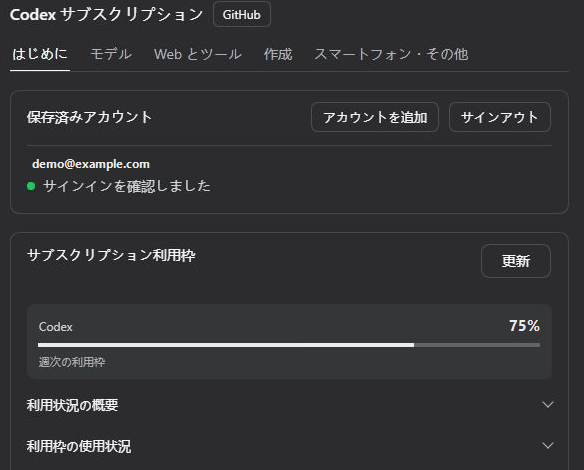
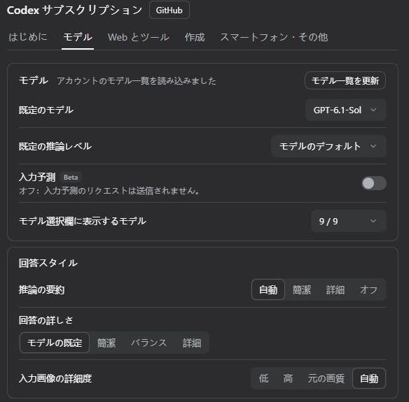

<p align="center"></p>

<div align="center">

# DSH Codex Subscription

[English](README.md) · [简体中文](README.zh-CN.md) · **日本語** · [Español](README.es.md) · [Français](README.fr.md) · [Deutsch](README.de.md) · [Русский](README.ru.md) · [Português](README.pt.md)

**DeepSeek Harness で ChatGPT / Codex サブスクリプションを直接利用**

ChatGPT Plus / Pro でサインインすると、DSH 内で GPT-6 などの Codex モデル、利用枠、ウェブ検索、画像生成を利用できます。OpenAI API キーや Codex CLI は不要です。

[](https://github.com/WSL043/dsh-codex-subscription/actions/workflows/ci.yml)
[](https://www.npmjs.com/package/dsh-codex-subscription)
[](https://www.npmjs.com/package/dsh-codex-subscription)
[](LICENSE)
[](https://github.com/WSL043/dsh-codex-subscription/stargazers)

[主な機能](#highlights) · [インストール](#install) · [画像とスケッチ](#images-and-sketching) · [スマートフォンからのリモート操作](#phone-remote-control-beta) · [全機能](#all-features) · [ユーザーガイド（英語）](docs/GUIDE.en.md) · [トラブルシューティング](#troubleshooting)

</div>

<p align="center"></p>

<a id="highlights"></a>

## 主な機能

| やりたいこと | プラグインでできること |
| --- | --- |
| **チャットと検索** | サブスクリプションでサインインし、アカウントで利用可能な Codex モデル、推論量、速度レベルを選択して、サブスクリプションのウェブ検索を利用できます。 |
| **アカウントと利用枠の管理** | アカウントの切り替え、短期間および週間の利用枠、クレジット、リセット時刻の確認ができます。利用履歴や、入力欄での任意の利用量アラートも確認できます。 |
| **画像の作成と編集** | 画像の生成、編集範囲の指定、または編集可能なスケッチボードでの手描きや Agent による描画ができます。[例 →](#images-and-sketching) |
| **スマートフォンから続ける** | ChatGPT モバイルアプリをペアリングして、このコンピューター上の DSH を操作できます。DeepSeek などの DSH モデルも利用できます。[ベータ版、デフォルトではオフ →](#phone-remote-control-beta) |
| **接続済みアプリを使う** | DSH モデルが ChatGPT に接続したアプリ（GitHub、Gmail、Drive、Calendar など）を使えるようにします。書き込みの承認は現在の DSH セッション権限に従います。 |

モデルと利用枠は、アカウントから返される情報によって異なります。[機能一覧 →](#all-features)

<details>
<summary>DeepSeek やその他のモデルでサブスクリプション機能を使う</summary>

DeepSeek やその他の DSH モデルで、ChatGPT に接続したアプリ（GitHub、Gmail、Google Drive、Calendar など）を使えるようにします。モデルはまず検索してから呼び出しを行い、書き込みの承認は選んだモードと現在の DSH セッション権限に従います。デフォルトではオフです。「Web とツール」で有効にしてください。

ウェブ検索とウェブページの読み取り元、ChatGPT コネクタ、公式 Codex の独立したサブタスクは、**設定 → Codex サブスクリプション → Web とツール**にあります。最上部にすべてを制御するスイッチがあります。オフにすると、DeepSeek やその他の Codex 以外のモデルとの会話では、サブスクリプションのウェブ検索（代わりに DSH 検索を使用）、画像生成、ChatGPT コネクタが使われなくなります。Codex サブスクリプションモデルには影響しません。デフォルトではオンです。

<p align="center"><picture><source media="(prefers-color-scheme: dark)" srcset="docs/assets/ui-interop-en-dark.webp"></picture></p>

</details>

<a id="prepare-dsh"></a>

## DSH の準備

DSH `0.2.2-rc.1` で動作確認済みです。`0.2.1-rc.3` および `0.2.1-rc.2` も引き続きサポートされます。サポート対象の最小バージョンは `0.1.7-rc.2` です。古い DSH をお使いの場合は、先にアップグレードしてください。

DSH `0.2.2-rc.1` CLI/Web には Node.js **24.9 以降**が必要です。公式デスクトップアプリでは、同梱のランタイムを使用します。

プレビュー版ホスト `0.2.2-alpha.2` にも対応しています。対象範囲と検証上の制限については、[互換性に関する注意事項（英語）](docs/dsh-022-alpha2-compatibility.md)をご覧ください。

このプラグインは、パッケージメタデータに記録された最新の DeepSeek Harness リリースをサポートします。また、現在 Codex を利用できる ChatGPT アカウントが必要です。

<details>
<summary>DSH の配布版を選ぶ</summary>

- **おすすめ：公式デスクトップアプリ。** DeepSeek が [DeepSeek Harness デスクトップアプリ](https://www.deepseek.com/harness/)を公開しています（Apple Silicon 搭載 Mac および 64 ビット Windows 対応、プレビュー版、オープンソース）。Node.js のセットアップは不要です。アプリをインストールし、以下の説明に従ってプラグインページからこのプラグインを追加してください。デスクトップアプリ、ウェブアプリ、CLI は共通の DSH プラグインシステムを使用します。このプラグインのエンドツーエンドの受け入れテストは主にウェブアプリで実施しているため、デスクトップアプリで問題が発生した場合は[問題を報告してください](https://github.com/WSL043/dsh-codex-subscription/issues)。
- Linux が必要な場合、またはコミュニティ製のポータブルビルドを希望する場合：[DSH-Portable](https://github.com/WSL043/DSH-Portable)をご利用ください。Windows、macOS、Linux 向けのコミュニティ製ポータブルデスクトップ配布版です。
- 公式の方法を希望する場合：[DeepSeek Harness の実行ガイド（英語）](https://github.com/deepseek-ai/deepseek-harness#run)に従ってください。

</details>

<a id="install"></a>

## インストール

<a id="install-from-the-plugins-page-recommended"></a>

### プラグインページからインストール（おすすめ）

1. DSH で **プラグイン → プラグインを追加** を開きます。
2. バージョンを含めた以下のパッケージ名を、**パッケージ名またはアドレス**欄に貼り付けます。

   ```text
   dsh-codex-subscription@3.2.8
   ```

3. **インストール**をクリックし、完了するまで待ちます。ページの指示に従ってください。再起動を求められた場合は、その前に作業内容を保存してください。
4. **設定 → Codex**を開いて ChatGPT にサインインし、会話で Codex モデルを選択します。

<details>
<summary>バージョンを指定する理由</summary>

バージョンを指定する理由：DSH のプラグインページでは、公開から 24 時間以上経過したバージョンのみがインストールされます。そのため、新しいバージョンの公開後 1 日間は、パッケージ名だけを指定すると古いバージョンがインストールされる場合があり、そのバージョンがお使いの DSH に対応していない可能性があります。バージョンを指定すれば、このリリースを確実にインストールできます。公開から 1 日後には、バージョンを省略した `dsh-codex-subscription` でも最新の安定版が選ばれます。その他のバージョン番号は[リリースページ](https://github.com/WSL043/dsh-codex-subscription/releases)をご覧ください。

</details>

<details>
<summary>ターミナルからインストール（dsh コマンドがすでにある場合）</summary>

```sh
dsh plugin --profile web add dsh-codex-subscription@3.2.8
```

再起動の指示に従い、その後 **設定 → Codex** でサインインしてください。プラグインページとターミナルのどちらからインストールしても、DSH のインストール管理機能が使用されます。

</details>

<details>
<summary>ヘッドレスタスク</summary>

Web でサインインし、Codex モデルを選択した後、Headless プロファイルにも同じプラグインをインストールします。

```sh
dsh plugin --profile headless add dsh-codex-subscription@3.2.8
dsh --profile headless "Reply with only the word: ok"
```

</details>

<a id="interface-demo"></a>

## インターフェースのデモ

ChatGPT アカウントを連携し、DSH で Codex モデルを選び、設定からサブスクリプションの利用枠を確認できます。

<details>
<summary>サインインして利用枠を確認</summary>

**設定 → Codex → はじめに** を開き、**ブラウザーでサインイン** を選びます。連携後は、保存済みアカウントと ChatGPT から取得した利用枠が表示されます。詳しくは **使用状況の概要** や **利用枠の使用状況** を開きます。

<p align="center"></p>

_画面のアカウントと利用枠はサンプルデータです。_

</details>

<details>
<summary>Codex モデルを選んでメッセージを送信</summary>

**設定 → Codex → モデル** でデフォルトのモデルと推論量を選べます。会話ごとに変える場合は、入力欄のモデル選択を使います。メッセージを送信すると、DSH からサブスクリプションのモデルを利用できます。

<p align="center"></p>

</details>

<details>
<summary>各設定タブの内容</summary>

| 設定タブ | 設定できる内容 |
| --- | --- |
| **はじめに** | サインインとアカウント、各機能のスイッチ、サブスクリプションの利用枠、利用枠の表示とアラート |
| **モデル** | デフォルトモデル、デフォルトの推論量とモデル一覧、回答スタイル。「詳細設定」グループを展開すると、コンテキスト長、再試行、接続モード、クラウドでの圧縮、レビュー用モデルを設定できます |
| **Web とツール** | その他のモデル向けのマスタースイッチ、検索元、ChatGPT コネクタ、公式 Codex サブタスク |
| **作成** | 画像生成、編集、入力欄での @image、画像ビューアー、スケッチキャンバス、エージェントによる描画 |
| **スマートフォン・その他** | スマートフォンからのリモート操作、実験的な音声通話、ローカルキャッシュ、サポート用診断情報 |

音声会話はデフォルトでオフです。有効にするには **スマートフォン・その他** でオンにしてから、入力欄で通話を開始してください。Linux を含め、ネイティブウィンドウが WebRTC に対応していない場合、DSH は同じ会話をブラウザーで続けるよう提案します。音声サンプルは引き続き利用でき、既存のサブスクリプションが API キーなしで使用されます。

**モデルに応じたコンテキスト** はアカウントのモデルディレクトリに従います。更新しても未保存の下書きは保持されます。設定には余裕分を差し引く前のコンテキストウィンドウ長が表示されます。会話のコンテキスト予算では、公式の割合（省略時は 5%）に基づいて余裕を確保し、その後 DSH が出力用の領域確保と圧縮を管理します。手動で差し引く必要はありません。利用枠グループには、Spark のような個別の枠を含め、バックエンドが提供する値が使われます。

サブスクリプションのエラーは表示されたままになります。有料の別ルートに黙ってフォールバックすることはありません。

</details>

<a id="images-and-sketching"></a>

## 画像とスケッチ

サブスクリプションを使って画像を生成し、オリジナルを表示・ダウンロードできます。また、範囲を指定してメモを追加し、編集を続けることもできます。画像の生成と編集は **Settings → Codex → Create** で管理します。

<details>
<summary>画像への注釈と編集の続行</summary>

<p align="center"></p>

</details>

<details>
<summary>画像とスケッチの設定を表示</summary>

<p align="center"><picture><source media="(prefers-color-scheme: dark)" srcset="docs/assets/ui-creative-en-dark.png"></picture></p>

設定画面は、ライトテーマまたはダークテーマに沿った、実際の DSH インターフェースのトリミング済みスクリーンショットです。

</details>

<a id="sketch-board-beta"></a>

### スケッチボード（ベータ）

スケッチキャンバスとエージェントの描画機能は**ベータ版**で、デフォルトではオフです。「作成」ページでオンにしてください。入力欄のスケッチボタンから手描きするか、`@sketch` をリクエストとともに送信してエージェントに描画させることができます。

ボードはレイヤー、ネイティブ曲線、ブラシ、グラデーション、ぼかし、ブレンドモード、クリッピング、元に戻す／やり直し、ショートカットに対応しています。複数の下書きを保存し、PNG または編集可能な下書きとして書き出せます。参照画像があれば、Agent は画像を比較し、色や位置を測定して、操作を元に戻すことができます。完成した描画は再生でき、動画として記録できます。

<details>
<summary>Agent による描画例：クジラの女の子</summary>

Agent は画像生成を呼び出さず、ネイティブの編集可能なストロークを使って、これらの例をスケッチボード上に描きました。3つとも同じ参照画像と描画ツールの基本設定を使用しています。これらは、推論量と所要時間が異なる個別の実行例です。

<p align="center"><b>参照画像</b><br></p>

<table>
<tr><th width="33%">GPT-6-Astra</th><th width="33%">GPT-6.1-Sol</th><th width="33%">DeepSeek Flash</th></tr>
<tr><td></td><td></td><td></td></tr>
<tr><td>中 · 20分57秒<br>686ストローク</td><td>高 · 1ターン目：23分<br>1,020ストローク</td><td>高 · 9分33秒<br>623ストローク</td></tr>
</table>

接続が中断された後、6.1 の描画は自動保存データと、正常に完了した元の呼び出しから復元されました。その後、モデルがプレビューを確認して保存しました。手描きの追加はありません。中断なく正常に完了した実行ではありません。

</details>

<details>
<summary>スケッチから生成画像へ：時計塔と青緑の風景</summary>

エージェントはまず編集可能なスケッチを描き、次にそのスケッチを参照画像としてサブスクリプションの画像生成を使いました。下の Sol と Astra は、ワークフローを指示した会話モデルの名称であり、画像生成バックエンドではありません。

**時計塔の断面図**

<table>
<tr><th>会話モデル</th><th width="43%">Agent のスケッチ</th><th width="43%">スケッチから生成</th></tr>
<tr><td>GPT-6.1-Sol<br>Xhigh</td><td></td><td></td></tr>
<tr><td>GPT-6-Astra<br>Low</td><td></td><td></td></tr>
</table>

**青緑の風景**

<table>
<tr><th>会話モデル</th><th width="43%">Agent のスケッチ</th><th width="43%">スケッチから生成</th></tr>
<tr><td>GPT-6.1-Sol<br>Xhigh</td><td></td><td></td></tr>
<tr><td>GPT-6-Astra<br>Low</td><td></td><td></td></tr>
</table>

</details>

[画像編集と下書きの保存 →](docs/GUIDE.en.md#image-generation-and-editing)（英語）

<a id="phone-remote-control-beta"></a>

## スマートフォンからのリモート操作（ベータ）

ChatGPT モバイルアプリの Codex セクションを、パソコン上の DSH とペアリングします。DeepSeek やその他の DSH モデルを使って、スマートフォンから会話を開始・継続したり、ツールを使ったり、承認を処理したりできます。

**デフォルトではオフです。** 有効にするには **設定 → Codex → スマートフォン・その他 → スマートフォンからのリモート操作** でオンにし、QR コードまたは手動コードでペアリングしてください。パソコンは電源を入れ、オンラインにして、DSH を実行したままにする必要があります。

これは OpenAI のリモート接続サービスを使う、サードパーティ製の互換レイヤーです。公式の Codex リモート操作機能は存在しますが、DSH ホストとの互換性は OpenAI によって明示的に保証されておらず、サービスの更新によって変わる可能性があります。ペアリングしたデバイスはいつでも削除でき、機能を無効にもできます。

<details>
<summary>スマートフォンでできる操作</summary>

- 会話のフォロー、開始、続行、中断、アーカイブ。会話と、その会話内のキーワードを検索。
- モデル、推論レベル、権限（ワークスペースへの書き込み／フルアクセス）を切り替え。
- 承認と質問はスマートフォンにポップアップ表示されます。接続が切れた場合、スマートフォンを再び開くと再表示されます。そうでない場合はパソコンに戻ります。
- 返信は入力されるそばから表示されます。コマンド、差分付きのファイル編集、タスクリスト、ウェブ検索、コネクター呼び出し、生成画像には、スマートフォンのネイティブ表示が使われます。
- 写真を送信したり、@ を使ってパソコン上のファイルを検索したり、/ を使って DSH スキルを選んだりできます。読み取り専用の git で変更を確認し、実際のフォルダーピッカーからチャットを開始することもできます。
- DSH ワークスペースはプロジェクトとして表示されます。会話の分岐、使用制限・累計使用量・コンテキスト使用量の確認ができます。DSH が `/compact` に対応している場合は、スマートフォンからコンテキストをコンパクト化できます。
- モデルのエラーはスマートフォンに表示されます。ペアリング済みのスマートフォンは設定で一覧表示され、削除できます。

</details>

<details>
<summary>ペアリング設定とペアリング済みスマートフォン</summary>

<p align="center"><picture><source media="(prefers-color-scheme: dark)" srcset="docs/assets/ui-remote-en-dark.png"></picture></p>

</details>

<a id="all-features"></a>

## すべての機能

モデルへのアクセスと利用枠はアカウントによって異なります。

<details>
<summary><b>モデルと検索</b>（14）</summary>
<br>

| 機能 | できること | 利用条件／設定 |
| --- | --- | --- |
| **サブスクリプションでのサインイン** | ChatGPT にサインインし、API キーなしで Codex サブスクリプションモデルを使用 | 通常のチャットに Codex CLI は不要 |
| **モデルカタログの同期** | アカウントで利用可能なモデルと推論レベルを読み込み、手動で更新します。最後に正常に取得したカタログはアカウントごとにローカルに保存され、再起動後のバックグラウンド更新中も利用できます（有効期間は24時間）。提供終了予定のモデルは、モデル名の横に提供終了日が表示されます。選択内容が自動で切り替わることはありません | アカウントで利用可能になると新しいモデルが表示されます。アカウントのカタログのみを参照するため、サインアウト中、またはリモートから取得できず有効なキャッシュもない場合は、モデルは表示されません |
| **モデル一覧** | 「モデル」ページで、入力欄の選択リストに表示するモデルを個別に選択します。選択リストには、新モデルのバッジなど、DSH 独自のモデルラベルが表示されます | 表示のみを切り替えます。選択したモデルとリクエストは引き続き利用できます |
| **デフォルトモデル** | 「モデル」ページで、新しい会話を開始するときに使うモデルを選択します | DSH のデフォルトモデル設定を書き込みます。チャット中にモデルを切り替えたときに書き込まれる設定と同じです。DSH のデフォルトに従うには、設定を解除してください |
| **デフォルトの推論量** | 「モデル」ページで、サブスクリプションモデルのデフォルトレベルを選択します。「モデルのデフォルト」は各モデルの公式カタログの推奨設定に従います | 手動で選択した設定が優先されます。サポートされていないレベルは、モデルで有効なデフォルトにフォールバックします。会話ごとに手動で選択済みの設定は保持されます |
| **推論レベル** | 入力欄で、サポートされている推論量を選択します | レベルはモデルによって異なります |
| **速度ティア** | 対応モデルを「標準」と「高速」の間で切り替えます。アカウントのカタログで利用可能な場合は「超高速（ベータ版）」も選択でき、稲妻のインジケーターが表示されます | デフォルトは「標準」です。「高速」と「超高速」は使用量が増加します。現在、「超高速」を利用できるのは Pro 500 のみです |
| **応答の詳しさ** | 短い、標準、または詳しい応答をリクエストします | 変更しない限り、モデルのデフォルトに従います |
| **入力画像の詳細度** | チャットモデルに送信する画像の詳細度として、「低」「高」「オリジナル」「自動」を選択します | 入力トークン数に影響します。デフォルトは「自動」です |
| **サブスクリプションのウェブ検索** | 自動、DSH、Codex の検索元を選択します | 「自動」はセッションのモデルに合った検索元を優先し、認証情報がない場合、またはサービスを利用できない場合に限り、もう一方を試します。DSH / Codex を明示的に選ぶと検索元が固定され、エラーがそのまま報告されます。「その他のモデル」をオフにすると、Codex 以外のチャットでは DSH のネイティブ検索のみを使用します。このプラグインが DSH の検索設定を書き換えたり、DeepSeek アカウントへのフォールバックを追加したりすることはありません。ネイティブ検索の料金は選択したサービスによって異なります |
| **その他のモデルの切り替え** | DeepSeek およびその他の Codex 以外のモデルを使う会話で、サブスクリプションのウェブ検索、画像生成、ChatGPT コネクターを使わないようにするスイッチです | 「設定」→「Codex サブスクリプション」→「ウェブとツール」で設定します。デフォルトでオンです。Codex サブスクリプションモデルには影響しません。スマートフォンのリモート操作と音声機能はユーザー自身が開始するものであり、影響を受けません |
| **検索範囲** | ライブ検索 / キャッシュ検索を選ぶ、検索を無効にする、または検索対象ドメインを制限します | 「ウェブとツール」の検索元グループで設定します |
| **ストリーム無応答タイムアウト** | リクエストのストリームデータが受信されない状態が続き、リクエストを中止するまでの時間を設定します | デフォルトは10分です。応答全体の期限ではありません |
| **コンテキスト予算** | モデルごとに標準、拡張、またはカスタムの予算を使用します | モデルカタログの範囲内で設定できます |
| **GPT-Reserve** | アカウントで利用可能な場合に、予備モデルを選択します | 実験的機能です。別枠の予備利用枠があることを保証するものではありません |

</details>

<details>
<summary><b>アカウントと利用枠</b> (10)</summary>
<br>

| 機能 | できること | 利用条件 / 設定 |
| --- | --- | --- |
| **複数アカウント** | アカウントの追加、切り替え、削除、またはすべてのアカウントからのサインアウトができます | 「設定」→「Codex」→「開始」 |
| **利用枠の詳細** | 短期 / 週間の利用枠、リセット時刻、個別の利用枠グループを確認できます | バックエンドから提供された利用枠とグループのみ表示されます |
| **利用枠の内訳** | 利用枠カードで、各週の利用枠をモデル、利用画面、ソース、トリガー別に確認できます | 公式の利用レポートに基づきます。概算であり、1～2日遅れる場合があります。アカウントにレポートがない場合は表示されません |
| **利用状況の概要** | 利用枠カードで、累計トークン数、最も利用した日、連続利用日数、最もよく使った推論レベル、半年分の日別ヒートマップを確認できます | 公式の利用統計に基づきます。アカウントに統計がない場合は表示されません |
| **クレジットとリセットカード** | 追加クレジット、利用上限、利用可能なリセットカードを確認できます | アカウントに返された項目が表示されます |
| **入力欄の利用枠** | チャット中に、残り利用枠を割合または進捗バーで確認できます | デフォルトではオフです。表示方法を選択してください |
| **残り利用可能時間の推定** | 入力欄の利用枠にカーソルを合わせるかクリックすると、直近の利用状況が続いた場合に利用枠を使い切る時期を確認できます | ベータ版です。任意の推定値であり、保証ではありません |
| **利用量アラート** | 固定、早期、または短期 / 長期のカスタムしきい値を設定できます | デフォルトは残り20%です。無効にできます |
| **リセットカードの利用** | 利用可能なリセットカードを、確認後に使用できます | 確認と待機に関する安全措置があります。結果はサーバーが決定します |
| **リセット後に再試行** | 短期利用枠のリセットが確認されるまで待機してから続行します | デフォルトではオフです。待機は中止できます |

</details>

<details>
<summary><b>画像とスケッチ</b> (14)</summary>
<br>

| 機能 | できること | 利用条件 / 設定 |
| --- | --- | --- |
| **画像生成** | サブスクリプションを使って画像を生成し、利用可能なリクエストモデルや品質オプションを調整できます。必要に応じて、背景が透明な PNG をリクエストしてください | デフォルトでオンです。無効にできます |
| **参照画像の編集** | 参照画像を使って、画像の調整を続けられます | デフォルトでオンです。無効にできます |
| **画像の表示とダウンロード** | 回答後に、ツールの動作を展開しなくても完成した画像が表示されます。拡大、パン、ウィンドウに合わせた表示、検証済みのオリジナル画像のダウンロードができます | 組み込みビューアーを使用します。古い画像ではプレビューしか利用できない場合があります |
| **領域指定による編集** | 領域に印を付け、メモを追加し、位置を示す参照を使って編集を続けられます | 内容が入力欄に入力されます。確認してから送信してください |
| **手動キャンバス** | アスペクト比を選び、ペン、鉛筆、マーカー、消しゴムで描画できます | ベータ版です。キャンバスはデフォルトでオフです |
| **図形とテキスト** | 線、矢印、図形、ネイティブ曲線、編集可能なテキスト / オブジェクトを描画できます | スケッチキャンバスで利用できます |
| **グラデーション、ぼかし、ブレンド、クリップ** | 線形／放射状グラデーションで塗りつぶし、ぼかし（グロー、シャドウ、かすみ）、ブレンドモード（乗算、スクリーン、オーバーレイなど）や図形によるクリッピングをストロークに追加できます。レイヤーにもブレンドモードを設定できます | すべて編集可能なプロパティとして保持され、移動、拡大縮小、下書き、書き出し後も維持されます。エージェントも SVG グラデーション、`feGaussianBlur`、`mix-blend-mode`、`clip-path` を通じて同じ機能を利用できます |
| **レイヤーと画像のインポート** | レイヤーを使って作業し、画像をキャンバスに取り込めます | 画像はレイヤーとして管理されます |
| **スムージングとナビゲーション** | ストロークを描き終えて離した後に全体を滑らかにします。パン、ズーム、元に戻す、やり直しができます | ショートカットはカスタマイズまたは無効化できます |
| **複数の下書き** | 最大 20 件のローカル下書きを保存して再び開けます | 現在のブラウザーに保存されます |
| **インポートとエクスポート** | 編集可能なストロークを保持する PNG またはネイティブ形式の下書きをエクスポートできます | 下書きを再度インポートして編集を続けられます |
| **エージェントによる描画** | エージェントに `@sketch` で描画するよう依頼し、進行状況を確認して停止できます。エージェントは SVG で工程全体を描画し、編集可能なネイティブストロークとしてインポートできます。参照画像がある場合は、並べて比較し、差分ヒートマップを確認し、領域を拡大し、色やエッジの位置を測定して、元に戻すこともできます。また、各バッチで誤差がどう変化したかが報告されます | ベータ版。デフォルトではオフで、キャンバスが必要です。ツールは測定と表示のみを行い、モデルの代わりに描画することはありません |
| **リプレイと動画** | リプレイボタンを押すと、ストロークごとに描画過程を再現します（線は軌跡に沿って描かれ、塗りつぶしは最初に輪郭が描かれてから上から下へ塗られます）。速度プリセットとスクラバーを使え、WebM 動画として記録できます | 動画はボード上でプレビューでき、「動画を保存」をクリックしたときにのみ保存されます。自動的にダウンロードされることはありません |
| **モデル向けの結果プレビュー** | 描画後にキャンバス画像を返し、その後の確認に使います | ベータ版。デフォルトではオフで、画像入力の使用量が増えます |

</details>

<a id="codex-subtask-runtime"></a>

<details>
<summary><b>高度な機能とメンテナンス</b> (9)</summary>
<br>

| 機能 | できること | 利用条件／設定 |
| --- | --- | --- |
| **スマートフォンからのリモート操作** | ChatGPT モバイルアプリの Codex セクションから、コンピューター上の DSH を操作できます。会話の開始、続行、アーカイブ、モデルや権限の切り替え、承認や質問への回答が可能です。DeepSeek やその他の DSH モデルも使えます | ベータ版。デフォルトではオフです。「設定」→「Codex」→「スマートフォン・その他」→「スマートフォンからのリモート操作」で、QR コードまたは手動コードを使ってペアリングします |
| **Codex の独立したサブタスク** | サブスクリプションのサインインとワークスペース権限を再利用し、使用を許可するモデルと推論量を選択できます | ベータ版、任意。ほとんどのユーザーには不要です。デフォルトでは DSH が独自のサブエージェントを実行します（サブスクリプションモデルも使用可能です）。公式 Codex エージェントにサブタスクを実行させたい場合に限り、任意コンポーネント（このプラグイン専用の Codex CLI を含む）をインストールし、「プラグイン」→「サブエージェント」でモデル選択をオンにしてください。専用のデータディレクトリとサブスクリプションのサインイン情報を使用し、このコンピューター上の Codex ログイン情報は使用しません |
| **サブタスクコンポーネントの管理** | 設定から公式 Codex サブタスクコンポーネントをインストール、無効化、アンインストールできます | 対応する DSH ホストが管理します。追加のログインは不要です |
| **クラウドコンテキストの圧縮** | DSH の履歴とネイティブ圧縮を保持したまま、Codex の圧縮を使って長い会話を続けられます | ベータ版／実験的機能。デフォルトではオフです。有効にしたリクエストでは SSE を使用します |
| **WebSocket トランスポート** | 接続とコンテキスト転送を実験的に再利用し、接続に失敗した場合は SSE にフォールバックします | ベータ版／実験的機能。デフォルトは SSE で、速度は保証されません |
| **自動レビューの Codex レビュアー** | DSH の自動レビューで、Codex 独自のレビューモデルを使ってツール呼び出しを判定します。DSH のレビュー方針と許可／拒否のフローは維持されます | ベータ版。デフォルトではオフです。アカウントのモデルカタログで対象モデルが利用できる場合に適用されます |
| **ChatGPT コネクター** | ChatGPT で接続したアプリ（GitHub、Gmail、Google Drive、Calendar など）を、DeepSeek または任意の DSH モデルから使えるようにします。モデルはまず検索してから呼び出しを行い、書き込みの承認は選んだモードと現在の DSH セッション権限に従います | デフォルトではオフです。「設定」→「Codex」→「ウェブとツール」→「ChatGPT コネクター」で設定します。先に ChatGPT でアプリを接続してください |
| **サポート診断** | 前提条件や最近の操作結果を確認し、認証情報や会話テキストを含まない短いレポート（約 1 KB。完全版も別途コピー可能）をコピーできます | 「設定」→「Codex」→「スマートフォン・その他」。未検証だからといって、壊れているとは限りません |
| **予測キャッシュのクリーンアップ** | ローカルの利用枠予測履歴を確認して消去できます | サインイン情報、下書き、オリジナル、共有依存関係は保持されます |

</details>

<a id="reuse-cache-when-changing-effort"></a>

### 推論量変更時にキャッシュを再利用

**推論量変更時にキャッシュを再利用**は、**「設定」→「Codex」→「モデル」→「詳細設定」**にあります。デフォルトでオンですが、オフにできます。保存済みのオフ設定は保持されます。現在のアカウントカタログで明示的にサポートされている標準の単一エージェントモデルにのみ適用されます。モデル名からサポートの有無を推測することはありません。通常のプロンプトキャッシュは自動で行われ、このスイッチがオフでも引き続き機能します。

リクエストレベルの `reasoning.effort` は、現在のコンテキストウィンドウの初期値のままです。変更は新しい履歴に `configuration_update` 項目として記録され、元の位置で再生されます。これにより推論量を切り替えたときのキャッシュ無効化を減らせる場合がありますが、キャッシュヒット、高速な応答、利用枠の節約は保証されません。応答レベルの推論量には、引き続き初期値が報告される場合があります。

- **クラウドの自動圧縮と無制限リトライが有効な場合、この機能は無効になります。** UI に競合が表示されます。圧縮、リトライ、認証、接続、キャッシュキーの設定が自動的に変更されることはありません。
- 成功した応答では、再起動、再開、フォークに備え、DSH の既存の再生メタデータとともに、テキストを含まない小さな状態情報が保存されます。ローカルでの圧縮が成功するとプレフィックスが変わります。DSH の確定済み履歴置換を確認した後、プラグインは選択した推論量で新しいベースラインを設定します。圧縮に失敗した場合は、以前の状態が維持されます。
- 既存のチャットで機能を有効にしたとき、またはサポート対象のモデルに戻ったときは、入力全体が DSH のネイティブセッション履歴と一致する場合に限り、ベースラインが設定されます。最初のリクエストでは以前のキャッシュが失われることがあります。履歴を検証できない場合、サポート対象外のモデル、アカウントの変更、リソース制限がある場合は、選択した推論量で通常のリクエストが行われます。
- 同一プロセス内の保留状態では、失敗またはキャンセルされた場合でも、すでに送信された入力が固定されます。その再試行で異なる推論量を選択するとエラーが表示されます。元の推論量を維持するか、新しいメッセージを送信してください。失敗した試行には、成功応答の永続的なチェックポイントがないため、プロセスの再起動やプラグインの再読み込み後もキャッシュのプレフィックスが維持される保証はありません。
- 無効にすると、通常のリクエストに戻ります。古いログに遡って更新が反映されることはありません。更新履歴が `/responses/compact` に送信されることはありません。Pro、マルチエージェント、自動切り詰め、自動コンパクションはサポートされていません。
- この機能の上限は、入力項目20,000件、フィンガープリント対象の入力／エンベロープデータ16 MiB、更新128件、アクティブ／保留中セッション256件です。上限超過や履歴の検証エラーが発生した場合、維持処理は停止しますが、選択した推論量には影響しません。

これは OpenAI の[推論ガイド](https://developers.openai.com/api/docs/guides/reasoning)に記載された設定更新を使用します。キャッシュの要件については[プロンプトキャッシュ](https://developers.openai.com/api/docs/guides/prompt-caching)をご覧ください。サポート状況は、現在のアカウントカタログと実際の応答に従います。バックエンドによるパラメーター拒否はそのまま表示され、古い推論量や API キーを使って再試行することはありません。

<a id="update-and-uninstall"></a>

## 更新とアンインストール

DSH の **プラグイン** ページでこのプラグインを見つけ、更新またはアンインストールの操作を行ってください。再起動の指示があれば従ってください。このプラグインをアンインストールしても、他のプラグインは削除されません。

<details>
<summary>ターミナルコマンド</summary>

```sh
dsh plugin --profile web update dsh-codex-subscription@3.2.8
```

アンインストールする場合にのみ実行してください：

```sh
dsh plugin --profile web remove dsh-codex-subscription
```

</details>

<a id="troubleshooting"></a>

## トラブルシューティング

<details>
<summary>プラグイン一覧にある公式 Codex バンドル（dsh-hooks-codex）とはどのような関係ですか？</summary>

両者に関係はなく、併用できます。公式の Codex／Claude Code バンドルを使うと、DSH で Codex または Claude Code 形式のフック設定（ツール呼び出しの前後に実行されるスクリプト）を実行できます。このプラグインは ChatGPT サブスクリプションでサインインし、Codex モデル、利用枠、検索、画像、スマートフォンからのリモート操作を提供します。

</details>

<details>
<summary>お使いのコンピューターに dsh コマンドがありませんか？</summary>

DSH で **プラグイン → プラグインを追加** を選択し、パッケージ名を貼り付けてください。ターミナルでのセットアップは不要です。

</details>

<details>
<summary>DSH を複数インストールしている場合、またはプラグインが見つからない場合は？</summary>

実際に使用している DSH からインストールしてください。ターミナルからインストールする場合は、目的の DSH 環境でコマンドを実行し、そのプロファイルを確認してください。インストールを強制するためにプロファイルを削除したり、システムの PATH を変更したりしないでください。

</details>

<details>
<summary>問題を報告するには？</summary>

**設定 → Codex → スマートフォン・その他** で **サポート診断情報** を生成し、[バグ報告フォーム](https://github.com/WSL043/dsh-codex-subscription/issues/new?template=install-problem.yml)に貼り付けて、問題が発生した手順を記載してください。

診断情報には、認証情報、アカウント識別子、生の応答、ログ全体は含まれません。サインイン URL、認証コード、ブラウザーのコールバックアドレスは絶対に添付しないでください。

</details>

<details>
<summary>Codex コマンドラインは必要ですか？</summary>

**Codex の独立サブタスク**を使う場合は、DSH のプラグイン画面で **Codex サブエージェント**を導入し、購読設定で **CLI を準備**します。[導入・削除ガイド（英語） →](docs/GUIDE.en.md#codex-subtask-runtime)

</details>

<a id="positioning-and-boundaries"></a>
<a id="scope-and-support"></a>

<a id="project-and-support"></a>

## プロジェクトとサポート

- **ChatGPT／Codex サブスクリプションのみ**を対象に、利用枠と予測、画像とスケッチ、サブタスク、診断情報を深く掘り下げています。Claude や Grok など、その他のサブスクリプションは対象外です。
- **明示的に失敗させます**：リクエストが別の有料経路に黙ってフォールバックすることはありません。また、アカウントから返されない利用枠期間を捏造することもありません。
- **公式 DSH リリースに追従します**：latest や next などの公式 DSH チャネルで、各リリースについてインストール、起動、削除、再インストールまで一連の動作を確認しています。検証済みバージョンは[互換性に関する注記](docs/dsh-020-compatibility.md)に記録されています。
- モデル、利用枠、機能は、アカウントから実際に返される内容によって異なります。ChatGPT のバックエンドと DSH はそれぞれ独立して変更される場合があります。

このコミュニティプロジェクトは、DeepSeek または OpenAI との提携・推奨関係にはありません。

- プロジェクトへのフィードバックには[バグ報告フォーム](https://github.com/WSL043/dsh-codex-subscription/issues/new?template=install-problem.yml)をご利用ください。
- 具体的な製品への提案には[機能リクエストフォーム](https://github.com/WSL043/dsh-codex-subscription/issues/new?template=feature-request.yml)をご利用ください。
- 具体的な修正や互換性の改善を歓迎します。[CONTRIBUTING.md（英語）](CONTRIBUTING.md)をご覧ください。
- [プロジェクトの保守と開発を支援](CONTRIBUTING.md#help-maintain)してください：モジュールを継続的に担当したり、関連する課題への対応やコードレビューを行ったりできます。相談するには[課題を作成](https://github.com/WSL043/dsh-codex-subscription/issues/new?template=help-maintain.yml)してください。
- DSH プラグインについての議論は、[DeepSeek Harness Discussions](https://github.com/deepseek-ai/deepseek-harness/discussions)をご覧ください。
- 機密性の高い問題を報告する前に、[SECURITY.md（英語）](SECURITY.md)をお読みください。

このプロジェクトが役に立った場合は、[Star ボタン](https://github.com/WSL043/dsh-codex-subscription/stargazers)を押すと、より多くの DSH ユーザーに見つけてもらいやすくなります。

<a href="https://star-history.com/#WSL043/dsh-codex-subscription&Date">
  <picture>
    <source media="(prefers-color-scheme: dark)" srcset="https://api.star-history.com/svg?repos=WSL043/dsh-codex-subscription&type=Date&theme=dark" />
    
  </picture>
</a>

[English](README.md) · [简体中文](README.zh-CN.md) · **日本語** · [Español](README.es.md) · [Français](README.fr.md) · [Deutsch](README.de.md) · [Русский](README.ru.md) · [Português](README.pt.md) · [MIT](LICENSE)

[](https://github.com/deepseek-ai/deepseek-harness)
