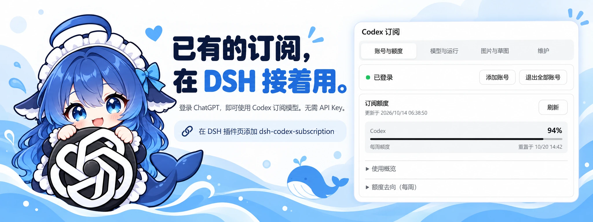
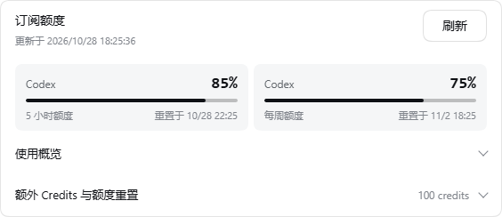
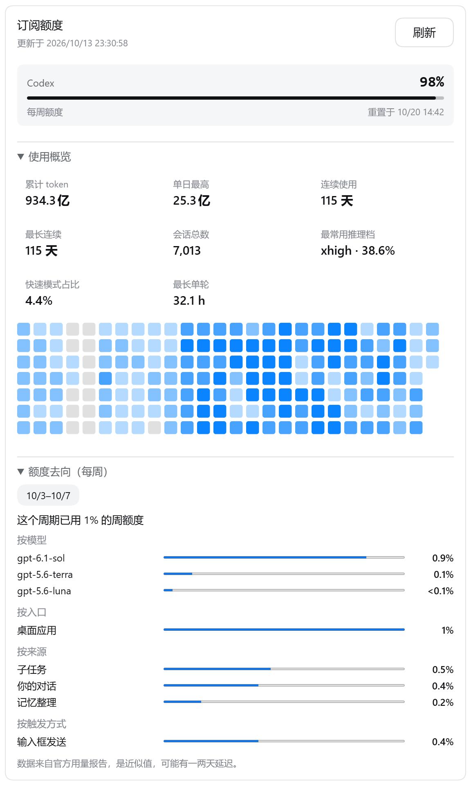
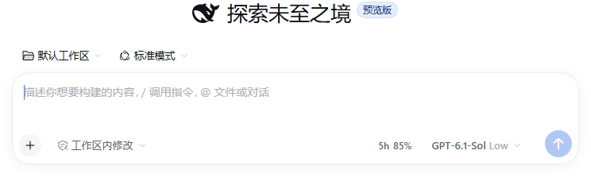
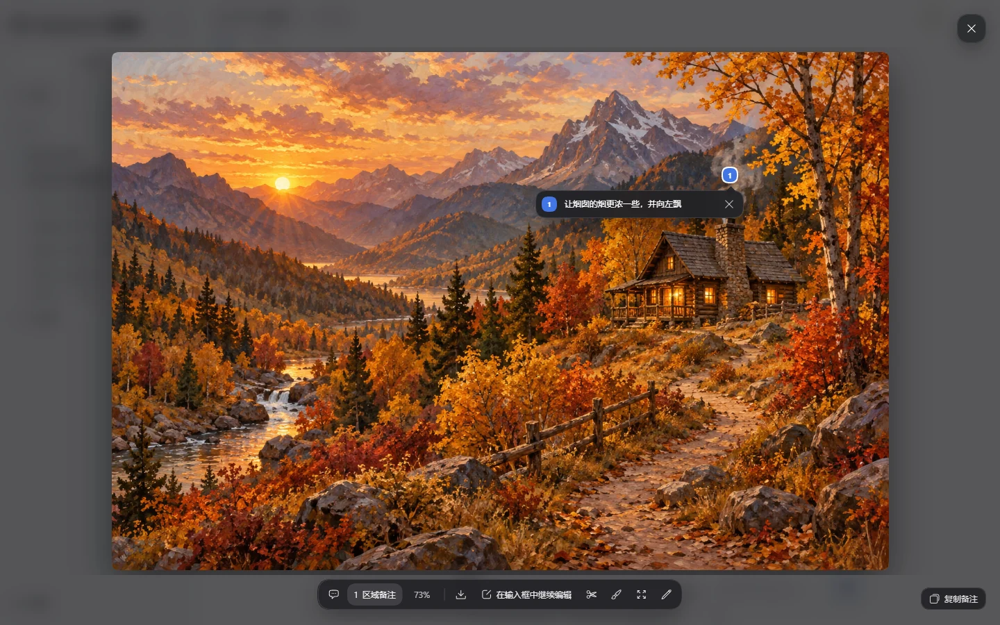
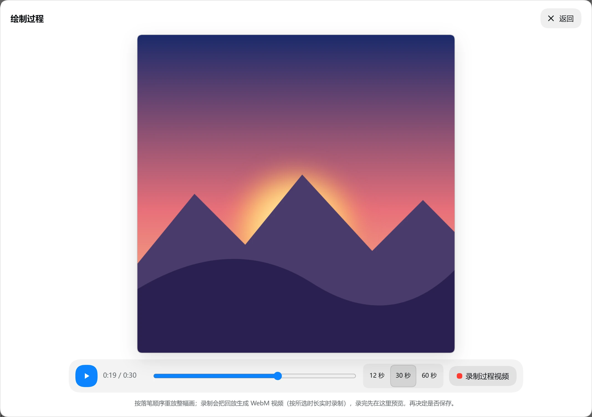
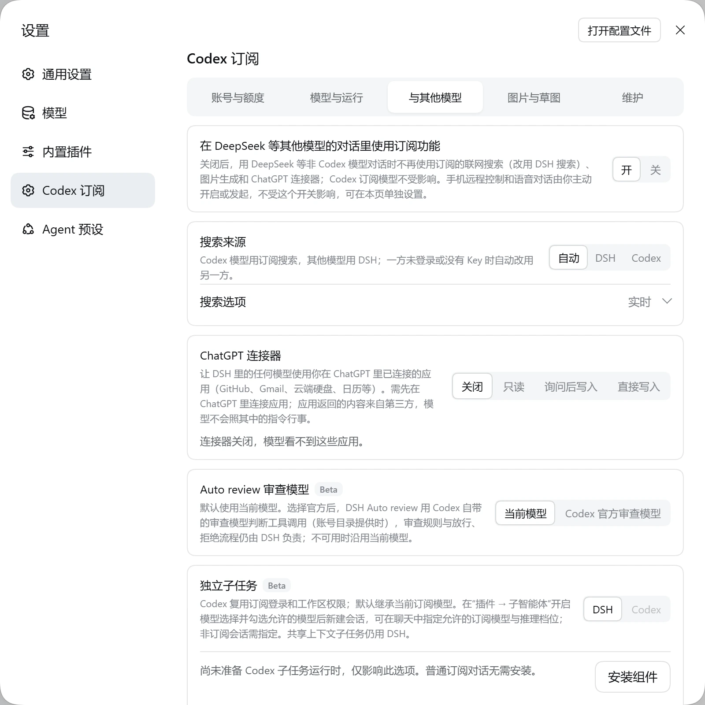
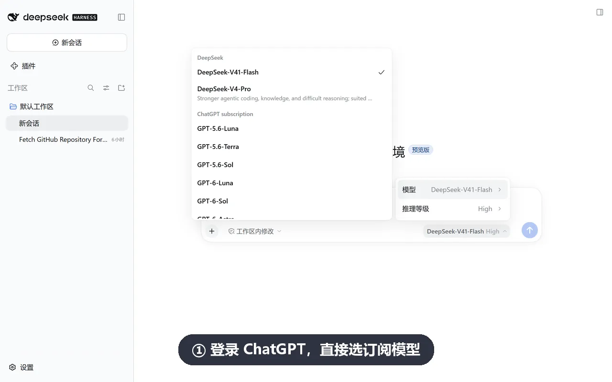
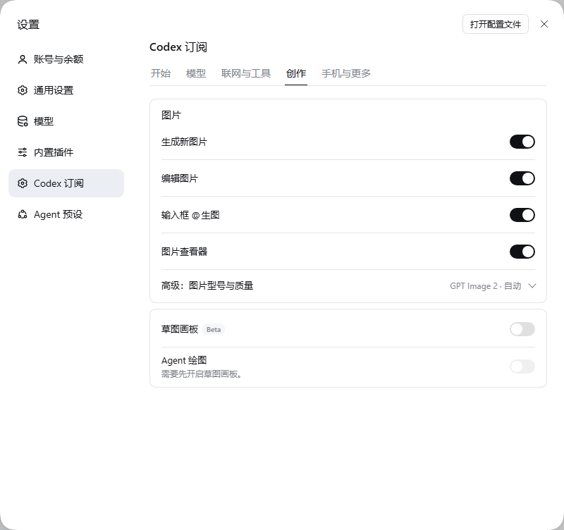

<p align="center"></p>

<div align="center">

# DSH Codex Subscription

**简体中文** · [English](https://github.com/WSL043/dsh-codex-subscription/blob/main/README.en.md)

**把 ChatGPT / Codex 订阅直接接入 DeepSeek Harness**

用 ChatGPT Plus / Pro 订阅登录，即可在 DSH 中使用 GPT-6 等 Codex 模型、查额度、联网搜索和生图。无需 OpenAI API Key，也不依赖 Codex CLI。

**新：用 ChatGPT 手机 App 远程控制电脑上的 DSH（Beta）**，DeepSeek 等任意 DSH 模型都能在手机上用。

[](https://github.com/WSL043/dsh-codex-subscription/actions/workflows/ci.yml)
[](https://www.npmjs.com/package/dsh-codex-subscription)
[](https://www.npmjs.com/package/dsh-codex-subscription)
[](LICENSE)
[](https://github.com/WSL043/dsh-codex-subscription/stargazers)

[安装](#安装) · [核心功能](#核心功能) · [手机远程控制](#手机远程控制beta) · [草图画板](#草图画板beta) · [全部功能](#全部功能) · [使用指南](docs/GUIDE.zh-CN.md) · [常见问题](#常见问题)

</div>

<p align="center"></p>

## 准备 DSH

已验证兼容 DSH `0.2.1-rc.2`（`latest` 与 `next` 通道），最低支持 `0.1.7-rc.2`；更早的 DSH 请先升级。

本插件支持软件包元数据中记录的最新版 DeepSeek Harness，并需要一个当前具有 Codex 使用资格的 ChatGPT 账户。

- **推荐：官方桌面端**。DeepSeek 已发布 [DeepSeek Harness 桌面版](https://www.deepseek.com/harness/)（macOS Apple Silicon、Windows 64 位，预览版、开源），无需配置 Node.js，安装后按下文在插件页面添加本插件即可。桌面端与网页版、命令行使用同一套 DSH 插件系统；本插件的端到端验收主要在网页版上完成，桌面端遇到问题请[提交 issue](https://github.com/WSL043/dsh-codex-subscription/issues)；
- 需要 Linux，或想要社区便携分发：使用 [DSH-Portable](https://github.com/WSL043/DSH-Portable)。这是面向 Windows、macOS 和 Linux 的社区便携桌面分发；
- 想按官方方式运行：查看 [DeepSeek Harness 官方说明](https://github.com/deepseek-ai/deepseek-harness#run)。

## 安装

### 在插件页面安装（推荐）

1. 打开 DSH 的 **插件 → 添加插件**。
2. 在 **包名或地址** 输入框中粘贴下面的包名（已带版本号）：

   ```text
   dsh-codex-subscription@3.1.2
   ```

3. 点击 **安装**，等待安装完成；按页面提示操作，需要重启时先保存工作。
4. 打开 **设置 → Codex 订阅**，登录 ChatGPT，然后在会话中选择 Codex 模型。

为什么要带版本号：DSH 的插件页只会安装发布满 24 小时的版本，只填包名时，新版本发布后的第一天可能装到更早的旧版，而旧版不一定兼容你的 DSH。带上版本号可以直接装到这一版；发布一天后只填 `dsh-codex-subscription` 也会装到最新正式版。其他版本号见[发布页](https://github.com/WSL043/dsh-codex-subscription/releases)。

<details>
<summary>终端安装（已能运行 dsh 命令）</summary>

```sh
dsh plugin --profile web add dsh-codex-subscription@3.1.2
```

安装完成后按提示重启 DSH，再到 **设置 → Codex 订阅** 登录。插件页面和终端均由 DSH 管理安装。

</details>

<details>
<summary>Headless 任务</summary>

先在 Web 中完成登录并选择一次 Codex 模型，再把同一个插件安装到 Headless profile：

```sh
dsh plugin --profile headless add dsh-codex-subscription@3.1.2
dsh --profile headless "只回复：ok"
```

</details>

## 核心功能

### 用订阅登录，直接用 Codex 模型

在 DSH 的 **设置 → Codex 订阅** 登录 ChatGPT，会话里就能选 GPT-6 等账号目录里的模型，调推理档位和速度档位，并使用订阅联网搜索。不需要 API Key。模型和额度以账号实际返回为准。

### 额度一眼看清

短周期和每周额度、重置时间、额外 Credits 与重置卡都在设置里；输入框旁可以常驻显示剩余额度，低于阈值会提醒。

<details>
<summary>查看截图</summary>

<p align="center"><picture><source media="(prefers-color-scheme: dark)" srcset="docs/assets/ui-quota-zh-dark.png"></picture></p>

</details>

<details>
<summary>使用概览与额度去向：累计用量、连续天数、每日热力图，以及每周额度花在哪</summary>
<br>
<p align="center"></p>
</details>

### 日常操作，留在输入框

选模型、调推理档位、切换速度档位，同时查看剩余额度，无需为每次请求打开设置。

<details>
<summary>查看截图</summary>

<p align="center"><picture><source media="(prefers-color-scheme: dark)" srcset="docs/assets/ui-composer-zh-dark.png"></picture></p>

</details>

### 手机远程控制（Beta）

用 ChatGPT 手机 App 的 Codex 扫码配对，这台电脑上的 DSH 就出现在手机的主机列表里，DeepSeek 等任意 DSH 模型都能在手机上用：

- 查看、新建、续聊、中断、归档对话，搜索对话和对话内的关键词；
- 切换模型、推理档位和权限（工作区内修改 / 完全访问）；
- 批准工具调用或回答提问时手机直接弹出；手机掉线，重新打开会再弹一次，否则交回电脑处理；
- 回复边生成边显示；命令、文件修改（带差异）、任务清单、联网搜索、连接器调用和生成的图片用手机原生视图显示；
- 发图片，@ 搜电脑上的文件，/ 选 DSH 技能，只读 git 查看改动，用真实的文件夹选择器新建对话；
- DSH 工作区对应手机上的项目；可以从手机分叉对话，看用量额度、累计用量和上下文用量；DSH 带有 `/compact` 时（0.2.0-rc.2 起）还能从手机压缩上下文；
- 模型报错会显示在手机上；设置里能看到已配对的手机，随时移除。

默认关闭：**设置 → Codex 订阅 → 手机与更多 → 手机远程控制**。电脑需要保持开机、联网并打开 DSH。本功能基于 Codex Remote Control 协议实现第三方主机兼容，使用 OpenAI 的远程连接服务。Codex 的远程控制能力已有官方实现，但 DSH 作为第三方主机的接入方式尚不属于官方明确承诺支持的范围，后续服务更新可能影响兼容性，所以标为 Beta。功能默认关闭，你可以自行开启、管理已配对设备或随时停用。该功能不代表获得 OpenAI 官方认证或背书。

<details>
<summary>查看截图</summary>

<p align="center"><picture><source media="(prefers-color-scheme: dark)" srcset="docs/assets/ui-remote-zh-dark.png"></picture></p>

</details>

### 图片与草图

用订阅生成图片，在图上圈出区域写备注继续修改，或者打开草图画板自己画、让 Agent 画，再以草图为参考生成成品。画板支持渐变、模糊、混合模式和形状裁剪；Agent 照着参考图画时能并排对比、看差异热图、量颜色和位置、撤销重来，画完还能一笔一笔回放并录成视频。

<details>
<summary>查看截图</summary>

<p align="center"></p>

</details>

<details>
<summary>查看截图</summary>

<p align="center"><picture><source media="(prefers-color-scheme: dark)" srcset="docs/assets/ui-replay-zh-dark.webp"></picture></p>

</details>

草图画板见 [草图画板](#草图画板beta)，开关在 **设置 → Codex 订阅 → 创作**。

### ChatGPT 连接器

让 DeepSeek 等任意 DSH 模型使用你在 ChatGPT 里连接的应用：GitHub、Gmail、Google 云端硬盘、日历等。模型先搜索再调用，写操作默认每次都要你批准，也可以在设置里改成不再询问。默认关闭，在“与其他模型”里开启。

### 订阅功能要不要给 DeepSeek 等其他模型用，由你定

联网搜索来源、ChatGPT 连接器和官方 Codex 子任务在 **设置 → Codex 订阅 → 联网与工具**，页首一个总开关：关闭后，用 DeepSeek 等非 Codex 模型对话时不再使用订阅的联网搜索（改用 DSH 搜索）、图片生成和 ChatGPT 连接器，Codex 订阅模型不受影响。默认开启。

<details>
<summary>查看截图</summary>

<p align="center"><picture><source media="(prefers-color-scheme: dark)" srcset="docs/assets/ui-interop-zh-dark.webp"></picture></p>

</details>

[详细用法、限制与可选组件 →](docs/GUIDE.zh-CN.md)

## 全部功能

模型权限和额度以账号实际返回为准。

<details>
<summary><b>模型与搜索</b>（14 项）</summary>
<br>

| 功能 | 你可以做什么 | 使用方式 / 条件 |
| --- | --- | --- |
| **订阅登录** | 直接登录 ChatGPT，使用 Codex 订阅模型，无需 API Key | 普通聊天无需 Codex CLI |
| **模型目录同步** | 自动读取账号可用模型与推理档位，支持手动刷新；目录标注退役的模型会在模型名称旁显示退役日期，不会自动切换你的选择 | 新型号以账号目录开放情况为准；模型只来自账号目录，未登录或读取失败时不显示任何模型，也不使用内置列表 |
| **模型列表** | 在“模型”页中逐个显示或隐藏输入框中的模型；模型选择器沿用 DSH 官方的模型标识（如新模型徽章） | 仅影响列表显示；已选模型和请求不受影响 |
| **默认模型** | 在“模型”页里选择每次新建会话默认使用的模型 | 写入 DSH 的默认模型设置，与在对话里切换模型是同一处；未设置时跟随 DSH 默认 |
| **推理等级** | 在输入框选择模型支持的推理档位 | 档位随模型变化 |
| **速度档位** | 在支持的模型上切换标准 / Fast；账号目录提供时还有 Ultrafast（Beta），输入框显示闪电标识 | 默认标准；Fast 和 Ultrafast 会增加用量消耗，Ultrafast 目前仅 Pro 500 |
| **输出详略** | 选择简短、适中或详细的回答偏好 | 默认跟随模型 |
| **输入图片精度** | 为发送给聊天模型的图片选择低、高、原图或自动精度 | 影响输入 token 用量；默认自动 |
| **订阅联网搜索** | 使用 Codex 搜索，或选择 DSH 搜索 | 可选自动、DSH、Codex 来源；在搜索发生时分流，不改写 DSH 自己的搜索设置，所以官方设置页的开关保持你设的样子；DeepSeek 账号路线和填了 API Key 的路线（新版 Search API / 旧版）都兼容；一方未登录或没有 Key 时自动改用另一方 |
| **其他模型总开关** | 一键让 DeepSeek 等非 Codex 模型的对话不再使用订阅的联网搜索、图片生成和 ChatGPT 连接器 | 设置 → Codex 订阅 → 联网与工具；默认开启，Codex 订阅模型不受影响；手机远程控制和语音由你主动开启或发起，不受它影响 |
| **搜索范围** | 选择实时 / 缓存搜索、关闭搜索，或限定域名 | 在“联网与工具”的搜索来源下 |
| **流无响应超时** | 设置连续没有收到流式数据时中断请求的时长 | 默认 10 分钟；不是整体回答时限 |
| **上下文预算** | 按模型使用标准、扩展或自定义上下文预算 | 受模型目录上限约束 |
| **GPT-Reserve** | 在账号开放时选择备用模型入口 | 实验性；不承诺独立备用额度 |

</details>

<details>
<summary><b>账号与额度</b>（10 项）</summary>
<br>

| 功能 | 你可以做什么 | 使用方式 / 条件 |
| --- | --- | --- |
| **多账号管理** | 添加、切换、移除账号，或退出全部账号 | 设置 → Codex 订阅 → 开始 |
| **额度详情** | 查看短周期 / 每周额度、重置时间及独立额度分组 | 仅展示服务端返回的窗口与分组 |
| **额度去向** | 在额度卡片里按周查看额度花在哪：按模型、入口、来源和触发方式拆分 | 来自官方用量报告，近似值，有一两天延迟；账号没有该报告时不显示 |
| **使用概览** | 在额度卡片里查看累计 token、单日最高、连续使用天数、最常用推理档，以及最近半年的每日用量热力图 | 来自官方使用统计；账号没有该统计时不显示 |
| **Credits 与重置卡** | 查看额外 Credits、消费上限和可用重置卡 | 账号返回对应数据时显示 |
| **输入框额度** | 不离开会话即可查看百分比或进度条 | 默认关闭，可选显示方式 |
| **续航预测** | 根据最近使用速度估算剩余可用时长 | Beta；可选，不是保证值 |
| **额度提醒** | 使用固定阈值、提前提醒，或分别设置短 / 长周期阈值 | 默认剩余 20% 提醒，可关闭 |
| **使用重置卡** | 在确认后主动使用服务端提供的重置卡 | 二次确认与等待保护，由服务端判定结果 |
| **重置后重试** | 等待已确认的短时额度重置，再继续请求 | 默认关闭；等待期间可停止 |

</details>

<details>
<summary><b>图片与草图</b>（14 项）</summary>
<br>

| 功能 | 你可以做什么 | 使用方式 / 条件 |
| --- | --- | --- |
| **图片生成** | 通过订阅生成图片，调整可用的请求型号与质量；需要时可生成透明背景 PNG | 默认开启，可关闭 |
| **参考图编辑** | 带上参考图继续修改作品 | 默认开启，可关闭 |
| **图片查看与下载** | 完成的出图结果直接显示在回答后，无需展开工具过程；可缩放、拖动、适合窗口、下载校验后的原图 | 内置查看器，无需另装；旧图可能只有预览 |
| **区域标注编辑** | 在图上圈定区域、填写备注，带定位参考继续编辑 | 回填输入框后由你确认发送 |
| **手绘画板** | 选择画布比例，使用钢笔、铅笔、荧光笔及橡皮 | Beta；画板默认关闭 |
| **形状与文字** | 绘制直线、箭头、形状、原生曲线，选中修改对象和文字 | 在草图画板中使用 |
| **渐变、模糊、混合与裁剪** | 填充可用线性 / 径向渐变；笔画可加模糊（发光、阴影、雾气）、混合模式（正片叠底、滤色、叠加等）和形状裁剪；图层也能设混合模式 | 都保留为可编辑属性，随移动缩放、草稿和导出保存；Agent 用 SVG 的渐变、`feGaussianBlur`、`mix-blend-mode`、`clip-path` 画出同样效果 |
| **图层与图片导入** | 分层创作，将图片加入草图继续画 | 图片作为图层管理 |
| **笔画平滑与导航** | 抬笔后平滑整条路径；拖动、缩放、撤销重做 | 快捷键可自定义和关闭 |
| **多份草稿** | 保存并重新编辑最多 20 份本地草稿 | 保存在当前浏览器 |
| **导入与导出** | 导出 PNG，或交换保留原生笔画的草稿文件 | 草稿文件可重新导入继续编辑 |
| **Agent 绘图** | 用 `@sketch` 让 Agent 绘制，查看进度并随时停止；Agent 可用 SVG 整段作画，导入为可编辑原生笔画；有参考图时可并排对比、看差异热图、局部放大、量颜色与边缘位置、撤销重画，每批画完都会返回误差变化 | Beta；默认关闭，需同时开启画板。这些工具只测量和展示，不替模型作画 |
| **绘制回放与视频** | 画板里的“回放”按钮把绘制过程一笔一笔重放（线条沿路径画出，填充先描边再自上而下铺色），可调速、拖动进度，并录成 WebM 视频 | 视频先在画板里预览，点“保存视频”才会保存，不会自动下载 |
| **绘图结果回看** | 完成后向模型返回画布预览，帮助后续检查 | Beta；默认关闭，会增加图片输入用量 |

</details>

<details>
<summary><b>进阶能力与维护</b>（9 项）</summary>
<br>

| 功能 | 你可以做什么 | 使用方式 / 条件 |
| --- | --- | --- |
| **手机远程控制** | 在 ChatGPT 手机 App 的 Codex 里直接指挥电脑上的 DSH：新建、续聊、归档对话，切换模型和权限，回答审批和提问，DeepSeek 等任意 DSH 模型都能用 | Beta；默认关闭，设置 → Codex 订阅 → 手机与更多 → 手机远程控制，扫码或输入手动码配对 |
| **Codex 独立子任务** | 复用订阅登录和工作区权限执行独立任务，可指定允许的模型与推理档位 | Beta，可选，多数人用不到：默认用 DSH 自己的子智能体（同样能用订阅模型）；想让子任务由官方 Codex Agent 执行时，才安装可选组件（约 377 MB，Windows），并在“插件 → 子智能体”开启模型选择。用独立数据目录和订阅登录，不读你电脑上的 Codex 登录 |
| **子任务组件管理** | 在设置里安装、停用或卸载官方 Codex 子任务组件 | 由支持的 DSH 宿主管理，无需额外登录 |
| **云端上下文压缩** | 使用 Codex 云端压缩继续长对话，同时保留 DSH 历史与原生压缩 | Beta / 实验性；默认关闭，开启的请求使用 SSE |
| **WebSocket 连接** | 实验性复用连接和上下文传输，连接失败可回退 SSE | Beta / 实验性；默认 SSE，不保证更快 |
| **Auto review 官方审查模型** | DSH Auto review 改用 Codex 自带的审查模型判断工具调用，审查规则与放行流程仍由 DSH 负责 | Beta；默认关闭，账号目录提供该模型时生效 |
| **ChatGPT 连接器** | 让 DeepSeek 等任意 DSH 模型使用你在 ChatGPT 里连接的应用：GitHub、Gmail、Google 云端硬盘、日历等；模型先搜索再调用，写操作默认每次都要你批准，可改成不再询问 | 默认关闭，设置 → Codex 订阅 → 与其他模型 → ChatGPT 连接器；需先在 ChatGPT 里连接应用 |
| **支持诊断** | 查看功能前置条件和近期操作结果，一键复制约 1 KB 的精简报告（完整报告可另行复制）；不含凭据和会话正文 | 设置 → 维护；未验证不代表故障 |
| **预测缓存清理** | 查看并清理本地额度预测历史 | 保留登录、草稿、原图和共享依赖 |

</details>

## 界面演示

<details>
<summary><b>界面演示（动图，点击展开）</b>：选模型、提问、出图、标注、草图、额度与重置</summary>
<br>
<p align="center"></p>
</details>

### 账号与偏好，集中管理

在 **设置 → Codex 订阅** 中管理账号和额度；其余功能按任务需要开启。

<details>
<summary>五个设置页分别做什么？</summary>

| 设置页 | 在这里做什么 |
| --- | --- |
| **开始** | 登录与切换账号、各功能开关一览、订阅额度、额度显示和提醒 |
| **模型** | 默认模型与模型列表、回答风格；折叠的“高级”里有上下文长度、重试、连接方式、云端压缩、审查模型 |
| **联网与工具** | 其他模型能否用订阅功能的总开关，搜索来源、ChatGPT 连接器、官方 Codex 子任务 |
| **创作** | 图片生成、编辑、输入框 @生图、图片查看器，草图画板和 Agent 绘图 |
| **手机与更多** | 手机远程控制、语音对话、本机缓存、支持诊断 |

**模型感知上下文**跟随账号模型目录，刷新不会覆盖未保存的草稿。额度分组以服务端实际返回为准，包括 Spark 等独立额度。

订阅请求失败时会明确报错，不会静默切换到其他付费路由。

</details>

[查看完整使用指南 →](docs/GUIDE.zh-CN.md)

## 草图画板（Beta）

草图画板和 Agent 绘图为 **Beta**，默认关闭，在“创作”页按需开启。手动画图点输入框的草图按钮；让 Agent 画发送 `@sketch` 加要求。

<details>
<summary>查看图片与草图设置</summary>

<p align="center"><picture><source media="(prefers-color-scheme: dark)" srcset="docs/assets/ui-creative-zh-dark.png"></picture></p>

DSH 实机设置截图，随浅色 / 深色主题切换。

</details>

支持图层、原生曲线、笔刷、撤销重做和快捷键；可保存多份草稿，导出 PNG 或可编辑草稿。生成图可标注区域后继续编辑。

[图片编辑与草稿保存 →](docs/GUIDE.zh-CN.md#图片生成与编辑beta)

## 更新与卸载

在 DSH **插件** 页面找到本插件，使用更新或卸载操作，完成后按页面提示重启。卸载插件不会删除其他插件。

<details>
<summary>终端方式</summary>

```sh
dsh plugin --profile web update dsh-codex-subscription@3.1.2
```

仅在需要卸载时运行：

```sh
dsh plugin --profile web remove dsh-codex-subscription
```

</details>

## 常见问题

<details>
<summary>和官方插件列表里的 Codex 组合包（dsh-hooks-codex）是什么关系？</summary>

没有关系，可以同时安装。官方的 Codex / Claude Code 组合包让 DSH 运行 Codex 或 Claude Code 格式的 hooks 配置（工具调用前后自动执行的脚本）；本插件负责用 ChatGPT 订阅登录、使用 Codex 模型、查看额度、搜索、生图和手机远程控制。

</details>

<details>
<summary>电脑没有 dsh 命令，怎么安装？</summary>

直接使用 DSH 的 **插件 → 添加插件**，粘贴包名即可，无需配置终端命令。

</details>

<details>
<summary>有多个 DSH，或安装后找不到插件？</summary>

在你实际使用的 DSH 中安装。使用终端时，请从目标 DSH 环境运行命令，并确认对应的 profile；不要删除 profile 或修改系统 PATH 来强行安装。

</details>

<details>
<summary>如何反馈问题？</summary>

在 **设置 → Codex 订阅 → 维护** 生成“支持诊断”，粘贴到[使用问题表单](https://github.com/WSL043/dsh-codex-subscription/issues/new?template=install-problem.yml)的诊断栏，并补充触发步骤。

诊断不含凭据、账号标识、原始响应或完整日志。请勿附上登录链接、授权码或浏览器回调地址。

</details>

<details>
<summary>需要装 Codex 命令行才能用吗？</summary>

普通订阅聊天不需要。只有想用 **Codex 独立子任务** 时，才在“设置 → Codex 订阅 → 联网与工具”里点“安装组件”，停用和卸载也在同一处。其余实验选项按需开启。[可选组件、存储清理与完整说明 →](docs/GUIDE.zh-CN.md)

</details>

## 定位与边界

- **只做 ChatGPT / Codex 订阅**，并把这一件事做深：额度与预测、图片与草图、子任务、诊断；不接入 Claude、Grok 等其他订阅。
- **失败就明确报错**：不会静默切换到其他付费路由，也不会虚构账号没有返回的额度窗口。
- **跟随官方 DSH 发布**：每次发版都用官方 DSH 的 latest、next 等通道做安装、启动、卸载、重装的端到端验收；已验证的版本见 [兼容性记录](docs/dsh-020-compatibility.md)。
- 模型、额度和功能开放情况以你的账号实际返回为准；ChatGPT 后端与 DSH 可能独立变化。

## 边界与支持

ChatGPT Codex 后端和 DSH 可能独立变化；本项目为社区项目，与 DeepSeek、OpenAI 无隶属或背书关系。

本项目的问题反馈请使用[使用问题表单](https://github.com/WSL043/dsh-codex-subscription/issues/new?template=install-problem.yml)；
明确的产品建议请使用[功能建议表单](https://github.com/WSL043/dsh-codex-subscription/issues/new?template=feature-request.yml)；
欢迎提交聚焦的修复和兼容性改进，具体要求见 [CONTRIBUTING.md](CONTRIBUTING.md)；
DSH 插件交流可前往 [DeepSeek Harness Discussions](https://github.com/deepseek-ai/deepseek-harness/discussions)。
敏感问题请先阅读 [SECURITY.md](SECURITY.md)。

如果这个项目对你有帮助，[点一下 Star](https://github.com/WSL043/dsh-codex-subscription/stargazers) 可以让更多 DSH 用户发现它。

<a href="https://star-history.com/#WSL043/dsh-codex-subscription&Date">
  <picture>
    <source media="(prefers-color-scheme: dark)" srcset="https://api.star-history.com/svg?repos=WSL043/dsh-codex-subscription&type=Date&theme=dark" />
    
  </picture>
</a>

[MIT](LICENSE)
