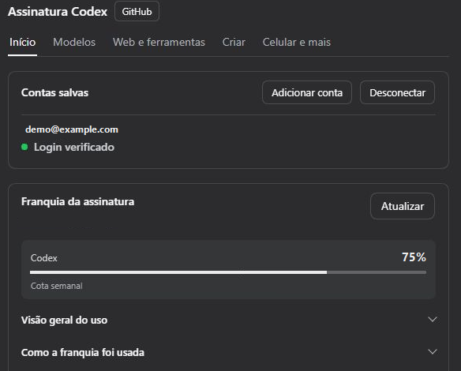
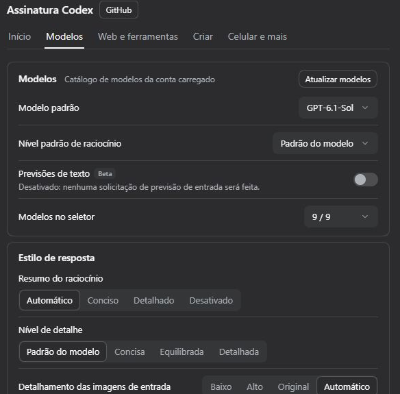

<p align="center"></p>

<div align="center">

# DSH Codex Subscription

[English](README.md) · [简体中文](README.zh-CN.md) · [日本語](README.ja.md) · [Español](README.es.md) · [Français](README.fr.md) · [Deutsch](README.de.md) · [Русский](README.ru.md) · **Português**

**Use sua assinatura do ChatGPT / Codex diretamente no DeepSeek Harness**

Entre com o ChatGPT Plus / Pro para usar GPT-6 e outros modelos Codex, a cota, a pesquisa na web e a geração de imagens dentro do DSH. Não é necessária uma chave de API da OpenAI nem o Codex CLI.

[](https://github.com/WSL043/dsh-codex-subscription/actions/workflows/ci.yml)
[](https://www.npmjs.com/package/dsh-codex-subscription)
[](https://www.npmjs.com/package/dsh-codex-subscription)
[](LICENSE)
[](https://github.com/WSL043/dsh-codex-subscription/stargazers)

[Destaques](#highlights) · [Instalação](#install) · [Imagens e esboços](#images-and-sketching) · [Controle remoto pelo celular](#phone-remote-control-beta) · [Todos os recursos](#all-features) · [Guia do usuário (em inglês)](docs/GUIDE.en.md) · [Solução de problemas (em inglês)](#troubleshooting)

</div>

<p align="center"></p>

<a id="highlights"></a>

## Destaques

| O que você quer fazer | O que o plugin oferece |
| --- | --- |
| **Conversar e pesquisar** | Entre com sua assinatura; escolha entre os modelos Codex, níveis de raciocínio e velocidade disponibilizados pela conta; use a pesquisa na web da assinatura. |
| **Gerenciar contas e cota** | Alterne entre contas, consulte a cota de períodos curtos e semanal, os créditos e as redefinições; veja o histórico de uso e alertas opcionais de cota no campo de mensagem. |
| **Criar e editar imagens** | Gere imagens, marque regiões para edição ou desenhe manualmente e com o agente em um quadro de esboço editável. [Exemplos →](#images-and-sketching) |
| **Continuar pelo celular** | Emparelhe o aplicativo móvel do ChatGPT para controlar o DSH deste computador. Os modelos DeepSeek e outros modelos do DSH também funcionam. [Beta, desativado por padrão →](#phone-remote-control-beta) |
| **Usar aplicativos conectados** | Permita que os modelos do DSH usem aplicativos conectados no ChatGPT, incluindo GitHub, Gmail, Drive e Calendar; a aprovação de escrita segue as permissões da sessão do DSH. |

Os modelos e a cota dependem do que sua conta disponibiliza. [Lista completa de recursos →](#all-features)

<details>
<summary>Use os recursos da assinatura com DeepSeek e outros modelos</summary>

Permita que o DeepSeek ou qualquer outro modelo do DSH use os aplicativos que você conectou no ChatGPT: GitHub, Gmail, Google Drive, Calendar e outros. Os modelos primeiro pesquisam e depois fazem chamadas; a aprovação de escrita segue o modo e as permissões da sessão do DSH. Desativado por padrão; ative em Web e ferramentas.

As fontes de pesquisa na web e leitura de páginas, os conectores do ChatGPT e as subtarefas independentes oficiais do Codex ficam em **Configurações → Assinatura Codex → Web e ferramentas**, com um controle geral na parte superior: quando desativado, as conversas com DeepSeek e outros modelos que não sejam Codex deixam de usar a pesquisa na web da assinatura (a pesquisa do DSH é usada no lugar), a geração de imagens e os conectores do ChatGPT; os modelos da assinatura Codex não são afetados. Ativado por padrão.

<p align="center"><picture><source media="(prefers-color-scheme: dark)" srcset="docs/assets/ui-interop-en-dark.webp"></picture></p>

</details>

<a id="prepare-dsh"></a>

## Preparar o DSH

Verificado com o DSH `0.2.2-rc.1`, com suporte mantido para `0.2.1-rc.3` e `0.2.1-rc.2`; a versão mínima compatível é `0.1.7-rc.2`. Atualize primeiro as versões mais antigas do DSH.

O CLI/Web do DSH `0.2.2-rc.1` requer Node.js **24.9 ou mais recente**; o aplicativo oficial para computador usa o ambiente de execução incluído.

Também é compatível com o host de prévia `0.2.2-alpha.2`. Consulte as [notas de compatibilidade (em inglês)](docs/dsh-022-alpha2-compatibility.md) para conhecer o escopo e os limites de validação.

Este plugin é compatível com a versão mais recente do DeepSeek Harness registrada nos metadados do pacote e requer uma conta ChatGPT que tenha acesso ao Codex no momento.

<details>
<summary>Escolha uma distribuição do DSH</summary>

- **Recomendado: o aplicativo oficial para computador.** O DeepSeek agora oferece um [aplicativo DeepSeek Harness para computador](https://www.deepseek.com/harness/) (macOS em Apple Silicon e Windows de 64 bits; versão de prévia e código aberto). Não é necessário configurar o Node.js: instale o aplicativo e adicione este plugin pela página Plugins, conforme descrito abaixo. O aplicativo para computador, o aplicativo Web e o CLI compartilham um único sistema de plugins do DSH; a aceitação completa deste plugin é testada principalmente no aplicativo Web. Portanto, [abra uma issue](https://github.com/WSL043/dsh-codex-subscription/issues) se o aplicativo para computador apresentar problemas.
- Precisa de Linux ou prefere uma versão portátil da comunidade? Use o [DSH-Portable](https://github.com/WSL043/DSH-Portable), uma distribuição portátil para computador da comunidade, compatível com Windows, macOS e Linux.
- Prefere o caminho oficial? Siga o [guia de execução do DeepSeek Harness (em inglês)](https://github.com/deepseek-ai/deepseek-harness#run).

</details>

<a id="install"></a>

## Instalação

<a id="install-from-the-plugins-page-recommended"></a>

### Instalar pela página Plugins (recomendado)

1. No DSH, abra **Plugins → Adicionar plugin**.
2. Cole o nome deste pacote, com a versão, no campo **Nome ou endereço do pacote**:

   ```text
   dsh-codex-subscription@3.2.8
   ```

3. Clique em **Instalar** e aguarde a conclusão. Siga as instruções da página; salve seu trabalho antes de reiniciar, se solicitado.
4. Abra **Configurações → Codex**, entre no ChatGPT e selecione um modelo Codex na conversa.

<details>
<summary>Por que incluir a versão?</summary>

Por que a versão está incluída: a página de plugins do DSH só instala versões com pelo menos 24 horas, então o nome simples do pacote pode instalar uma versão mais antiga durante o primeiro dia após o lançamento, e essa versão pode não ser compatível com seu DSH. Com a versão especificada, você obtém exatamente esta versão; um dia após o lançamento, o nome simples `dsh-codex-subscription` também aponta para a versão estável mais recente. Outros números de versão estão na [página de lançamentos](https://github.com/WSL043/dsh-codex-subscription/releases).

</details>

<details>
<summary>Instalação pelo terminal (com um comando dsh existente)</summary>

```sh
dsh plugin --profile web add dsh-codex-subscription@3.2.8
```

Siga as instruções para reiniciar e entre em **Configurações → Codex**. Tanto a página Plugins quanto o terminal usam o gerenciamento de instalações do DSH.

</details>

<details>
<summary>Tarefas sem interface gráfica</summary>

Depois de entrar e selecionar um modelo Codex na versão Web, instale o mesmo plugin no perfil Headless:

```sh
dsh plugin --profile headless add dsh-codex-subscription@3.2.8
dsh --profile headless "Reply with only the word: ok"
```

</details>

<a id="interface-demo"></a>

## Demonstração da interface

Conecte sua conta do ChatGPT, escolha um modelo do Codex no DSH e acompanhe a franquia da assinatura nas configurações.

<details>
<summary>Fazer login e conferir a franquia</summary>

Abra **Configurações → Codex → Início** e selecione **Login pelo navegador**. Após entrar, você verá as contas salvas e a franquia informada pelo ChatGPT. Expanda a visão geral ou o detalhamento de uso para ver mais informações.

<p align="center"></p>

_A conta e os valores de franquia são exemplos._

</details>

<details>
<summary>Escolher um modelo do Codex e enviar uma mensagem</summary>

Em **Configurações → Codex → Modelos**, escolha o modelo e o nível de raciocínio padrão. Para mudar de modelo em uma conversa, use o seletor ao lado do campo de entrada. Digite e envie uma mensagem para usar sua assinatura no DSH.

<p align="center"></p>

</details>

<details>
<summary>O que há em cada aba das configurações?</summary>

| Aba das configurações | O que ela controla |
| --- | --- |
| **Início** | Login e contas, controle individual para cada recurso, cota da assinatura, exibição da cota e alertas |
| **Modelos** | Modelo padrão, nível de raciocínio padrão e lista de modelos, estilo das respostas; o grupo avançado recolhido contém tamanho do contexto, novas tentativas, modo de conexão, compactação na nuvem e modelo de revisão |
| **Web e ferramentas** | Controle geral para outros modelos, fonte de pesquisa, conectores do ChatGPT, subtarefas independentes oficiais do Codex |
| **Criar** | Geração de imagens, edição, @image no campo de mensagem, visualizador de imagens, quadro de esboço e desenho pelo agente |
| **Celular e mais** | Controle remoto pelo celular, chamadas de voz experimentais, cache local, diagnósticos de suporte |

A conversa por voz vem desativada por padrão. Ative-a em **Celular e mais** e, em seguida, inicie uma chamada pelo campo de mensagem. Se uma janela nativa, inclusive no Linux, não oferecer suporte a WebRTC, o DSH oferecerá a opção de continuar a mesma conversa em um navegador. As amostras de voz continuam disponíveis, e sua assinatura existente é usada sem uma chave de API.

**Contexto adaptado ao modelo** segue o diretório de modelos da sua conta; atualizar preserva o rascunho não salvo. As configurações mostram a janela bruta; os limites de conversa reservam uma margem usando a porcentagem oficial (5% quando não especificada), e então o DSH gerencia as reservas de saída e a compactação. Não é necessário fazer subtrações manualmente. Os grupos de cota usam os valores fornecidos pelo backend, incluindo categorias separadas, como Spark.

Falhas na assinatura continuam visíveis: não há mudança silenciosa para outra opção paga.

</details>

<a id="images-and-sketching"></a>

## Imagens e esboços

Gere imagens com sua assinatura, visualize e baixe os originais ou marque uma região e adicione observações para continuar editando. A geração e a edição de imagens são controladas em **Configurações → Codex → Criar**.

<details>
<summary>Anotação de imagem e edição contínua</summary>

<p align="center"></p>

</details>

<details>
<summary>Ver configurações de Imagens e esboços</summary>

<p align="center"><picture><source media="(prefers-color-scheme: dark)" srcset="docs/assets/ui-creative-en-dark.png"></picture></p>

Configurações mostradas diretamente em capturas de tela recortadas da interface real do DSH, seguindo o tema claro ou escuro.

</details>

<a id="sketch-board-beta"></a>

### Quadro de esboço (Beta)

O quadro de esboço e o desenho pelo agente estão em **Beta** e vêm desativados por padrão; ative-os na página Criar. Desenhe à mão usando o botão de esboço no campo de mensagem ou envie `@sketch` com um pedido para o agente desenhar.

O quadro oferece camadas, curvas nativas, pincéis, gradientes, desfoque, modos de mesclagem, recorte, desfazer/refazer e atalhos. Salve vários rascunhos e exporte PNGs ou rascunhos editáveis. Com uma referência, o Agent pode comparar imagens, medir cores e posições e desfazer ações. Os desenhos finalizados podem ser reproduzidos e gravados em vídeo.

<details>
<summary>Exemplo de desenho pelo Agent: garota-baleia</summary>

Os agentes desenharam estes exemplos no quadro de esboço usando traços nativos editáveis, sem chamar a geração de imagens. Os três usaram a mesma referência e a mesma configuração básica das ferramentas de desenho. Estas são execuções individuais com diferentes níveis de esforço e durações.

<p align="center"><b>Imagem de referência</b><br></p>

<table>
<tr><th width="33%">GPT-6-Astra</th><th width="33%">GPT-6.1-Sol</th><th width="33%">DeepSeek Flash</th></tr>
<tr><td></td><td></td><td></td></tr>
<tr><td>Médio · 20 min 57 s<br>686 traços</td><td>Alto · primeira rodada: 23 min<br>1.020 traços</td><td>Alto · 9 min 33 s<br>623 traços</td></tr>
</table>

Após uma interrupção na conexão, o desenho do 6.1 foi restaurado a partir do salvamento automático e das chamadas originais bem-sucedidas. Em seguida, o modelo conferiu a prévia e a salvou, sem adicionar nenhum desenho manual. Esta não foi uma execução bem-sucedida sem interrupções.

</details>

<details>
<summary>Do esboço à imagem gerada: torre do relógio e paisagem azul-esverdeada</summary>

Primeiro, o agente fez um esboço editável; depois, usou esse esboço como referência para gerar uma imagem com a assinatura. Sol e Astra abaixo são os nomes dos modelos de conversa que conduzem o fluxo de trabalho, não do backend de geração de imagens.

**Corte da torre do relógio**

<table>
<tr><th>Modelo de conversa</th><th width="43%">Esboço do Agent</th><th width="43%">Gerada a partir do esboço</th></tr>
<tr><td>GPT-6.1-Sol<br>Xhigh</td><td></td><td></td></tr>
<tr><td>GPT-6-Astra<br>Low</td><td></td><td></td></tr>
</table>

**Paisagem azul-esverdeada**

<table>
<tr><th>Modelo de conversa</th><th width="43%">Esboço do Agent</th><th width="43%">Gerada a partir do esboço</th></tr>
<tr><td>GPT-6.1-Sol<br>Xhigh</td><td></td><td></td></tr>
<tr><td>GPT-6-Astra<br>Low</td><td></td><td></td></tr>
</table>

</details>

[Edição de imagens e armazenamento de rascunhos →](docs/GUIDE.en.md#image-generation-and-editing)

<a id="phone-remote-control-beta"></a>

## Controle remoto pelo celular (Beta)

Emparelhe a seção Codex do aplicativo móvel ChatGPT com o DSH no seu computador. Inicie ou continue conversas, use ferramentas e gerencie solicitações de aprovação pelo celular, com DeepSeek ou qualquer outro modelo do DSH.

**Desativado por padrão.** Ative em **Configurações → Codex → Celular e mais → Controle remoto pelo celular** e emparelhe por QR ou código manual. Seu computador precisa permanecer ligado, conectado à internet e com o DSH em execução.

Esta é uma camada de compatibilidade de terceiros que usa o serviço de conexão remota da OpenAI. Existe um controle remoto oficial do Codex, mas a compatibilidade do host DSH não é explicitamente garantida pela OpenAI e pode mudar com as atualizações do serviço. Você pode remover dispositivos emparelhados ou desativar o recurso a qualquer momento.

<details>
<summary>Operações compatíveis pelo celular</summary>

- acompanhar, iniciar, continuar, interromper e arquivar conversas; pesquisar conversas e palavras-chave dentro de uma conversa;
- trocar o modelo, o nível de raciocínio e a permissão (gravação no espaço de trabalho / acesso total);
- aprovações e perguntas aparecem no celular; se a conexão cair, elas aparecem novamente quando você o reabrir; caso contrário, voltam para o computador;
- as respostas aparecem à medida que são escritas; comandos, edições de arquivos com diferenças, a lista de tarefas, pesquisas na web, chamadas de conectores e imagens geradas usam as visualizações nativas do celular;
- enviar fotos, usar @ para pesquisar arquivos no computador, usar / para escolher habilidades do DSH, ver alterações com o git somente leitura e iniciar conversas em um seletor de pastas real;
- os espaços de trabalho do DSH aparecem como projetos; bifurcar uma conversa, ver limites de uso, uso acumulado e uso de contexto; quando o DSH oferecer suporte a `/compact`, compactar o contexto pelo celular;
- erros de modelo aparecem no celular; os celulares emparelhados são listados nas configurações e podem ser removidos.

</details>

<details>
<summary>Configurações de emparelhamento e celulares emparelhados</summary>

<p align="center"><picture><source media="(prefers-color-scheme: dark)" srcset="docs/assets/ui-remote-en-dark.png"></picture></p>

</details>

<a id="all-features"></a>

## Todos os recursos

O acesso a modelos e a cota dependem da sua conta.

<details>
<summary><b>Modelos e pesquisa</b> (14)</summary>
<br>

| Recurso | O que você pode fazer | Disponibilidade / configuração |
| --- | --- | --- |
| **Login da assinatura** | Entre no ChatGPT e use os modelos da assinatura Codex sem uma chave de API | O chat normal não precisa do Codex CLI |
| **Sincronização do catálogo de modelos** | Lê os modelos e níveis de raciocínio disponíveis na sua conta, com atualização manual; o último catálogo sincronizado com sucesso é armazenado localmente por conta e permanece disponível durante a atualização em segundo plano após a reinicialização, por 24 horas; modelos marcados para descontinuação exibem a data ao lado do nome, sem alterar automaticamente sua seleção | Novos modelos aparecem quando são disponibilizados para sua conta; o catálogo da conta é a única fonte, portanto nenhum modelo é exibido quando você está desconectado ou quando não há leitura remota nem cache válido |
| **Lista de modelos** | Exibe ou oculta modelos individuais no seletor do campo de mensagem, na página Modelos; o seletor mantém os rótulos de modelo próprios do DSH (como o selo de modelo novo) | Apenas exibição; os modelos selecionados e as solicitações continuam funcionando |
| **Modelo padrão** | Escolhe o modelo com que uma nova conversa é iniciada, na página Modelos | Define a configuração de modelo padrão do DSH, a mesma que é alterada ao trocar de modelo em um chat; desmarque para seguir o padrão do DSH |
| **Nível padrão de raciocínio** | Escolhe um nível padrão para modelos de assinatura na página Modelos; Padrão do modelo segue a recomendação oficial do catálogo para cada modelo | As escolhas manuais têm prioridade. Níveis não compatíveis retornam ao padrão válido do modelo; escolhas manuais existentes nas conversas são preservadas |
| **Níveis de raciocínio** | Escolhe o nível de raciocínio compatível no campo de mensagem | Os níveis variam conforme o modelo |
| **Níveis de velocidade** | Alterna modelos compatíveis entre Padrão e Rápido; também inclui Ultrarrápido (Beta) quando o catálogo da conta o disponibiliza, com um indicador de raio | Padrão por padrão; Rápido e Ultrarrápido aumentam o uso, e atualmente Ultrarrápido está disponível apenas no Pro 500 |
| **Detalhamento das respostas** | Solicita respostas curtas, médias ou detalhadas | Segue o padrão do modelo, a menos que seja alterado |
| **Detalhe das imagens de entrada** | Escolhe o nível de detalhe Baixo, Alto, Original ou Automático para imagens enviadas ao modelo de chat | Afeta os tokens de entrada; Automático por padrão |
| **Pesquisa na web por assinatura** | Fontes Automático, DSH e Codex | Automático prioriza a fonte correspondente ao modelo da sessão e tenta a outra apenas quando faltam credenciais ou o serviço está indisponível. As escolhas explícitas DSH / Codex fixam a fonte e informam as falhas diretamente. Com Outros modelos desativado, chats que não usam Codex recorrem apenas à pesquisa nativa do DSH. O plugin não reescreve as configurações de pesquisa do DSH nem adiciona uma alternativa de conta DeepSeek; as cobranças da pesquisa nativa dependem do serviço selecionado |
| **Alternância para outros modelos** | Uma única opção impede que conversas em DeepSeek e outros modelos que não sejam Codex usem a pesquisa na web por assinatura, a geração de imagens e os conectores do ChatGPT | Configurações → Assinatura Codex → Web e ferramentas; ativada por padrão; não afeta os modelos da assinatura Codex; o controle remoto pelo celular e a voz são iniciados por você e não são afetados |
| **Escopo da pesquisa** | Escolhe pesquisa ao vivo / em cache, desativa a pesquisa ou restringe os domínios | Configure em Web e ferramentas, no grupo de fontes de pesquisa |
| **Tempo limite de inatividade do fluxo** | Define por quanto tempo uma solicitação pode ficar sem receber dados transmitidos antes de ser cancelada | 10 minutos por padrão; não é um prazo limite para a resposta inteira |
| **Orçamento de contexto** | Usa orçamentos padrão, estendidos ou personalizados por modelo | Limitado pelo catálogo de modelos |
| **GPT-Reserve** | Seleciona o modelo de reserva quando ele está disponível para sua conta | Experimental; não há garantia de uma cota de reserva separada |

</details>

<details>
<summary><b>Contas e cota</b> (10)</summary>
<br>

| Recurso | O que você pode fazer | Disponibilidade / configuração |
| --- | --- | --- |
| **Várias contas** | Adiciona, alterna, remove ou desconecta todas as contas | Configurações → Codex → Iniciar |
| **Detalhes da cota** | Exibe períodos curtos / semanais, horários de redefinição e grupos de cota separados | São exibidos apenas os períodos e grupos fornecidos pelo backend |
| **Destino da cota** | No cartão de cota, veja a divisão da cota de cada semana por modelo, interface, fonte e acionador | Com base no relatório oficial de uso: valores aproximados, podem apresentar atraso de um ou dois dias; oculto quando a conta não tem relatório |
| **Visão geral do uso** | No cartão de cota, veja os tokens acumulados, o dia de maior uso, sequências, o nível de raciocínio mais usado e um mapa de calor diário de seis meses | Com base nas estatísticas oficiais de uso; oculto quando a conta não tem estatísticas |
| **Créditos e cartões de redefinição** | Exibe Créditos adicionais, limites de gastos e cartões de redefinição disponíveis | Exibidos quando fornecidos para sua conta |
| **Cota no campo de mensagem** | Exibe a cota restante como porcentagem ou barra de progresso durante o chat | Desativada por padrão; escolha o modo de exibição |
| **Estimativa de duração** | Passe o cursor sobre a cota no campo de mensagem ou clique nela para ver quando o uso recente a esgotaria | Beta; estimativa opcional, não é uma garantia |
| **Alertas de cota** | Usa limites fixos, antecipados ou personalizados para períodos curtos / longos | 20% restante por padrão; pode ser desativado |
| **Resgatar cartões de redefinição** | Usa um cartão de redefinição disponível após confirmação | Proteções de confirmação e espera; o servidor determina o resultado |
| **Tentar novamente após a redefinição** | Aguarda a confirmação da redefinição do período curto antes de continuar | Desativado por padrão; a espera pode ser interrompida |

</details>

<details>
<summary><b>Imagens e esboços</b> (14)</summary>
<br>

| Recurso | O que você pode fazer | Disponibilidade / configuração |
| --- | --- | --- |
| **Geração de imagens** | Gera imagens pela sua assinatura e ajusta as opções disponíveis de modelo / qualidade da solicitação; se necessário, peça um PNG com fundo transparente | Ativada por padrão, pode ser desativada |
| **Edição de imagens de referência** | Continua aprimorando uma imagem com referências | Ativada por padrão, pode ser desativada |
| **Visualização e download de imagens** | As imagens concluídas aparecem após a resposta, sem expandir a atividade da ferramenta; amplia, desloca, ajusta à janela e baixa os originais verificados | Visualizador integrado; imagens mais antigas podem ter apenas prévias |
| **Edição por região** | Marca regiões, adiciona notas e continua a edição com referências de localização | Preenche o campo de mensagem para você revisar e enviar |
| **Tela de desenho manual** | Escolhe uma proporção e desenha com caneta, lápis, marcador e borrachas | Beta; a tela de desenho fica desativada por padrão |
| **Formas e texto** | Desenha linhas, setas, formas, curvas nativas e texto / objetos editáveis | Disponível na tela de esboço |
| **Gradientes, desfoque, mesclagem e recorte** | Preencha com gradientes lineares / radiais; adicione desfoque (brilho, sombra, névoa), modos de mesclagem (multiplicação, tela, sobreposição, …) e recorte de formas a um traço; as camadas também podem ter um modo de mesclagem | Tudo permanece como propriedades editáveis e é preservado ao mover, dimensionar, criar rascunhos e exportar; o agente obtém o mesmo por meio de gradientes SVG, `feGaussianBlur`, `mix-blend-mode` e `clip-path` |
| **Camadas e importação de imagens** | Trabalhe em camadas e traga imagens para a tela | As imagens são gerenciadas como camadas |
| **Suavização e navegação** | Suavize traços completos após soltá-los; mova a tela, amplie, desfaça e refaça | Os atalhos podem ser personalizados ou desativados |
| **Vários rascunhos** | Salve e reabra até 20 rascunhos locais | Armazenados no navegador atual |
| **Importação e exportação** | Exporte PNG ou rascunhos nativos que preservam traços editáveis | Os rascunhos podem ser importados novamente para continuar a edição |
| **Desenho pelo agente** | Peça ao agente para desenhar com `@sketch`, acompanhe o progresso e interrompa-o; o agente pode desenhar etapas completas em SVG, importadas como traços nativos editáveis; com uma referência, ele pode comparar lado a lado, ler um mapa de calor das diferenças, ampliar uma região, medir cores e posições de bordas e desfazer, e cada lote informa como o erro mudou | Beta; desativado por padrão, requer a tela. As ferramentas apenas medem e exibem; nunca desenham pelo modelo |
| **Reprodução e vídeo** | O botão Reproduzir redesenha o processo traço por traço (linhas ao longo de seu percurso, preenchimentos primeiro contornados e depois preenchidos de cima para baixo), com predefinições de velocidade e uma barra de navegação, e o grava como vídeo WebM | O vídeo é pré-visualizado no quadro e só é salvo quando você clica em Salvar vídeo; nada é baixado automaticamente |
| **Prévia do resultado para o modelo** | Retorne uma imagem da tela após desenhar para análise posterior | Beta; desativado por padrão, adiciona uso de entrada de imagem |

</details>

<a id="codex-subtask-runtime"></a>

<details>
<summary><b>Recursos avançados e manutenção</b> (9)</summary>
<br>

| Recurso | O que você pode fazer | Disponibilidade / configuração |
| --- | --- | --- |
| **Controle remoto pelo celular** | Controle o DSH no computador pela seção Codex do app móvel do ChatGPT: inicie, continue e arquive conversas, alterne o modelo e as permissões, responda a aprovações e perguntas; DeepSeek e qualquer outro modelo do DSH funcionam | Beta; desativado por padrão; Configurações → Codex → Celular e mais → Controle remoto pelo celular, emparelhe por QR ou código manual |
| **Subtarefas independentes do Codex** | Reutilize o login da assinatura e as permissões do espaço de trabalho; selecione modelos e níveis de raciocínio permitidos | Beta, opcional, desnecessário para a maioria: por padrão, o DSH executa seus próprios subagentes (que também podem usar modelos da assinatura); instale o componente opcional (inclui um Codex CLI exclusivo deste plugin) e ative a seleção de modelos em Plugins → Subagentes somente se quiser que as subtarefas sejam executadas pelo agente oficial do Codex. Ele usa seu próprio diretório de dados e o login da sua assinatura, nunca o login do Codex neste computador |
| **Gerenciamento do componente de subtarefas** | Instale, desative ou desinstale o componente oficial de subtarefas do Codex pelas configurações | Gerenciado por hosts DSH compatíveis; não requer login adicional |
| **Compactação de contexto na nuvem** | Continue conversas longas usando a compactação do Codex, preservando o histórico do DSH e a compactação nativa | Beta / experimental; desativado por padrão, as solicitações com o recurso ativado usam SSE |
| **Transporte por WebSocket** | Reutilize conexões e transferências de contexto de forma experimental, com uso de SSE como alternativa em caso de falha na conexão | Beta / experimental; SSE por padrão, sem garantia de velocidade |
| **Revisor do Codex para revisão automática** | A revisão automática do DSH avalia chamadas de ferramentas com o modelo de revisão próprio do Codex; o DSH mantém sua política de revisão e o fluxo de permitir/negar | Beta; desativado por padrão, aplica-se quando o catálogo da sua conta oferece o modelo |
| **Conectores do ChatGPT** | Permita que o DeepSeek ou qualquer modelo do DSH use os apps que você conectou ao ChatGPT: GitHub, Gmail, Google Drive, Calendar e outros; os modelos primeiro pesquisam e depois fazem chamadas, e a aprovação de escrita segue o modo e as permissões da sessão do DSH | Desativado por padrão, Configurações → Codex → Web e ferramentas → Conectores do ChatGPT; conecte os apps primeiro no ChatGPT |
| **Diagnóstico de suporte** | Verifique os pré-requisitos e os resultados recentes das operações e copie um relatório breve (cerca de 1 KB; o relatório completo pode ser copiado separadamente) sem credenciais nem texto de conversas | Configurações → Codex → Celular e mais; não verificado não significa que esteja com defeito |
| **Limpeza do cache de previsão** | Verifique e limpe o histórico local de previsão de cotas | Preserva o login, os rascunhos, os originais e as dependências compartilhadas |

</details>

<a id="reuse-cache-when-changing-effort"></a>

### Reutilizar cache ao alterar o nível

**Reutilizar cache ao alterar o nível** fica em **Configurações → Codex → Modelos → Avançado**. Está ativado por padrão e pode ser desativado; as escolhas salvas como desativadas são preservadas. Aplica-se somente a modelos padrão de agente único explicitamente compatíveis com o catálogo atual da conta; a compatibilidade nunca é inferida pelos nomes dos modelos. O cache comum de prompts é automático e continua funcionando mesmo quando esta opção está desativada.

O `reasoning.effort` no nível da solicitação permanece no valor inicial da janela de contexto atual. As alterações são registradas como itens `configuration_update` no novo histórico e reproduzidas nas posições originais. Isso pode reduzir a invalidação do cache ao mudar o nível de raciocínio; não garante acertos de cache, respostas mais rápidas nem economia de cota. O nível de raciocínio no nível da resposta ainda pode informar o valor inicial.

- **A compactação automática na nuvem e as tentativas ilimitadas desativam este recurso.** A interface explica o conflito; suas configurações de compactação, tentativas, autenticação, conexão e chave de cache nunca são alteradas automaticamente.
- Respostas bem-sucedidas salvam um pequeno estado sem texto junto aos metadados de reprodução existentes do DSH para reinicialização, retomada e ramificações. Uma compactação local bem-sucedida altera o prefixo; após verificar a substituição confirmada do histórico pelo DSH, o plugin estabelece uma nova referência inicial no nível de raciocínio selecionado. Uma compactação com falha mantém o estado anterior.
- Ativar esse recurso em um chat existente ou voltar a um modelo compatível estabelece uma referência inicial somente quando a entrada completa corresponde ao histórico de sessão nativo do DSH. A primeira solicitação pode perder o cache antigo. Históricos não verificáveis, modelos incompatíveis, mudanças de conta e limites de recursos usam solicitações comuns com o nível de raciocínio selecionado.
- O estado pendente no mesmo processo congela uma entrada já enviada, mesmo que ela falhe ou seja cancelada. Selecionar um nível de raciocínio diferente para essa mesma repetição gera um erro; mantenha o nível original ou envie uma nova mensagem. Tentativas com falha não têm um ponto de verificação durável de resposta bem-sucedida, portanto não há garantia de que o prefixo do cache seja preservado após a reinicialização do processo ou o recarregamento do plugin.
- Desativar restaura as solicitações normais, sem aplicar atualizações retroativamente aos registros antigos. O histórico de atualizações nunca é enviado para `/responses/compact`. Pro, multiagente, truncamento automático e compactação automática não são compatíveis.
- O recurso é limitado a 20.000 itens de entrada, 16 MiB de dados de entrada/envelope com impressão digital, 128 atualizações e 256 sessões ativas/pendentes. Falhas na validação dos limites ou do histórico interrompem a preservação, não o nível de raciocínio selecionado.

Isso usa atualizações de configuração documentadas no [guia de raciocínio](https://developers.openai.com/api/docs/guides/reasoning) da OpenAI; consulte [cache de prompts](https://developers.openai.com/api/docs/guides/prompt-caching) para ver os requisitos de cache. O suporte acompanha o catálogo atual da conta e as respostas reais. Rejeições de parâmetros pelo backend são informadas e nunca levam a uma nova tentativa com um nível de raciocínio antigo ou uma chave de API.

<a id="update-and-uninstall"></a>

## Atualizar e desinstalar

Encontre este plugin na página **Plugins** do DSH e use a opção de atualização ou desinstalação. Siga as instruções de reinicialização, se houver. Desinstalar este plugin não remove outros plugins.

<details>
<summary>Comandos do terminal</summary>

```sh
dsh plugin --profile web update dsh-codex-subscription@3.2.8
```

Execute somente quando quiser desinstalar:

```sh
dsh plugin --profile web remove dsh-codex-subscription
```

</details>

<a id="troubleshooting"></a>

## Solução de problemas

<details>
<summary>Qual é a relação disso com o pacote oficial Codex (dsh-hooks-codex) na lista de plugins?</summary>

Eles não têm relação e podem ser instalados juntos. Os pacotes oficiais Codex / Claude Code permitem que o DSH execute configurações de hooks no estilo Codex ou Claude Code (scripts executados antes e depois das chamadas de ferramentas). Este plugin inicia sessão com sua assinatura do ChatGPT e oferece modelos Codex, cota, busca, imagens e controle remoto pelo celular.

</details>

<details>
<summary>Não há o comando dsh no seu computador?</summary>

No DSH, use **Plugins → Add plugin** e cole o nome do pacote. Não é necessário configurar nada pelo terminal.

</details>

<details>
<summary>Você tem várias instalações do DSH ou está faltando um plugin?</summary>

Instale pelo DSH que você realmente usa. Para instalar pelo terminal, execute os comandos no ambiente DSH desejado e confira o perfil correspondente. Não exclua perfis nem altere o PATH do sistema para forçar uma instalação.

</details>

<details>
<summary>Como relatar um problema?</summary>

Gere **Diagnósticos de suporte** em **Configurações → Codex → Celular e mais**, cole o resultado no [formulário de relato de bugs](https://github.com/WSL043/dsh-codex-subscription/issues/new?template=install-problem.yml) e inclua as etapas que causaram o problema.

Os diagnósticos não incluem credenciais, identificadores da conta, respostas brutas nem registros completos. Nunca anexe URLs de início de sessão, códigos de autorização ou endereços de retorno do navegador.

</details>

<details>
<summary>Preciso da linha de comando do Codex?</summary>

Para usar **subtarefas independentes do Codex**, instale o **subagente Codex** nos plugins do DSH e selecione **Preparar CLI** nas configurações da assinatura. [Guia de instalação e desinstalação (em inglês) →](docs/GUIDE.en.md#codex-subtask-runtime)

</details>

<a id="positioning-and-boundaries"></a>
<a id="scope-and-support"></a>

<a id="project-and-support"></a>

## Projeto e suporte

- **Somente assinatura ChatGPT / Codex**, com suporte aprofundado: cota e previsão, imagens e esboços, subtarefas, diagnósticos. Outras assinaturas, como Claude ou Grok, não fazem parte do escopo.
- **Falhas explícitas**: as solicitações nunca recorrem silenciosamente a outra opção paga, e nunca são inventadas janelas de cota que a conta não retorna.
- **Acompanha os lançamentos oficiais do DSH**: cada lançamento é validado de ponta a ponta (instalação, inicialização, remoção e reinstalação) nos canais oficiais do DSH, como latest e next; as versões verificadas são registradas nas [notas de compatibilidade](docs/dsh-020-compatibility.md).
- Os modelos, a cota e os recursos dependem do que sua conta realmente retorna; o backend do ChatGPT e o DSH podem mudar de forma independente.

Este projeto da comunidade não é afiliado nem endossado pela DeepSeek ou pela OpenAI.

- Use o [formulário de relato de bugs](https://github.com/WSL043/dsh-codex-subscription/issues/new?template=install-problem.yml) para enviar comentários sobre o projeto.
- Use o [formulário de solicitação de recursos](https://github.com/WSL043/dsh-codex-subscription/issues/new?template=feature-request.yml) para sugerir melhorias específicas ao produto.
- Correções específicas e melhorias de compatibilidade são bem-vindas; consulte [CONTRIBUTING.md](CONTRIBUTING.md).
- Ajude a [manter e desenvolver o projeto](CONTRIBUTING.md#help-maintain): assuma a responsabilidade contínua por um módulo, acompanhe questões relacionadas ou revise código. [Abra uma issue](https://github.com/WSL043/dsh-codex-subscription/issues/new?template=help-maintain.yml) para conversar.
- Para conversar sobre plugins do DSH, acesse [DeepSeek Harness Discussions](https://github.com/deepseek-ai/deepseek-harness/discussions).
- Leia [SECURITY.md](SECURITY.md) antes de relatar problemas sensíveis.

Se este projeto for útil, o [botão Star](https://github.com/WSL043/dsh-codex-subscription/stargazers) ajuda mais usuários do DSH a encontrá-lo.

<a href="https://star-history.com/#WSL043/dsh-codex-subscription&Date">
  <picture>
    <source media="(prefers-color-scheme: dark)" srcset="https://api.star-history.com/svg?repos=WSL043/dsh-codex-subscription&type=Date&theme=dark" />
    
  </picture>
</a>

[English](README.md) · [简体中文](README.zh-CN.md) · [日本語](README.ja.md) · [Español](README.es.md) · [Français](README.fr.md) · [Deutsch](README.de.md) · [Русский](README.ru.md) · **Português** · [MIT](LICENSE)

[](https://github.com/deepseek-ai/deepseek-harness)
