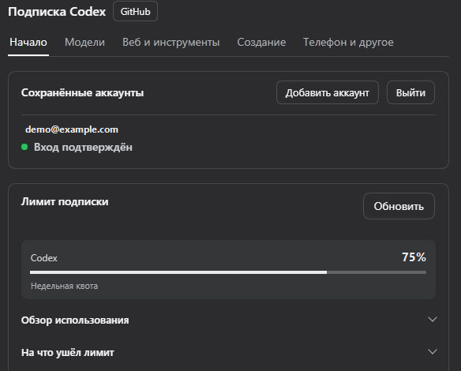
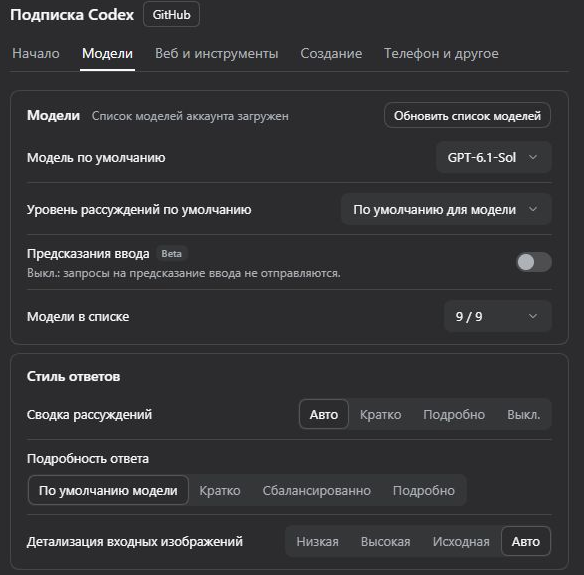

<p align="center"></p>

<div align="center">

# DSH Codex Subscription

[中文](README.md) · [English](README.en.md) · [日本語](README.ja.md) · [Español](README.es.md) · [Français](README.fr.md) · [Deutsch](README.de.md) · **Русский** · [Português](README.pt.md)

**Используйте подписку ChatGPT / Codex прямо в DeepSeek Harness**

Войдите через ChatGPT Plus / Pro, чтобы использовать GPT-6 и другие модели Codex, квоту, веб-поиск и создание изображений в DSH. Ключ API OpenAI и Codex CLI не нужны.

[](https://github.com/WSL043/dsh-codex-subscription/actions/workflows/ci.yml)
[](https://www.npmjs.com/package/dsh-codex-subscription)
[](https://www.npmjs.com/package/dsh-codex-subscription)
[](LICENSE)
[](https://github.com/WSL043/dsh-codex-subscription/stargazers)

[Основные возможности](#highlights) · [Установка](#install) · [Изображения и рисование](#images-and-sketching) · [Удалённое управление с телефона](#phone-remote-control-beta) · [Все возможности](#all-features) · [Руководство пользователя (на английском)](docs/GUIDE.en.md) · [Решение проблем (на английском)](#troubleshooting) · [Agent](#agent-reference)

</div>

<p align="center"></p>

<a id="highlights"></a>

## Основные возможности

| Что вы хотите сделать | Что предоставляет плагин |
| --- | --- |
| **Общаться и искать** | Войдите через подписку; выбирайте модели Codex, уровни рассуждений и скорости, доступные в вашем аккаунте; используйте веб-поиск по подписке. |
| **Управлять аккаунтами и квотой** | Переключайте аккаунты, просматривайте краткосрочную и недельную квоту, кредиты и сбросы; смотрите историю использования и включайте уведомления об использовании в поле ввода сообщения. |
| **Создавать и редактировать изображения** | Создавайте изображения, отмечайте области для редактирования или рисуйте вручную и с помощью Agent на редактируемом холсте для эскизов. [Примеры →](#images-and-sketching) |
| **Продолжать работу с телефона** | Подключите мобильное приложение ChatGPT, чтобы управлять DSH на этом компьютере. Также работают DeepSeek и другие модели DSH. [Бета-версия, по умолчанию выключена →](#phone-remote-control-beta) |
| **Использовать подключённые приложения** | Разрешите моделям DSH использовать приложения, подключённые в ChatGPT, включая GitHub, Gmail, Drive и Calendar; подтверждение записи зависит от разрешений сеанса DSH. |

Модели и квота зависят от данных, возвращаемых вашим аккаунтом. [Полный список возможностей →](#all-features)

<details>
<summary>Используйте возможности подписки с DeepSeek и другими моделями</summary>

Позвольте DeepSeek или любой другой модели DSH использовать приложения, подключённые вами в ChatGPT: GitHub, Gmail, Google Drive, Calendar и другие. Сначала модели выполняют поиск, а затем вызывают приложения; подтверждение записи зависит от режима и разрешений сеанса DSH. По умолчанию выключено; включите в разделе «Веб и инструменты».

Источники веб-поиска и чтения веб-страниц, коннекторы ChatGPT и официальные независимые подзадачи Codex находятся в **Настройки → Подписка Codex → Веб и инструменты**; сверху расположен общий переключатель: если он выключен, в беседах с DeepSeek и другими моделями, не относящимися к Codex, больше не используются веб-поиск по подписке (вместо него используется поиск DSH), создание изображений и коннекторы ChatGPT; на модели подписки Codex это не влияет. По умолчанию включено.

<p align="center"><picture><source media="(prefers-color-scheme: dark)" srcset="docs/assets/ui-interop-en-dark.webp"></picture></p>

</details>

<a id="prepare-dsh"></a>

## Подготовка DSH

Проверено на DSH `0.2.2-rc.1`; `0.2.1-rc.3` и `0.2.1-rc.2` по-прежнему поддерживаются; минимальная поддерживаемая версия — `0.1.7-rc.2`. Сначала обновите более старые версии DSH.

Официальное приложение DSH Desktop `0.2.2-rc.2` проверено в работе.

Для CLI/Web DSH `0.2.2-rc.1` требуется Node.js **версии 24.9 или новее**; в официальном настольном приложении используется встроенная среда выполнения.

Также поддерживается предварительная версия хоста `0.2.2-alpha.2`. См. [заметки о совместимости (на английском)](docs/archive/dsh-022-alpha2-compatibility.md), где описаны область действия и ограничения проверки.

Этот плагин поддерживает последний выпуск DeepSeek Harness, указанный в метаданных его пакета, и требует аккаунт ChatGPT, которому в данный момент доступен Codex.

<details>
<summary>Выберите дистрибутив DSH</summary>

- **Рекомендуется: официальное настольное приложение.** Теперь DeepSeek выпускает [настольное приложение DeepSeek Harness](https://www.deepseek.com/harness/) (macOS на Apple Silicon и 64-разрядная Windows; предварительная версия, открытый исходный код). Настраивать Node.js не нужно: установите приложение, затем добавьте этот плагин на странице «Плагины», как описано ниже. В настольном приложении, веб-приложении и CLI используется единая система плагинов DSH; сквозные приёмочные испытания этого плагина в основном выполняются в веб-приложении, поэтому [сообщите о проблеме](https://github.com/WSL043/dsh-codex-subscription/issues), если настольное приложение работает некорректно.
- Нужен Linux или вы предпочитаете портативную сборку сообщества? Используйте [DSH-Portable](https://github.com/WSL043/DSH-Portable) — портативный настольный дистрибутив сообщества для Windows, macOS и Linux.
- Предпочитаете официальный способ? Следуйте [руководству по запуску DeepSeek Harness (на английском)](https://github.com/deepseek-ai/deepseek-harness#run).

</details>

<a id="install"></a>

## Установка

<a id="install-from-the-plugins-page-recommended"></a>

### Установка со страницы Plugins (рекомендуется)

1. Откройте **Plugins → Add plugin** в DSH.
2. Вставьте имя этого пакета вместе с его версией в поле **Package name or address**:

   ```text
   dsh-codex-subscription@3.2.13
   ```

3. Нажмите **Install** и дождитесь завершения. Следуйте инструкциям на странице; если будет предложено перезапустить приложение, перед этим сохраните свою работу.
4. Откройте **Настройки → Codex**, войдите в ChatGPT, затем выберите модель Codex в беседе.

<details>
<summary>Почему указана версия?</summary>

Почему указана версия: страница плагинов DSH устанавливает только версии, которым не менее 24 часов. Поэтому в первый день после выпуска новой версии по одному лишь имени пакета может установиться более старая версия, которая может не поддерживать ваш DSH. Указав версию, вы получите именно этот выпуск; спустя день после выпуска имя без версии `dsh-codex-subscription` также будет указывать на последний стабильный выпуск. Другие номера версий указаны на [странице выпусков (на английском)](https://github.com/WSL043/dsh-codex-subscription/releases).

</details>

<details>
<summary>Установка через терминал (если команда dsh уже установлена)</summary>

```sh
dsh plugin --profile web add dsh-codex-subscription@3.2.13
```

Следуйте инструкциям по перезапуску, затем войдите в систему в разделе **Настройки → Codex**. И страница «Плагины», и терминал используют систему управления установками DSH.

</details>

<details>
<summary>Задачи без интерфейса</summary>

Войдите в систему и выберите модель Codex в Web, затем установите тот же плагин в профиле Headless:

```sh
dsh plugin --profile headless add dsh-codex-subscription@3.2.13
dsh --profile headless "Reply with only the word: ok"
```

</details>

<a id="interface-demo"></a>

## Демонстрация интерфейса

Подключите аккаунт ChatGPT, выберите модель Codex в DSH и проверяйте лимит подписки в настройках.

<details>
<summary>Вход в аккаунт и проверка лимита</summary>

Откройте **Настройки → Codex → Начало** и выберите **Вход через браузер**. После входа здесь появятся сохранённые аккаунты и лимит, который передаёт ChatGPT. Подробности можно посмотреть в обзоре использования и разбивке расхода.

<p align="center"></p>

_Аккаунт и значения лимита приведены для примера._

</details>

<details>
<summary>Выбор модели Codex и отправка сообщения</summary>

В разделе **Настройки → Codex → Модели** выберите модель и уровень рассуждения по умолчанию. Модель для отдельного чата можно сменить через меню рядом с полем ввода. Введите и отправьте сообщение, чтобы воспользоваться подпиской в DSH.

<p align="center"></p>

</details>

<details>
<summary>Что настраивается на каждой вкладке?</summary>

| Вкладка настроек | Что на ней настраивается |
| --- | --- |
| **Начало** | Вход и аккаунты, переключатель каждой возможности, квота подписки, отображение квоты и оповещения |
| **Модели** | Модель по умолчанию, уровень рассуждений по умолчанию и список моделей, стиль ответов; в свёрнутой группе «Дополнительно» находятся длина контекста, повторные попытки, режим подключения, облачная компактизация и модель для проверки |
| **Веб и инструменты** | Общий переключатель для других моделей, источник поиска, коннекторы ChatGPT, официальные подзадачи Codex |
| **Создание** | Создание изображений, редактирование, @image в поле ввода сообщения, просмотр изображений, холст для набросков и рисование агентом |
| **Телефон и другое** | Удалённое управление с телефона, экспериментальные голосовые вызовы, локальный кэш, диагностика для поддержки |

Голосовой режим по умолчанию выключен. Включите его в разделе **Телефон и другое**, затем начните звонок из поля ввода сообщения. Если нативное окно, в том числе в Linux, не поддерживает WebRTC, DSH предложит продолжить тот же разговор в браузере. Голосовые примеры останутся доступными, а для работы будет использоваться ваша существующая подписка без API-ключа.

**Контекст с учётом модели** соответствует каталогу моделей вашей учётной записи; обновление сохраняет несохранённый черновик. В настройках показывается исходное окно, а бюджеты разговоров резервируют запас с учётом официального процента (5%, если значение не задано); затем DSH управляет резервированием вывода и уплотнением контекста. Вручную ничего вычитать не нужно. Группы квот используют значения, предоставленные серверной частью, включая отдельные квоты, например Spark.

Сбои подписки остаются видимыми: незаметного переключения на другой платный способ нет.

</details>

<a id="images-and-sketching"></a>

## Изображения и рисование

Создавайте изображения с помощью подписки, просматривайте и скачивайте оригиналы либо выделите область и добавьте заметки, чтобы продолжить редактирование. Создание и редактирование изображений настраиваются в разделе **Настройки → Codex → Создание**.

<details>
<summary>Аннотации к изображению и продолжение редактирования</summary>

<p align="center"></p>

</details>

<details>
<summary>Настройки изображений и рисования</summary>

<p align="center"><picture><source media="(prefers-color-scheme: dark)" srcset="docs/assets/ui-creative-en-dark.png"></picture></p>

Настройки показаны непосредственно в виде обрезанных скриншотов настоящего интерфейса DSH с использованием светлой или тёмной темы.

</details>

<a id="sketch-board-beta"></a>

### Доска для рисования (бета-версия)

Холст для набросков и рисование агентом находятся в **бета-версии** и по умолчанию выключены; включите их на странице «Создание». Рисуйте от руки с помощью кнопки наброска в поле ввода сообщения или отправьте `@sketch` с просьбой, чтобы агент нарисовал.

Доска поддерживает слои, нативные кривые, кисти, градиенты, размытие, режимы наложения, обтравку, отмену и повтор действий, а также сочетания клавиш. Сохраняйте несколько черновиков и экспортируйте PNG или редактируемые черновики. При наличии образца Агент может сравнивать изображения, измерять цвета и позиции, а также отменять действия. Готовые рисунки можно воспроизводить и записывать в виде видео.

<details>
<summary>Пример рисунка Агента: девушка-кит</summary>

Агенты нарисовали эти примеры на доске, используя нативные редактируемые штрихи, без вызова создания изображений. Во всех трёх случаях использовались один и тот же образец и базовые настройки инструмента рисования. Это отдельные запуски с разными уровнями рассуждений и продолжительностью.

<p align="center"><b>Исходное изображение</b><br></p>

<table>
<tr><th width="33%">GPT-6-Astra</th><th width="33%">GPT-6.1-Sol</th><th width="33%">DeepSeek Flash</th></tr>
<tr><td></td><td></td><td></td></tr>
<tr><td>Средний · 20 мин 57 с<br>686 штрихов</td><td>Высокий · первый ход: 23 мин<br>1 020 штрихов</td><td>Высокий · 9 мин 33 с<br>623 штриха</td></tr>
</table>

После прерывания соединения рисунок 6.1 был восстановлен из автосохранения и исходных успешных вызовов. Затем модель проверила предварительный просмотр и сохранила его; вручную ничего не дорисовывали. Это не был непрерывный успешный запуск.

</details>

<details>
<summary>Из наброска в сгенерированное изображение: часовая башня и сине-зелёный пейзаж</summary>

Сначала Агент создал редактируемый набросок, а затем использовал его как образец для создания изображения по подписке. Sol и Astra ниже — названия моделей диалога, управлявших процессом, а не серверной части создания изображений.

**Часовая башня в разрезе**

<table>
<tr><th>Модель диалога</th><th width="43%">Набросок Агента</th><th width="43%">Создано по наброску</th></tr>
<tr><td>GPT-6.1-Sol<br>Xhigh</td><td></td><td></td></tr>
<tr><td>GPT-6-Astra<br>Low</td><td></td><td></td></tr>
</table>

**Сине-зелёный пейзаж**

<table>
<tr><th>Модель диалога</th><th width="43%">Набросок Агента</th><th width="43%">Создано по наброску</th></tr>
<tr><td>GPT-6.1-Sol<br>Xhigh</td><td></td><td></td></tr>
<tr><td>GPT-6-Astra<br>Low</td><td></td><td></td></tr>
</table>

</details>

[Редактирование изображений и хранение черновиков →](docs/GUIDE.en.md#image-generation-and-editing)

<a id="phone-remote-control-beta"></a>

## Удалённое управление с телефона (бета-версия)

Свяжите раздел Codex мобильного приложения ChatGPT с DSH на компьютере. Начинайте или продолжайте разговоры, используйте инструменты и подтверждайте действия с телефона — с DeepSeek или любой другой моделью DSH.

**По умолчанию выключено.** Включите функцию в разделе **Настройки → Codex → Телефон и другое → Удалённое управление с телефона** и выполните сопряжение по QR-коду или вручную с помощью кода. Компьютер должен быть включён, подключён к интернету, а DSH — запущен.

Это сторонний слой совместимости, использующий службу удалённого подключения OpenAI. Официальное удалённое управление Codex существует, однако OpenAI явно не гарантирует совместимость с хостом DSH, и она может измениться при обновлении службы. В любое время можно удалить сопряжённые устройства или отключить функцию.

<details>
<summary>Доступные действия с телефона</summary>

- отслеживать, начинать, продолжать и прерывать разговоры, перемещать их в архив; искать разговоры и ключевые слова внутри них;
- переключать модель, уровень рассуждений и разрешения (запись в рабочую область / полный доступ);
- запросы на подтверждение и вопросы появляются на телефоне; если соединение прервётся, они появятся снова при повторном открытии, иначе будут переданы на компьютер;
- ответы отображаются по мере написания; команды, изменения файлов с различиями, список задач, веб-поиск, вызовы коннекторов и созданные изображения используют нативные представления телефона;
- отправлять фотографии, искать файлы на компьютере с помощью @, выбирать навыки DSH с помощью /, просматривать изменения через git в режиме только для чтения и начинать чаты в настоящем окне выбора папки;
- рабочие пространства DSH отображаются как проекты; можно создавать ответвления разговоров, просматривать лимиты использования, общее использование за всё время и использование контекста; если DSH поддерживает `/compact`, уплотнять контекст с телефона;
- ошибки модели отображаются на телефоне; сопряжённые телефоны перечислены в настройках, и их можно удалить.

</details>

<details>
<summary>Настройки сопряжения и сопряжённые телефоны</summary>

<p align="center"><picture><source media="(prefers-color-scheme: dark)" srcset="docs/assets/ui-remote-en-dark.png"></picture></p>

</details>

<a id="all-features"></a>

## Все возможности

Доступ к моделям и квоты зависят от вашей учётной записи.

<details>
<summary><b>Модели и поиск</b></summary>

Выберите модель по задаче, уровень рассуждений по требуемому объёму анализа, а скорость по доступным режимам. Подробность задаёт желаемый объём ответа. В разделе **Веб и инструменты** поиск находит страницы, а чтение открывает уже известный URL.

| Возможность | Что можно делать | Доступность / настройка |
| --- | --- | --- |
| **Вход по подписке** | Войдите в ChatGPT и используйте модели Codex по подписке без API-ключа | Для обычного чата Codex CLI не требуется |
| **Синхронизация каталога моделей** | Считывайте доступные модели и уровни рассуждений из своей учётной записи и обновляйте каталог вручную; последний успешно полученный каталог хранится локально отдельно для каждой учётной записи и остаётся доступным после перезапуска во время фонового обновления, срок его действия — 24 часа; у моделей, помеченных как устаревающие, дата вывода из эксплуатации указана рядом с названием, автоматического переключения выбранной модели не происходит | Новые модели появляются, когда становятся доступны в вашей учётной записи; единственный источник — каталог учётной записи, поэтому при выходе из учётной записи или отсутствии удалённых данных и действительного кэша модели не отображаются |
| **Список моделей** | Показывайте или скрывайте отдельные модели в списке выбора в поле ввода сообщения на странице «Модели»; в списке выбора сохраняются собственные обозначения моделей DSH (например, значок новой модели) | Только отображение: выбранные модели и запросы продолжают работать |
| **Меню моделей в поле ввода** | Автоматический режим уступает место другому селектору и показывает меню подписки, когда работает один. Стандарт DSH оставляет выбор хосту или другому плагину. | Настраивается в разделе Модели. Выберите Подписка для доступа к меню и поддерживаемым скоростям. Сохранённые настройки учитываются. |
| **Подсказки ввода (бета)** | После завершения ответа пустое поле может предложить следующее сообщение. Tab переносит его в редактируемый черновик. | По умолчанию выключены в разделе Модели. Нужны поддерживаемая модель Codex и доступ к подсказкам. Запросы могут расходовать квоту. |
| **Модель по умолчанию** | Выберите на странице «Модели», с какой моделью будет открываться новый разговор | Записывает настройку модели DSH по умолчанию — ту же, что записывается при переключении модели в чате; сбросьте её, чтобы использовать модель DSH по умолчанию |
| **Уровень рассуждений по умолчанию** | Выберите на странице «Модели» уровень по умолчанию для моделей по подписке; «По умолчанию для модели» использует рекомендацию из официального каталога для каждой модели | Ручные настройки имеют приоритет. Если уровень не поддерживается, используется допустимый уровень по умолчанию для модели; существующие ручные настройки разговоров сохраняются |
| **Уровни рассуждений** | Выбирайте поддерживаемый уровень рассуждений в поле ввода сообщения | Доступные уровни зависят от модели |
| **Рассуждение Ultra** | DSH может поручать независимые части работы встроенным подзадачам, используя поддерживаемый моделью уровень рассуждений. | Доступно при поддержке модели и профиля агента. Ultrafast задаёт скорость. |
| **Режимы скорости** | Переключайте поддерживаемые модели между режимами «Стандартный» и «Быстрый»; режим «Сверхбыстрый» (бета-версия) тоже доступен, если он есть в каталоге учётной записи; он отмечен значком молнии | По умолчанию используется «Стандартный»; «Быстрый» и «Сверхбыстрый» увеличивают расход, а «Сверхбыстрый» сейчас доступен только в Pro 500 |
| **Подробность ответов** | Запрашивайте краткие, средние или подробные ответы | Если не менять настройку, используется значение по умолчанию для модели |
| **Детализация входных изображений** | Выбирайте низкую, высокую, исходную или автоматическую детализацию изображений, отправляемых модели чата | Влияет на количество входных токенов; по умолчанию используется «Авто» |
| **Веб-поиск по подписке** | Источники «Авто», DSH и Codex | В режиме «Авто» предпочтение отдаётся источнику, соответствующему модели сеанса. Второй источник используется только при отсутствии учётных данных или недоступности сервиса. При явном выборе DSH / Codex используется только этот источник, а ошибки сообщаются напрямую. Если параметр «Другие модели» выключен, в чатах не с Codex используется только встроенный поиск DSH. Плагин не переписывает настройки поиска DSH и не добавляет резервный вариант с учётной записью DeepSeek; стоимость встроенного поиска зависит от выбранного сервиса |
| **Источник для чтения веб-страниц** | Выберите способ чтения известного URL отдельно от источника поиска. | В разделе Веб и инструменты. По умолчанию используется DSH. Для Codex нужен совместимый хост, а ошибки чтения показываются в интерфейсе. |
| **Переключатель «Другие модели»** | Один переключатель, который отключает веб-поиск по подписке, создание изображений и коннекторы ChatGPT в разговорах с DeepSeek и другими моделями, кроме Codex | Настройки → Подписка Codex → Веб и инструменты; включён по умолчанию; на модели подписки Codex не влияет; удалённое управление с телефона и голосовые функции запускаются вами и не затрагиваются |
| **Область поиска** | Выбирайте поиск в реальном времени или по кэшу, отключайте поиск либо ограничивайте его доменами | Настройте в разделе «Веб и инструменты», в группе источников поиска |
| **Тайм-аут бездействия потока** | Укажите, сколько времени запрос может не получать данные потока, прежде чем его прервут | По умолчанию — 10 минут; это не общий срок ожидания ответа |
| **Бюджет контекста** | Используйте стандартный, расширенный или пользовательский бюджет для каждой модели | Ограничен каталогом моделей |
| **GPT-Reserve** | Выберите резервную модель, если она доступна в вашей учётной записи | Экспериментальная функция; отдельная квота для резервной модели не гарантируется |

</details>

<details>
<summary><b>Учётные записи и квоты</b></summary>

В разделе **Начало → Квота подписки** видны остаток и время сброса. Короткий и недельный периоды могут действовать одновременно. Разбивка показывает прошлый расход, а прогноз оценивает остаток времени по недавнему темпу. Включите показ квоты в поле ввода, чтобы видеть остаток во время диалога.

| Функция | Что можно делать | Доступность / настройка |
| --- | --- | --- |
| **Несколько учётных записей** | Добавляйте учётные записи, переключайтесь между ними, удаляйте их или выходите из всех сразу | Настройки → Codex → Начать |
| **Сведения о квоте** | Просматривайте короткие / недельные периоды, время сброса и отдельные группы квот | Отображаются только периоды и группы, предоставленные сервером |
| **На что ушла квота** | В карточке квоты просматривайте разбивку недельного лимита по модели, интерфейсу, источнику и типу запроса | Данные из официального отчёта об использовании: приблизительные, могут отставать на день-два; скрыты, если для учётной записи нет отчёта |
| **Обзор использования** | В карточке квоты просматривайте общее количество токенов за всё время, самый загруженный день, серии дней использования, наиболее часто используемый уровень рассуждений и ежедневную тепловую карту за полгода | Данные из официальной статистики использования; скрыты, если для учётной записи такой статистики нет |
| **Кредиты и карточки сброса** | Просматривайте дополнительные кредиты, ограничения расходов и доступные карточки сброса | Отображаются, если они предоставлены для вашей учётной записи |
| **Квота в поле ввода сообщения** | Во время чата просматривайте остаток квоты в процентах или в виде индикатора выполнения | По умолчанию выключено; выберите способ отображения |
| **Оценка оставшегося времени** | Наведите указатель на квоту в поле ввода сообщения или нажмите на неё, чтобы узнать, когда текущие темпы использования исчерпают её | Бета-версия; необязательная оценка, а не гарантия |
| **Уведомления об использовании** | Используйте фиксированные, ранние или пользовательские пороги для короткого / длинного периода | По умолчанию — при остатке 20%; можно отключить |
| **Использовать карточки сброса** | Используйте доступную карточку сброса после подтверждения | Предусмотрены защитные меры при подтверждении и ожидании; результат определяет сервер |
| **Повторить после сброса** | Дождитесь подтверждённого сброса короткого периода, прежде чем продолжить | По умолчанию выключено; ожидание можно остановить |

</details>

<details>
<summary><b>Изображения и наброски</b></summary>

Генерируйте новое изображение или уточняйте правку с помощью референса либо метки с комментарием. Закрытие просмотрщика сохраняет метки. **Добавить в поле ввода** переносит их в черновик для проверки перед отправкой. PNG подходит для обмена, а родной формат черновика сохраняет редактируемые слои и штрихи.

| Функция | Что можно делать | Доступность / настройка |
| --- | --- | --- |
| **Создание изображений** | Создавайте изображения за счёт подписки и настраивайте доступные параметры модели и качества запроса; при необходимости попросите создать PNG с прозрачным фоном | Включено по умолчанию, можно отключить |
| **Редактирование эталонных изображений** | Продолжайте дорабатывать изображение, используя эталонные изображения | Включено по умолчанию, можно отключить |
| **Просмотр и скачивание изображений** | Готовые изображения появляются после ответа без разворачивания действий инструмента; увеличивайте и перемещайте изображение, подгоняйте под размер окна и скачивайте проверенные оригиналы | Встроенный просмотрщик; для старых изображений могут быть доступны только превью |
| **Редактирование отдельных областей** | Выделяйте области, добавляйте пометки и продолжайте редактирование, указывая расположение на изображении | Заполняет поле ввода сообщения, чтобы вы могли проверить и отправить запрос |
| **Ручной холст** | Выбирайте соотношение сторон и рисуйте пером, карандашом, маркером и ластиками | Бета-версия; холст по умолчанию выключен |
| **Фигуры и текст** | Рисуйте линии, стрелки, фигуры, нативные кривые, а также добавляйте редактируемый текст и объекты | Доступно на холсте для набросков |
| **Градиенты, размытие, наложение и обрезка** | Заливка линейными и радиальными градиентами; размытие (свечение, тень, дымка), режимы наложения (умножение, экран, перекрытие, …) и обрезка по форме для обводки; у слоёв тоже может быть свой режим наложения | Всё это остаётся редактируемыми свойствами и сохраняется при перемещении, масштабировании, создании черновиков и экспорте; агенту доступны те же возможности через градиенты SVG, `feGaussianBlur`, `mix-blend-mode` и `clip-path` |
| **Слои и импорт изображений** | Работайте со слоями и добавляйте изображения на холст | Изображения управляются как слои |
| **Сглаживание и навигация** | Сглаживайте весь штрих после отпускания кнопки; перемещайте холст, масштабируйте, отменяйте и повторяйте действия | Сочетания клавиш можно настроить или отключить |
| **Несколько черновиков** | Сохраняйте и открывайте до 20 локальных черновиков | Хранятся в текущем браузере |
| **Импорт и экспорт** | Экспортируйте PNG или черновики в собственном формате, сохраняющие редактируемые штрихи | Черновики можно снова импортировать, чтобы продолжить редактирование |
| **Рисование агентом** | Попросите агента рисовать с помощью `@sketch`, следите за ходом работы и останавливайте его; агент может создавать целые этапы в SVG, которые импортируются как редактируемые штрихи в собственном формате; при наличии образца он может сравнить изображения рядом, изучить тепловую карту различий, увеличить область, измерить цвета и положение контуров, а также отменить действия; после каждого пакета отображается, как изменилось отклонение | Бета-версия; по умолчанию отключено, требуется холст. Инструменты только измеряют и отображают данные — они никогда не рисуют за модель |
| **Повтор и видео** | Кнопка «Повтор» заново воспроизводит процесс, штрих за штрихом (линии по их траектории, сначала контуры заливок, затем заливка сверху вниз), с настройками скорости и ползунком перемотки, а также записывает его в видео WebM | Видео можно просмотреть на доске; оно сохранится только после нажатия «Сохранить видео». Автоматическая загрузка не выполняется |
| **Предпросмотр результата для модели** | После рисования возвращайте изображение холста для последующей проверки | Бета-версия; по умолчанию отключено, увеличивает расход на ввод изображений |

</details>

<a id="codex-subtask-runtime"></a>

<details>
<summary><b>Расширенные возможности и обслуживание</b></summary>

Удалённое управление связывает приложение ChatGPT с работающим DSH. Голосовой вызов нужен для разговора, а подзадача помогает делегировать часть работы. При сбое откройте **Телефон и другое → Диагностика для поддержки** и уточните, какое условие или недавняя операция проверялись.

| Возможность | Что можно делать | Доступность / настройка |
| --- | --- | --- |
| **Удалённое управление с телефона** | Управляйте DSH на компьютере из раздела Codex мобильного приложения ChatGPT: начинайте, продолжайте и архивируйте беседы, переключайте модель и разрешения, отвечайте на запросы подтверждения и вопросы; DeepSeek и любые другие модели DSH также работают | Бета-версия; по умолчанию отключено; Настройки → Codex → Телефон и другое → Удалённое управление с телефона; подключите устройство по QR-коду или коду вручную |
| **Голосовой диалог (бета)** | Начните вызов из поля ввода. Если нативное окно не поддерживает WebRTC, вызов можно открыть в браузере. | По умолчанию выключен в разделе Телефон и другое. Разрешите доступ к микрофону по запросу. |
| **Независимые подзадачи Codex** | Используйте тот же вход по подписке и разрешения рабочего пространства; выбирайте разрешённые модели и уровни рассуждений | Бета-версия, необязательно; большинству пользователей это не нужно: по умолчанию DSH запускает собственных субагентов (они тоже могут использовать модели по подписке); устанавливайте необязательный компонент (с отдельным Codex CLI для этого плагина) и включайте выбор модели в разделе «Плагины → Субагенты», только если хотите запускать подзадачи с помощью официального агента Codex. Он использует собственный каталог данных и вход по вашей подписке, а не вход Codex на этом компьютере |
| **Управление компонентом подзадач** | Устанавливайте, отключайте или удаляйте официальный компонент подзадач Codex в настройках | Управляется поддерживаемыми хостами DSH; дополнительный вход не требуется |
| **Облачная компактизация контекста** | Продолжайте длинные беседы, используя компактизацию Codex и сохраняя историю DSH и встроенную компактизацию | Бета-версия / экспериментальная функция; по умолчанию отключено; при включённой функции запросы используют SSE |
| **Транспорт WebSocket** | В экспериментальном режиме повторно используйте подключения и передачу контекста; при сбое подключения используется резервный вариант SSE | Бета-версия / экспериментальная функция; по умолчанию используется SSE; ускорение не гарантируется |
| **Проверка Codex для автоматической проверки** | Автоматическая проверка DSH оценивает вызовы инструментов с помощью собственной модели проверки Codex; DSH сохраняет свою политику проверки и процесс разрешения или запрета | Бета-версия; по умолчанию отключено; действует, если модель доступна в каталоге вашей учётной записи |
| **Коннекторы ChatGPT** | Позвольте DeepSeek или любой модели DSH использовать приложения, подключённые в ChatGPT: GitHub, Gmail, Google Drive, Calendar и другие; сначала модели выполняют поиск, затем вызывают приложения, и по умолчанию для каждого изменения запрашивают ваше подтверждение; это можно изменить | По умолчанию отключено; Настройки → Codex → Веб и инструменты → Коннекторы ChatGPT; сначала подключите приложения в ChatGPT |
| **Диагностика поддержки** | Проверяйте необходимые условия и результаты недавних операций, а также копируйте краткий отчёт (около 1 КБ; полный отчёт можно скопировать отдельно) без учётных данных и текста бесед | Настройки → Codex → Телефон и другое; статус «не проверено» не означает, что функция не работает |
| **Очистка кэша прогнозов** | Просматривайте и очищайте локальную историю прогнозов квоты | Не затрагивает вход, черновики, оригиналы и общие зависимости |

</details>

<a id="agent-reference"></a>

### Справка для агентов и участников проекта

DSH управляет диалогами, подтверждениями инструментов и правами рабочей области. Плагин предоставляет подключение к Codex и описанные выше настройки и инструменты. Если функция недоступна, сначала проверьте версию DSH, возможности аккаунта, выбранную модель и настройку, затем проверьте соответствующий инструмент или запрос.

[Подробное руководство (английский)](docs/GUIDE.en.md) · [Протокол инструмента эскизов (английский)](docs/sketch-agent.md) · [Настройки по умолчанию](src/preference-fields.js) · [Указатель документации и разработки (на английском)](docs/DEVELOPMENT.md)

<a id="reuse-cache-when-changing-effort"></a>

### Повторно использовать кэш при смене уровня

По умолчанию включено в разделе **Настройки → Codex → Модели → Дополнительно**. Помогает совместимым моделям повторно использовать кэш при изменении уровня рассуждения. Обычное кэширование промптов доступно и при отключении этой настройки.

[Как это работает и какие есть ограничения (на английском)](docs/GUIDE.en.md#reuse-cache-when-changing-effort)

<a id="update-and-uninstall"></a>

## Обновление и удаление

Найдите этот плагин на странице **Плагины** в DSH и воспользуйтесь действием обновления или удаления. Следуйте инструкциям по перезапуску, если они появятся. Удаление этого плагина не удаляет другие плагины.

<details>
<summary>Команды терминала</summary>

```sh
dsh plugin --profile web update dsh-codex-subscription@3.2.13
```

Запускайте только в том случае, если хотите удалить плагин:

```sh
dsh plugin --profile web remove dsh-codex-subscription
```

</details>

<a id="troubleshooting"></a>

## Устранение неполадок

<details>
<summary>Как это связано с официальным пакетом Codex (dsh-hooks-codex) в списке плагинов?</summary>

Они не связаны, и их можно установить вместе. Официальные пакеты Codex / Claude Code позволяют DSH выполнять конфигурации хуков в стиле Codex или Claude Code (скрипты, запускаемые до и после вызовов инструментов). Этот плагин выполняет вход через подписку ChatGPT и предоставляет модели Codex, квоту, поиск, создание изображений и удалённое управление с телефона.

</details>

<details>
<summary>На компьютере нет команды dsh?</summary>

В DSH откройте **Plugins → Add plugin** и вставьте имя пакета. Настройка через терминал не требуется.

</details>

<details>
<summary>Установлено несколько экземпляров DSH или отсутствует плагин?</summary>

Устанавливайте плагин из того экземпляра DSH, которым действительно пользуетесь. Для установки через терминал выполняйте команды в нужной среде DSH и проверьте её профиль. Не удаляйте профили и не меняйте системную переменную PATH, чтобы принудительно выполнить установку.

</details>

<details>
<summary>Как сообщить о проблеме?</summary>

Создайте отчёт **Диагностика поддержки** в разделе **Настройки → Codex → Телефон и другое**, вставьте его в [форму сообщения об ошибке](https://github.com/WSL043/dsh-codex-subscription/issues/new?template=install-problem.yml) и опишите действия, вызвавшие проблему.

В диагностические данные не входят учётные данные, идентификаторы аккаунтов, необработанные ответы и полные журналы. Никогда не прикладывайте URL для входа, коды авторизации или адреса обратного вызова браузера.

</details>

<details>
<summary>Нужна ли мне командная строка Codex?</summary>

Для **независимых подзадач Codex** установите **субагент Codex** в разделе плагинов DSH, затем выберите **Подготовить CLI** в настройках подписки. [Руководство по установке и удалению (на английском) →](docs/GUIDE.en.md#codex-subtask-runtime)

</details>

<a id="positioning-and-boundaries"></a>
<a id="scope-and-support"></a>

<a id="project-and-support"></a>

## Проект и поддержка

- **Только подписка ChatGPT / Codex**, глубокая проработка: квота и прогнозирование, изображения и наброски, подзадачи, диагностика. Другие подписки, например Claude или Grok, не входят в область проекта.
- **Явно сообщает об ошибках**: запросы никогда незаметно не переключаются на другой платный способ, а окна квоты, которые аккаунт не возвращает, никогда не выдумываются.
- **Следит за официальными выпусками DSH**: каждый выпуск полностью проверяется (установка, запуск, удаление, повторная установка) в официальных каналах DSH, таких как latest и next; проверенные версии указаны в [заметках о совместимости](docs/DEVELOPMENT.md#compatibility).
- Модели, квота и функции зависят от фактических данных, возвращаемых вашим аккаунтом; бэкенд ChatGPT и DSH могут меняться независимо друг от друга.

Этот проект сообщества не связан с DeepSeek или OpenAI и не одобрен ими.

- Отзывы о проекте отправляйте через [форму сообщения об ошибке](https://github.com/WSL043/dsh-codex-subscription/issues/new?template=install-problem.yml).
- Предложения по улучшению продукта отправляйте через [форму запроса функции](https://github.com/WSL043/dsh-codex-subscription/issues/new?template=feature-request.yml).
- Мы приветствуем точечные исправления и улучшения совместимости; см. [CONTRIBUTING.md](CONTRIBUTING.md).
- Помогите [поддерживать и развивать проект](CONTRIBUTING.md#help-maintain): возьмите на себя постоянную ответственность за модуль, следите за связанными проблемами или проверяйте код. Чтобы обсудить это, [создайте issue](https://github.com/WSL043/dsh-codex-subscription/issues/new?template=help-maintain.yml).
- Обсудить плагины DSH можно в разделе [DeepSeek Harness Discussions](https://github.com/deepseek-ai/deepseek-harness/discussions).
- Перед сообщением о конфиденциальных проблемах прочтите [SECURITY.md](SECURITY.md).

Если этот проект вам полезен, [кнопка Star](https://github.com/WSL043/dsh-codex-subscription/stargazers) поможет другим пользователям DSH найти его.

<a href="https://star-history.com/#WSL043/dsh-codex-subscription&Date">
  <picture>
    <source media="(prefers-color-scheme: dark)" srcset="https://api.star-history.com/svg?repos=WSL043/dsh-codex-subscription&type=Date&theme=dark" />
    
  </picture>
</a>

[中文](README.md) · [English](README.en.md) · [日本語](README.ja.md) · [Español](README.es.md) · [Français](README.fr.md) · [Deutsch](README.de.md) · **Русский** · [Português](README.pt.md) · [MIT](LICENSE)

[](https://github.com/deepseek-ai/deepseek-harness)
